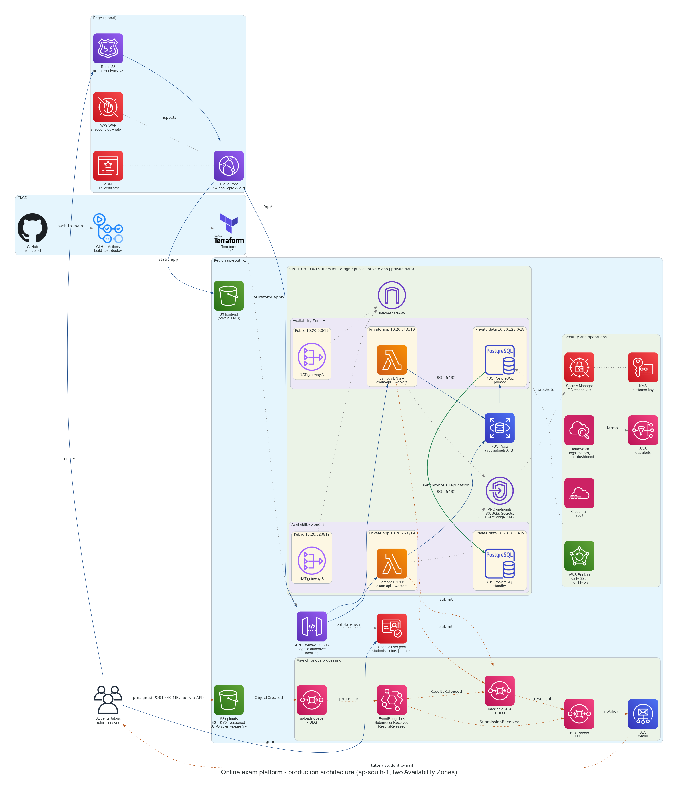
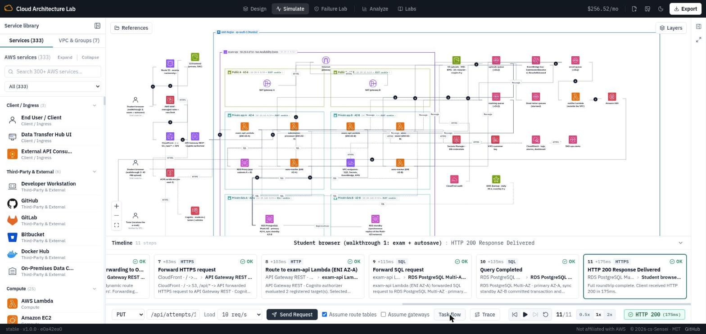
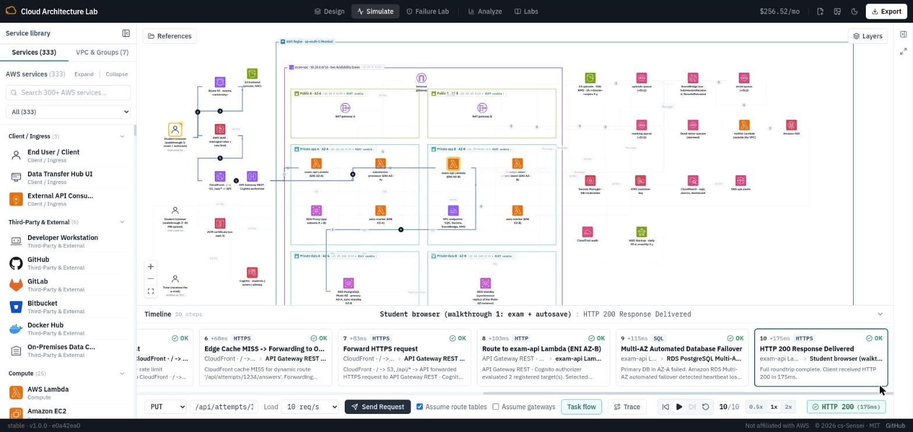
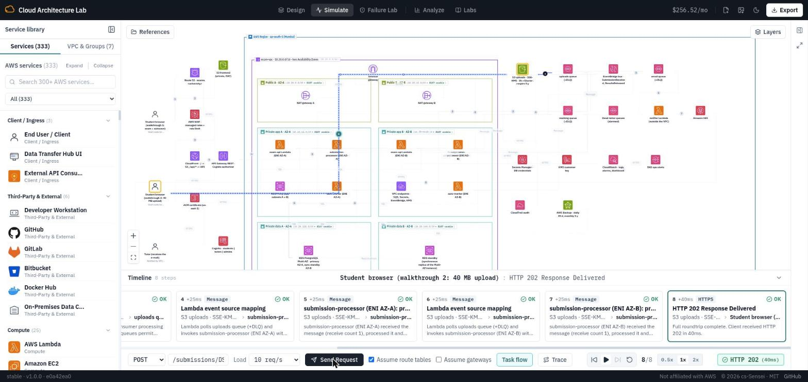
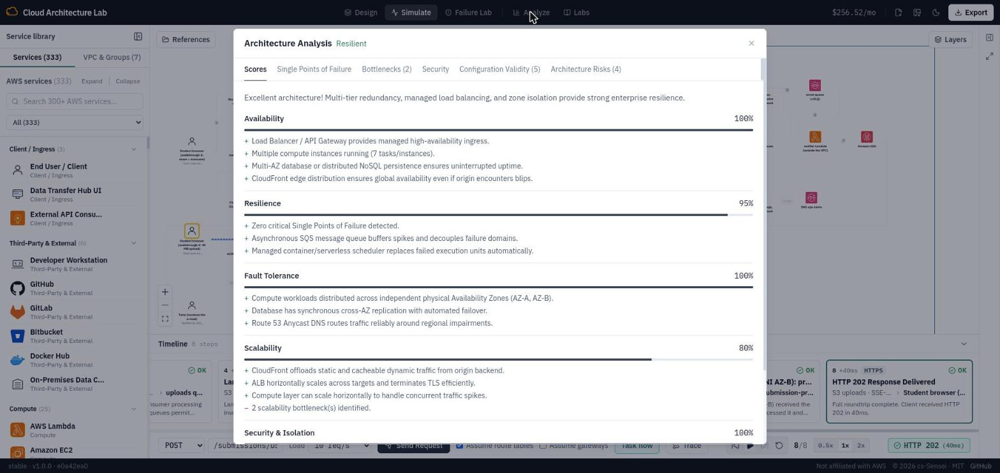

# DSO303 Assignment 2 – Online Exam Platform

**Student:** Pema Tshering Yangchen (ID 2230295) · **Module:** DSO303 Cloud Infrastructure, CST, RUB

An online exam and assignment platform for 8,000 students and 400 staff:
- **Exams:** timed MCQ and short-answer exams, answers autosaved every 30 s, MCQs auto-marked.
- **Assignments:** PDF/ZIP uploads up to 50 MB, with the tutor notified by email.
- **Results:** emailed to students when the tutor releases them.

It is designed for AWS (ap-south-1, two Availability Zones), and the same Terraform deploys it to Floci, the course's local AWS emulator. There it is fully working and tested end to end on every push.

| Target | How the design meets it |
|---|---|
| 300–500 concurrent users; 3,000 exam starts in 5 minutes | CloudFront serves the app from the edge. API Gateway and Lambda scale per request, and provisioned concurrency is scheduled before exams. RDS Proxy pools database connections. Uploads go straight to S3. Marking and email go through queues. |
| 99.9% availability; survives the loss of one AZ | Every tier is present in both AZs: NAT gateway per AZ, Lambda in both app subnets, RDS Multi-AZ with a synchronous standby. The remaining services (API Gateway, S3, SQS, Cognito…) are regional. |
| RPO ≤ 5 min, RTO ≤ 1 h | Synchronous Multi-AZ replication, 35-day point-in-time recovery, and the browser keeps an unsaved copy of answers and retries. Failover takes 1–2 min; a PITR restore takes well under 1 h. |
| Records kept 5 years | S3 lifecycle to Standard-IA, Glacier IR and Deep Archive, deleted after 1,830 days. AWS Backup keeps monthly database backups for 5 years. Logs are kept 5 years. |
| Encryption in transit and at rest | TLS everywhere (CloudFront TLS 1.2+, `rds.force_ssl`, bucket policies deny non-TLS). A KMS customer key encrypts RDS, uploads, Secrets Manager and backups. |

## Deliverables

| Path | What it is |
|---|---|
| [`architecture/architecture.png`](architecture/architecture.png) | Task 1 – production architecture diagram (generated by [`architecture/diagram.py`](architecture/diagram.py)) |
| [`architecture/walkthroughs.md`](architecture/walkthroughs.md) | Task 1 – the two request walkthroughs, and the peak / AZ-loss explanation (290 words) |
| [`docs/services.md`](docs/services.md) | Task 2 – every service: role, why over an alternative, key configuration, connections |
| [`simulation/`](simulation/) | Task 3 – the Cloud Architecture Lab build, as importable drafts, and how to run it |
| [`evidence/`](evidence/) | Cloud Architecture Lab screenshots, app screenshots and deployment evidence (index: [`evidence/README.md`](evidence/README.md)) |
| [`infra/`](infra/) | Terraform: the whole platform, frontend included |
| [`app/`](app/) | The web app (`frontend/`) and four Lambda functions (`functions/`) |
| [`scripts/`](scripts/) | `build.sh`, `deploy.sh`, `destroy.sh`, `smoke_test.py` |
| [`../.github/workflows/assignment-2.yml`](../.github/workflows/assignment-2.yml) | CI/CD: every push to `main` redeploys from code and tests both walkthroughs |

## Architecture in one paragraph

**The request path.** Route 53 points the exam domain at **CloudFront**, protected by **AWS WAF**. CloudFront serves the single-page app from a private S3 bucket and forwards `/api/*` to **API Gateway**. API Gateway's **Cognito** authorizer checks the student/tutor/admin token, then invokes Lambda functions in the private app subnets of **both AZs**. They reach **RDS for PostgreSQL Multi-AZ** in the private data subnets through **RDS Proxy**.

**Uploads and async work.** Uploads never touch the API: the API signs an **S3 presigned POST** that limits the size to 50 MB. S3 events go to an **SQS** queue; the processor validates the file and announces it on **EventBridge**; an email queue feeds the notifier, which sends through **SES**.

**Around it.** **Secrets Manager** and **KMS** protect credentials and data, **CloudWatch** alarms page the ops team, **CloudTrail** and **AWS Backup** keep the 5-year record, and **GitHub Actions + Terraform** deploy it all. Full detail: [`architecture/walkthroughs.md`](architecture/walkthroughs.md) and [`docs/services.md`](docs/services.md).



## Deploy

### Locally on Floci (what the video shows)

Prerequisites: Docker with Floci 1.5.34 running on `http://localhost:4566` (the course environment), Terraform ≥ 1.6, Python 3, the AWS CLI.

```bash
cd ~/dso303_as2026/assignment-2
./scripts/deploy.sh          # build functions -> terraform apply -> create schema + seed data (~3 min)
python3 scripts/smoke_test.py   # both walkthroughs end to end: 24 checks
```

`deploy.sh` prints the app URL. Open it with `?autosave=5` for a quicker demo:

```
http://localhost:4566/exam-frontend-000000000000/index.html?autosave=5
```

Demo accounts (Floci only, created by Terraform; password in `infra/floci.tfvars`): `student1@exams.example.edu`, `tutor1@exams.example.edu`, `admin1@exams.example.edu`. Emails sent through SES can be read at `http://localhost:4566/_aws/ses`.

### On AWS

```bash
cd ~/dso303_as2026/assignment-2
# credentials for the target account in the environment; optionally create infra/prod.tfvars
# (domain_name, alarm_email, ses_sender); the defaults are the production design
./scripts/deploy.sh aws
```

Production differences are all handled in the Terraform: RDS Proxy, the Cognito authorizer, CloudFront and its WAF, DNS-validated ACM, the CloudWatch dashboard, CloudTrail, provisioned concurrency and deletion protection. The SES sender must be verified, and the account taken out of the SES sandbox, before mail reaches real students.

## Tear down

```bash
./scripts/destroy.sh         # Floci: removes everything, and Floci's leftover PostgreSQL data directory
./scripts/destroy.sh aws     # AWS: first set deletion_protection = false on the database and user pool
```

On AWS the database and the user pool are deletion-protected **on purpose**. Tearing down production is a two-step decision.

## CI/CD – push to `main` redeploys automatically

[`.github/workflows/assignment-2.yml`](../.github/workflows/assignment-2.yml) runs on every push to `main` that changes `assignment-2/`:
1. Start **Floci 1.5.34** inside the GitHub runner, with the same settings as the course environment.
2. `terraform fmt -check` and `terraform validate`.
3. `scripts/deploy.sh`: build, `terraform apply` **from an empty account**, create the schema.
4. `scripts/smoke_test.py`: **both walkthroughs and the results release**, 24 checks; Floci's log is printed if anything fails.
5. Upload the test report as an artifact.

A green run therefore proves that the repository alone recreates a working platform. For AWS, the same workflow would assume an IAM role through GitHub OIDC (no stored keys) and run `deploy.sh aws`, with a manual approval and an "exam freeze" window. That part is designed but not wired, because the course runs on Floci.

## Cloud Architecture Lab (Task 3)

[`simulation/`](simulation/) holds the full build as two drafts of the same diagram: 38 services across two AZs, numbered walkthrough steps, and a least-privilege IAM role on every function.
- **To load:** Export → Upload JSON.
- **Walkthrough 1** (`exam-platform.cal.json`): Send Request → **HTTP 200**, through CloudFront, API Gateway and Lambda to RDS.
- **AZ failure:** Failure Lab → *AZ-A outage* → Send Request → **HTTP 200**. API Gateway picks the AZ-B Lambda and RDS fails over to its standby.
- **Walkthrough 2** (`exam-platform-walkthrough-2.cal.json`): **HTTP 202**, through S3, SQS and the processor in both AZs.
- **Analyze:** rated **Resilient**, with no single point of failure.

Details and the remaining analyser findings are in [`simulation/README.md`](simulation/README.md). Screenshots of every step, and of the deployed app, are indexed in [`evidence/README.md`](evidence/README.md).

| Walkthrough 1 – HTTP 200 | AZ-A outage – still HTTP 200 (AZ-B Lambda, RDS failover) |
|---|---|
|  |  |
| **Walkthrough 2 – HTTP 202** | **Analyze – Resilient, no single point of failure** |
|  |  |

## Floci differences (honest list)

| Floci 1.5.34 | What the code does |
|---|---|
| The API Gateway Cognito authorizer is created but not enforced, and its pool ARNs are not stored | The authorizer is created on AWS only. On both targets the function verifies every token's RS256 signature, issuer, audience and expiry against the pool's JWKS (`app/functions/common/auth.py`); on Floci that check is the one in force. |
| A Lambda alias ARN in an API integration is read as a function called `live` | Floci integrates the function; AWS integrates the alias, which carries the provisioned concurrency |
| RDS Multi-AZ is accepted (`MultiAZ: true`, subnet group in both AZs) but runs one container; no RDS Proxy | Lambda connects to the instance directly on Floci, through the proxy on AWS |
| No TLS on the PostgreSQL container | `db_ssl = disable` on Floci only; `rds.force_ssl=1` and `require` on AWS |
| Provider crash reading Floci's CloudFront distribution; no CloudWatch `PutDashboard`, no CloudTrail `ListTags`, no Cognito MFA API, no AWS managed policies | CloudFront, the dashboard, CloudTrail, MFA and the managed Backup policy are AWS-only (`count`) |
| AWS provider ≥ 6.58 waits for a REST API status Floci does not return | Provider pinned to 6.57.1 |
| Deleted RDS instances leave their data directory (course setting) | `destroy.sh` removes it, so a redeploy cannot inherit an old password |
| Some attributes are accepted but not returned (alarm dimensions and actions, some tags, security-group rule details) | A no-op `terraform plan` on Floci lists about 39 in-place updates; re-applying sends the same values again and is harmless |

## Requirements traceability

| Rubric criterion | Where |
|---|---|
| Architecture design | `architecture/` – tiers in two AZs, walkthroughs, peak and AZ loss |
| Service documentation | `docs/services.md` – role, alternative, configuration, connections for every service |
| Cloud Architecture Lab | `simulation/` drafts + `evidence/cal-*`: full build, both flows, AZ failure, Analyze |
| AWS deployment | `scripts/deploy.sh` on Floci; `evidence/app-*` and `evidence/deployment/` (smoke test 24/24, `MultiAZ: true`); the video shows frontend, API, two-AZ database, S3 uploads and the async step |
| IaC and CI/CD | `infra/` (everything in Terraform, frontend included) + the workflow: push to `main` redeploys and tests |
