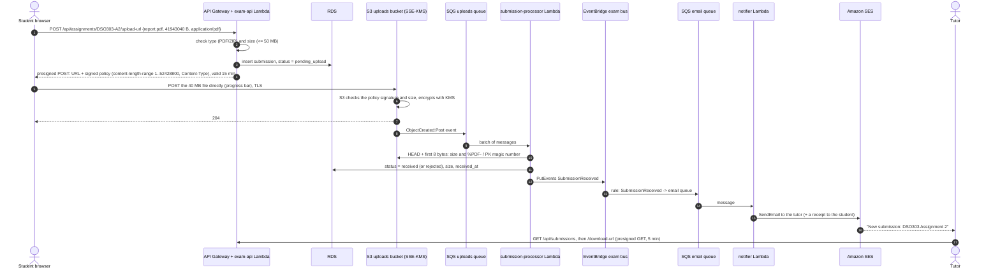

# Request walkthroughs

The production design is shown in [`architecture.png`](architecture.png) (source: [`diagram.py`](diagram.py)).
Both walkthroughs below were also run end to end against the Floci deployment and the Cloud Architecture
Lab model; see [`../evidence/`](../evidence/).

## 1. A student opens an exam and answers autosave

```mermaid
sequenceDiagram
    autonumber
    actor S as Student browser
    participant E as Route 53 + CloudFront + WAF
    participant C as Cognito
    participant G as API Gateway
    participant L as exam-api Lambda<br/>(private app subnet, AZ A or B)
    participant P as RDS Proxy
    participant D as RDS PostgreSQL<br/>(primary AZ A, standby AZ B)
    participant Q as SQS marking queue

    S->>E: GET / (app shell, JS, CSS)
    E-->>S: served from the edge cache (S3 origin only on a miss)
    S->>C: InitiateAuth (email + password, SRP on AWS)
    C-->>S: ID token, cognito:groups = students
    S->>E: POST /api/exams/DSO303-QUIZ1/attempts (Bearer token)
    E->>G: /api/* forwarded, not cached
    G->>G: Cognito authorizer validates the JWT
    G->>L: invoke (proxy event + verified claims)
    L->>P: is the exam open? insert attempt, deadline = now + 30 min
    P->>D: one pooled connection
    L-->>S: attempt id, server deadline, questions (no answer keys), saved answers
    loop every 30 seconds while answers changed
        S->>S: copy answers to localStorage first
        S->>G: PUT /api/attempts/{id}/answers {answers, seq}
        G->>L: invoke
        L->>D: upsert per question, skipped if seq is older than stored
        Note over L,D: synchronous write to primary and standby before commit
        L-->>S: 200 savedAt, secondsLeft
    end
    S->>G: POST /api/attempts/{id}/submit (or the timer reaches 0)
    L->>D: status = submitted
    L->>Q: {"type":"mark","attemptId":...}
    L-->>S: 202 marking queued
    Q->>Q: auto-marker Lambda scores the MCQs later; short answers wait for the tutor
```

1. **The app shell comes from the edge.** The browser resolves the exam domain in Route 53 and downloads the single-page app from **CloudFront**. WAF inspects every request at the edge first. The static files are cached, so 3,000 simultaneous opens barely reach the S3 origin.
2. **Sign-in issues a role-bearing token.** The student signs in with **Cognito**. The returned ID token carries `cognito:groups = students`; that group is the student's role.
3. **Starting the exam passes the token check first.** `POST /api/exams/{id}/attempts` goes through CloudFront to **API Gateway**, whose Cognito authorizer rejects any request without a valid token before Lambda is invoked.
4. **Lambda creates the attempt with the server's deadline.** The **exam-api** function runs in a private app subnet in whichever AZ Lambda places it, and reaches **RDS** through **RDS Proxy**. It checks the exam window and creates the attempt. The deadline comes from the server, so changing the clock on the laptop changes nothing. The response carries the questions without the answer keys.
5. **Every 30 seconds the browser autosaves, after first copying the answers to the device.** The local copy is written before `PUT /answers` is sent, so nothing is lost if the request fails.
   - **The save is an idempotent upsert per question,** with a sequence number so a delayed retry never overwrites a newer save.
   - **Multi-AZ commits to the standby too:** the write is committed to the primary and synchronously to the standby in the other AZ.
   - **Late saves are refused.** After the deadline plus 30 seconds' grace, the API returns 409.
6. **Submitting queues the marking.** On submit, or when the timer reaches zero, the attempt is closed and a job is put on the **SQS marking queue**. The student gets `202` at once.
7. **Marking happens asynchronously.** The **auto-marker** function scores the MCQs from the queue. Short answers wait for the tutor.

## 2. A student uploads a 40 MB assignment and the tutor is notified



1. **The student asks for permission to upload.** The browser sends the filename, size and type to `POST /upload-url`. The API checks the role, the assignment and the limits (PDF/ZIP, at most 50 MB), and records the submission as `pending_upload`.
2. **The API returns a presigned POST and steps out of the way.** The signed policy pins the object key, the content type and `content-length-range` to 50 MB, so S3 itself enforces the limit.
   - **Why the API steps aside:** the 40 MB never touches API Gateway (10 MB payload limit) or Lambda (6 MB).
   - **S3 scales the uploads:** it absorbs deadline-night bursts at thousands of PUTs per second per prefix.
3. **The browser POSTs the file straight to S3** over TLS. S3 checks the signature and size, then encrypts the object with the KMS key. The bucket is versioned, and the lifecycle moves the file to cheaper tiers and deletes it after 5 years.
4. **S3 announces the upload on a queue.** The `ObjectCreated` event lands on the **SQS uploads queue**, which absorbs bursts. A message that fails 5 times moves to a dead-letter queue, and a CloudWatch alarm fires.
5. **The processor checks the file is what it claims.** The **submission-processor** function reads the object's size and its first bytes: a real PDF starts with `%PDF-` and a ZIP with `PK`. It marks the submission `received` or `rejected` and publishes **SubmissionReceived** on the EventBridge bus.
6. **The notification goes to the tutor and the student.** An EventBridge rule routes the event to the **email queue**. The **notifier** function sends the tutor an email through **SES** ("New submission ... 40.0 MB") and the student a receipt.
7. **The tutor fetches the file.** The tutor dashboard lists the submission, and Download returns a 5-minute presigned GET URL.

## Handling the exam peak and the loss of one AZ

**Exam peak.**
- **The load:** 3,000 students starting within 5 minutes is about 10 starts per second, then about 100 autosaves per second for the rest of the exam.
- **Static files never reach the origin.** CloudFront serves the app from edge caches.
- **Uploads never reach the API.** They go to S3 through presigned POSTs.
- **API Gateway and Lambda scale per request,** with no instances to pre-warm. Provisioned concurrency on the `live` alias, scheduled before each exam, removes cold starts. API Gateway throttling protects the backend.
- **RDS Proxy multiplexes Lambda connections onto a small pool,** so the burst cannot exhaust the database's connections. The `db.r6g.large` primary handles roughly 100 small upserts per second comfortably.
- **Slow work is queued, never done in the request.** Marking, upload checks and 3,000 result emails go through SQS. The notifier's capped concurrency keeps SES within its send rate.

**Loss of one Availability Zone.** Every tier has a copy in both AZs:
- **Lambda:** ENIs in the app subnets of both AZs.
- **Outbound traffic:** a NAT gateway per AZ.
- **Connections:** RDS Proxy runs in both AZs.
- **Managed services:** API Gateway, CloudFront, S3, SQS, EventBridge, Cognito and SES are regional or global and survive an AZ outage.

If AZ A fails, Lambda runs only in AZ B, and RDS promotes the synchronous standby in AZ B (about 1–2 minutes). The proxy holds connections while it does.
- **No committed answer is lost:** each one was already on the standby.
- **Saves in flight during the switch are not lost either:** they wait in the browser's local copy and are retried.
- **Both targets are met:** RPO stays within 5 minutes and RTO within 1 hour, well inside the 99.9% budget.
