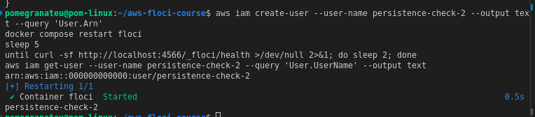

# DSO303 — AWS Practical Laboratory Report

**Student Name:** Pema Tshering Yangchen
**Student ID:** 2230295
**Module:** DSO303 — Cloud Infrastructure
**Lab:** Lab 01 — Identity and Access Management (IAM)
**Environment:** Floci (local AWS emulator), AWS CLI v2

---

## 1. Aim / Objective

The objective of this practical is to learn how AWS Identity and Access Management (IAM) is used to securely manage users, groups, roles, and permissions within an AWS account. This lab additionally covers building and configuring a durable local AWS emulation environment (Floci) using Docker Compose, and using the AWS CLI to create the complete IAM foundation for the University Student Management System (USMS) — the fictional project this course is built around.

---

## 2. Introduction

AWS Identity and Access Management (IAM) is a global AWS service that enables administrators to securely manage authentication and authorization for AWS resources. IAM allows organisations to create users, organise them into groups, assign permissions through policies, and grant temporary access using roles. Unlike most AWS services, IAM does not incur additional charges and is considered one of the foundational services in AWS security.

### Key Features
- User Management
- User Groups
- IAM Roles
- IAM Policies (AWS managed, customer managed, inline)
- Policy Versions
- Multi-Factor Authentication (MFA) *(conceptual in this lab — no console exists in Floci)*
- Fine-grained Access Control
- Temporary Security Credentials (via STS)
- Instance Profiles (for EC2)

Because this lab runs against **Floci**, a local, open-source AWS emulator, rather than a real AWS account, every AWS CLI command, ARN format, and policy document is genuinely identical to real AWS — but Floci does not perform cryptographic credential verification or enforce policies by default. This distinction is discussed further in Section 7.

---

## 3. Use Case

A software company (in this case, the fictional University Student Management System — USMS) employs developers, testers, and administrators. Instead of giving every employee full AWS administrator access, the cloud administrator creates IAM groups and assigns users to them based on role:

| Group | Permission |
|---|---|
| `usms-developers` | Read infrastructure + build VPC networking (Lab 02) |
| `usms-admins` | Same as developers, plus broader course-scoped access |
| `usms-auditors` | Read-only access everywhere |

Each employee is assigned to the appropriate IAM group, ensuring the **Principle of Least Privilege** is enforced. This lab also builds three IAM roles for non-human/temporary identities:

- `usms-ec2-app-role` — assumed by the USMS application server (EC2) to read/write student data in S3
- `usms-lambda-exec-role` — assumed by notification functions (Lambda) to write logs and read student data
- `usms-developer-role` — assumed temporarily by human developers for elevated build permissions

---

## 4. System Architecture / Design

**Environment architecture (Part A):**

```
   Your machine
   ┌─────────────────────────────────────────────────────────┐
   │                                                          │
   │  ~/aws-floci-course/          ~/floci-data/              │
   │  ├── docker-compose.yml ──┐   (bind-mounted into the     │
   │  ├── configs/             │    container as /app/data —  │
   │  ├── policies/            │    this is where IAM         │
   │  └── scripts/             │    users actually live)      │
   │                           │            ▲                 │
   │                           ▼            │                 │
   │              ┌────────────────────────────────┐          │
   │  aws CLI ───▶│  Docker container "floci"      │          │
   │  :4566       │  FLOCI_STORAGE_MODE=hybrid     │          │
   │              └────────────────────────────────┘          │
   └─────────────────────────────────────────────────────────┘
```

**IAM identity architecture (Part B):**

```
                    ┌────────────────┐
                    │  AWS Account   │
                    │ 000000000000   │
                    └───────┬────────┘
        ┌───────────────────┼───────────────────┐
        │                   │                    │
  ┌─────▼─────┐      ┌──────▼──────┐      ┌──────▼──────┐
  │usms-admins│      │usms-developers│    │usms-auditors│
  │  (group)  │      │   (group)     │    │  (group)    │
  └─────┬─────┘      └──────┬──────┘      └──────┬──────┘
        │                   │                    │
  usms-admin-01        usms-dev-01          usms-audit-01
                                             usms-intern-01

  Policies attached:
  usms-admins      ← USMSDeveloperBase, USMSAssumeAppRoles
  usms-developers  ← USMSDeveloperBase, USMSAssumeAppRoles
  usms-auditors    ← ReadOnlyAccess (AWS managed)

  Roles (assumed identities, no permanent credentials):
  usms-ec2-app-role      ← trust: ec2.amazonaws.com
  usms-lambda-exec-role  ← trust: lambda.amazonaws.com
  usms-developer-role    ← trust: usms-dev-01 (account principal)
```

---

## 5. Implementation Procedure

### Part A — Environment Setup

1. **System check** — confirmed OS (Linux x86_64), Docker (28.0.1), and Docker Compose v2 (v2.26.1) were installed and the daemon was reachable.
2. **Installed the Floci CLI** via `curl -fsSL https://floci.io/install.sh | sh`, confirmed with `floci version` (CLI 0.2.0).
3. **Ran `floci doctor`** to check the environment before starting anything — found and removed a stray non-Compose `floci` container left over from the CLI install.
4. **Created the project directory structure** (`aws-floci-course/` with `labs/`, `policies/`, `configs/`, `scripts/{setup,utilities,cleanup}`, `outputs/`, etc.) before starting any service, so configuration would be version-controlled from the first run.
5. **Wrote `.gitignore` and initialised Git before any secret existed.** Used `outputs/*` + `!outputs/.gitkeep` (not `outputs/`, which cannot be negated once a parent directory is excluded). Proved the rule worked by committing a fake secret file and confirming it never appeared in `git status`.
6. **Configured durable storage.** Floci defaults to `FLOCI_STORAGE_MODE=memory`, which discards all state on restart. Set `FLOCI_STORAGE_MODE=hybrid` in `configs/course.env`, with an absolute host bind mount (`FLOCI_HOST_DATA_DIR=$HOME/floci-data`) defined in `docker-compose.yml`.
7. **Wrote `scripts/setup/floci-up.sh` and `floci-down.sh`**, idempotent scripts that start/stop the Compose-managed container and self-verify the bind mount is real (not a phantom Docker volume).
8. **Installed AWS CLI v2** (already present: v2.31.35) and created a named profile `floci` pointing at `http://localhost:4566` with dummy credentials (`test`/`test`), since Floci accepts any non-empty credentials.
9. **Proved isolation from real AWS** three ways: (a) account number is the fixed dummy `000000000000`, (b) `--debug` output shows the request URL is `http://localhost:4566/`, not `amazonaws.com`, and (c) stopping the Floci container breaks all AWS CLI commands.
10. **Proved persistence** by creating a marker IAM user, fully restarting the Floci container, and confirming the user still existed afterward — and verified the underlying JSON files were actually present on disk in `~/floci-data`.
11. **Wrote diagnostic and safety scripts**: `whoami.sh` (confirms identity + refuses to proceed if not pointed at Floci), `floci-storage-check.sh` (six-point durability diagnostic), and `floci-prune-volumes.sh` (safe, dry-run-by-default volume cleanup).
12. **Committed Part A** to Git as a clean, reproducible environment.

### Part B — Building the IAM Foundation

1. **Created three IAM groups**: `usms-admins`, `usms-developers`, `usms-auditors`.
2. **Created four IAM users** (three required + one practice user `usms-intern-01`), each tagged with `Project` and `Role`, capturing ARNs via `--query`/`--output text` into shell variables rather than copying by hand.
3. **Added users to their groups** and verified membership from both directions (`get-group` and `list-groups-for-user`).
4. **Attached the AWS managed policy `ReadOnlyAccess`** to `usms-auditors` (confirmed available on this Floci build).
5. **Wrote and created `USMSDeveloperBase`**, a customer managed policy combining broad read access to infrastructure, scoped write access for VPC-building (needed in Lab 02, restricted to `us-east-1` via a `Condition`), and an explicit **Deny** statement blocking identity-escalation actions (`iam:CreateUser`, `iam:AttachUserPolicy`, etc.) — a guardrail that holds even if a broader policy is mistakenly attached later.
6. **Wrote and created `USMSStudentDataReadWrite`**, the S3 policy Lab 04 will use for real. This required two separate `Allow` statements because `s3:ListBucket` acts on the *bucket* ARN (`arn:aws:s3:::usms-student-data`) while `s3:GetObject`/`s3:PutObject` act on the *object* ARN (`arn:aws:s3:::usms-student-data/*`) — a common real-world S3 policy mistake avoided here.
7. **Used `--generate-cli-skeleton`** to discover the parameters of `create-role`, `create-policy`, and `ec2 create-vpc` without leaving the terminal — useful preparation for Lab 02.
8. **Wrote an inline policy `USMSSelfManageCredentials`** on `usms-dev-01`, using the IAM policy variable `${aws:username}` so the same document works for any user without modification. Used a quoted heredoc (`<< 'EOF'`) specifically to stop the shell from prematurely expanding the variable.
9. **Inspected the built identity** using `list-groups-for-user`, `list-attached-user-policies`, and `list-user-policies` together — demonstrating that a complete permissions audit requires checking all three, not just one.
10. **Created a new policy version** for `USMSDeveloperBase` (adding `ec2:DeleteVpc` and `ec2:DescribeAvailabilityZones` for Lab 02) using `create-policy-version --set-as-default`, rather than editing in place — preserving rollback capability.
11. **Created the EC2 role** (`usms-ec2-app-role`) with a service trust policy (`Principal: ec2.amazonaws.com`), attached `USMSStudentDataReadWrite`, and wrapped it in an **instance profile** (`usms-ec2-app-profile`) — required because EC2 instances cannot be assigned a role directly.
12. **Created the Lambda execution role** (`usms-lambda-exec-role`) with a `lambda.amazonaws.com` trust policy and a dedicated policy (`USMSLambdaBasic`) granting CloudWatch Logs write access and read-only S3 access for notifications.
13. **Created a human-assumable role** (`usms-developer-role`) with an account-principal trust policy naming `usms-dev-01`, and a matching `sts:AssumeRole` permission (`USMSAssumeAppRoles`) attached to the `usms-developers` and `usms-admins` groups — demonstrating the two-sided trust handshake required for role assumption.
14. **Assumed the role via STS** (`aws sts assume-role`), obtained genuine temporary credentials (`ASIA...` access key, secret key, session token, ~1 hour expiration), used them via exported environment variables to confirm the assumed identity, then explicitly `unset` them and confirmed return to the root identity.
15. **Created a real (Floci-dummy) access key** for `usms-dev-01`, redirecting output directly to a `chmod 600` file in `outputs/` (never displayed on screen), and proved Git's ignore rules actually blocked the file from being committed. Created a second CLI profile (`usms-dev`) using this key and confirmed it authenticates as the correct user ARN.
16. **Tested permissions with the IAM policy simulator** (`simulate-principal-policy`) against `usms-dev-01` for three actions — see Section 7 for a discrepancy found here.
17. **Saved all ARNs to `configs/lab-01.env`** for future labs to source directly, verified every value was populated (none `None`/empty), and archived the entire Floci state directory as a `.tar.gz` snapshot outside the Git repository (the native `floci snapshot` command was unsupported on this build).
18. **Committed all of Part B** to Git.

---

## 6. Results and Evidence

### 6.1 Environment Setup Evidence (Part A)


![`whoami.sh` full diagnostic output, ending in green `[ok]`](img/4.png)



![`floci-storage-check.sh` full six-section output, all `[ok]`](img/7.png)


### 6.2 IAM Foundation Evidence (Part B)


![JMESPath filter showing both roles: `Roles[?starts_with(RoleName, 'usms-')]`](img/26.png)


---

## 7. Analysis and Discussion

### What was achieved
All 33 steps of the lab were completed: a fully durable local AWS environment was built and *proven* durable (not just configured), and a complete IAM foundation — three groups, four users, five customer managed policies, one inline policy, and three roles (service-trusted and human-trusted) — was created entirely through the AWS CLI, matching the exact resource names and permission model this course's later labs (VPC, EC2, S3, Lambda) will depend on.

### Did the results match the expected outcome?
Mostly yes, with a few notable deviations documented below as genuine Floci behaviour rather than errors on my part.

### Errors encountered and how they were resolved
- A stray, non-Compose-managed `floci` container was found by `floci doctor` after installing the CLI. It was removed with `docker rm -f floci` before proceeding, since a non-Compose container has no durable storage and the startup script explicitly refuses to reuse one.
- The `scripts/setup/floci-down.sh` script was missing partway through Part A (likely only the `floci-up.sh` heredoc was executed in an earlier terminal session). Diagnosed with `ls -la scripts/setup/` and rewritten from the lab specification.
- Shell variables (e.g. `$DEVROLE_ARN`) captured via command substitution do not persist across terminal sessions. When a new terminal was opened before Step 30.3, `sts assume-role` failed with a parameter-validation error (`Invalid length for parameter RoleArn, value: 0`). Resolved by re-setting the variable from its known ARN value before retrying.

### Floci Limitations encountered (documented, not implementation errors)
- **`aws iam get-account-authorization-details`** returned `UnsupportedOperation` — this bulk audit-dump call is not implemented on this Floci build. Worked around by inspecting users, groups, and policies individually instead (Step 26, Parts A and B), which is itself a valid real-world audit technique.
- **`floci snapshot save`** returned `Snapshot API not available on this server version`. Used the documented tar-archive fallback (`tar -czf ~/floci-data-lab-01.tar.gz -C ~ floci-data`) instead, which achieves the same outcome using only the underlying bind-mounted filesystem.
- **`simulate-principal-policy`** returned `implicitDeny` for `usms-dev-01` on `ec2:CreateVpc`, even though `usms-dev-01` inherits `USMSDeveloperBase` (which explicitly allows this action, subject to a region condition) through membership in the `usms-developers` group. This strongly suggests the simulator on this Floci build evaluates only directly-attached policies and does not correctly resolve group-inherited permissions. On real AWS, this action would be expected to return `allowed`. The simulator correctly returned `explicitDeny` for `iam:CreateUser` (matching the `DenyDangerousIdentityChanges` statement) and `implicitDeny` for `s3:GetObject` (never granted), so the simulator is not broken outright — the gap appears specific to group policy resolution.
- **`sts assume-role`** returned a session name of `floci-session` in the resulting ARN rather than the `--role-session-name` value (`usms-dev-01-lab01`) that was explicitly passed. This is a minor Floci deviation from real AWS behaviour, where the supplied session name is always honoured and appears verbatim in the assumed-role ARN.
- Consistent with the lab's own documentation, **Floci does not enforce IAM policies against requests by default** — every command in this lab succeeded regardless of whether the calling identity's policies would actually have permitted it on real AWS. This means command success in this lab is evidence that policies were *written and stored correctly*, not evidence that they are *correctly scoped*. This is discussed further in the Reflection.

### Observations made during implementation
- The Git-hygiene proof (writing `.gitignore` before any secret exists, then proving the negation rule works on both a fake and a real credential file) was one of the most valuable parts of the lab — it demonstrates a genuinely important real-world practice rather than a toy exercise, since leaked AWS credentials on public GitHub repositories are scanned and exploited by bots within seconds.
- The distinction between a policy's `Resource` targeting a bucket ARN versus an object ARN (`arn:aws:s3:::bucket` vs `arn:aws:s3:::bucket/*`) is easy to get wrong and silently breaks functionality rather than raising an obvious error — this was reinforced directly in Step 23 by writing two separate `Allow` statements for exactly this reason.

---

## 8. Reflection

I learnt how IAM users, groups, roles, and policies work together to implement secure, least-privilege access control, and — just as importantly — how to build and *verify* a durable local dev environment.

One key observation was that permissions should be assigned to groups rather than individual users whenever possible (with the deliberate exception of the inline `USMSSelfManageCredentials` policy, which exists specifically to demonstrate a case where a permission is meaningful for exactly one identity).

This makes administration scalable, adding a new developer is a one-line group membership change, not five separate policy attachments.

The most important lesson from working in Floci rather than real AWS is that **command success is not the same as policy correctness**. Because Floci does not enforce policies against requests by default, every single command in this lab succeeded regardless of whether the identity making the call would actually have had permission to do so on real AWS. This means the discipline of reading and reasoning about a policy document rather than trusting that "it ran, so it must be right" is the actual skill being taught here

The biggest challenge i encountered was that shell variables do not persist between terminal sessions, which caused a failed command in *Step 30.3* after reopening the terminal. This reinforced why the lab has students write ARNs to a persistent `configs/lab-01.env` file in the final step

In a real-world cloud environment, IAM would be used to securely manage employee access, enforce least-privilege principles across an entire engineering organisation, and protect sensitive resources like student records through the two-sided trust handshake and explicit deny guardrails practiced here.

In future practical sessions, I would like to learn more about:
- Real IAM policy enforcement and diagnosing genuine `AccessDenied` errors (versus Floci's permissive default)
- Cross-account role assumption
- Multi-Factor Authentication (MFA) in a real console environment
- Permission boundaries and Service Control Policies (SCPs)
- CloudTrail auditing of IAM activity

---

## 9. Conclusion

The objectives of this practical were successfully achieved. I gained practical experience in building a durable, version-controlled local AWS development environment, and in creating IAM users, groups, roles, and policies using the AWS CLI — including the more advanced concepts of policy versioning, trust vs. permissions policies, temporary STS credentials, and safe access-key handling.

This laboratory reinforced the importance of secure identity management in cloud computing, demonstrated how IAM serves as the foundation of AWS security, and — through the specific limitations of the Floci emulator encountered along the way — highlighted the critical difference between a policy that is merely *stored* and one that is actually *enforced*, a distinction that will matter directly once this same IAM foundation is used against a real AWS account.

---

## 10. Appendix

### Additional Files
- `policies/usms-developer-base-policy.json` (and `-v2.json`)
- `policies/usms-student-data-rw-policy.json`
- `policies/usms-self-manage-credentials.json`
- `policies/trust-ec2.json`
- `policies/trust-lambda.json`
- `policies/trust-account-developers.json`
- `policies/usms-assume-app-roles-policy.json`
- `policies/usms-lambda-basic-policy.json`
- `configs/course.env`
- `configs/lab-01.env`
- `scripts/setup/floci-up.sh`, `floci-down.sh`
- `scripts/utilities/whoami.sh`, `floci-storage-check.sh`
- `scripts/cleanup/floci-prune-volumes.sh`

### Resource Inventory (kept for future labs)

| Category | Resources |
|---|---|
| Groups | `usms-admins`, `usms-developers`, `usms-auditors` |
| Users | `usms-admin-01`, `usms-dev-01`, `usms-audit-01` (+ practice user `usms-intern-01`) |
| Customer managed policies | `USMSDeveloperBase`, `USMSStudentDataReadWrite`, `USMSAssumeAppRoles`, `USMSLambdaBasic` |
| Inline policy | `USMSSelfManageCredentials` on `usms-dev-01` |
| Roles | `usms-ec2-app-role`, `usms-lambda-exec-role`, `usms-developer-role` |
| Instance profile | `usms-ec2-app-profile` |

*Required for Lab 02 (VPC): `usms-developer-role`, `configs/lab-01.env`, `docker-compose.yml`.*```