# DSO303 — AWS Practical Laboratory Report

**Student Name:** Pema Tshering Yangchen
**Student ID:** 2230295
**Module:** DSO303 — Cloud Infrastructure
**Lab:** Lab 02 — Virtual Private Cloud and Networking
**Environment:** Floci (local AWS emulator), AWS CLI v2

---

## 1. Aim / Objective

The objective of this practical is to design and build the complete networking foundation for the University Student Management System (USMS) using Amazon VPC — a VPC spanning two Availability Zones with public and private subnets, an internet gateway, a NAT gateway, route tables, security groups, a network ACL, and a gateway VPC endpoint for Amazon S3 — entirely through the AWS CLI, and to prove that the resulting network survives a restart of the emulator.

---

## 2. Introduction

Amazon Virtual Private Cloud (VPC) lets an account provision a logically isolated section of the AWS cloud where resources are launched into a network the account fully controls — its own IP address range, subnets, route tables, and gateways. A VPC closely resembles a traditional on-premises network but runs on AWS's scalable infrastructure, and every EC2 instance must live inside one.

### Key Features
- Custom IPv4 CIDR blocks (RFC 1918 private address space)
- Subnets scoped to a single Availability Zone
- Internet gateways for public internet access
- NAT gateways for outbound-only access from private subnets
- Route tables controlling where traffic is directed
- Security groups (stateful, instance-level, allow-only)
- Network ACLs (stateless, subnet-level, allow-and-deny)
- Gateway VPC endpoints (S3 and DynamoDB) that keep traffic off the public internet

This lab builds directly on the IAM foundation from Lab 01: the VPC itself was created while holding temporary credentials obtained by assuming `usms-developer-role`, and every resource enforces the `Project=USMS` tagging convention established in Lab 01.

---

## 3. Use Case

USMS requires three distinct network zones, each justified by a real requirement:

| Requirement | Network answer |
|---|---|
| Students and staff must reach a web tier from the public internet | Public subnets, routed to an internet gateway |
| Transcripts and enrolment records must never be reachable from the internet | Private subnets, with no route to any internet gateway |
| The private (data) tier must still fetch OS security patches | A NAT gateway giving private subnets outbound-only access |

The network spans two Availability Zones (`us-east-1a` and `us-east-1b`) because a single AZ is a single failure domain, and because Lab 06's RDS subnet group will later require subnets in at least two AZs.

---

## 4. System Architecture / Design

```
usms-vpc  10.0.0.0/16  (DNS support + DNS hostnames enabled)
 │
 ├── usms-igw  (internet gateway, attached)
 │
 ├── usms-public-rt        0.0.0.0/0 -> usms-igw ; 10.0.0.0/16 -> local
 │    ├── usms-public-subnet-a   10.0.1.0/24  us-east-1a  (auto-assign public IP: on)
 │    ├── usms-public-subnet-b   10.0.2.0/24  us-east-1b  (auto-assign public IP: on)
 │    └── usms-nat  (NAT gateway, lives here, holds an Elastic IP)
 │
 └── usms-private-rt       0.0.0.0/0 -> usms-nat ; 10.0.0.0/16 -> local
      └── usms-private-subnet-a  10.0.3.0/24  us-east-1a  (auto-assign public IP: off)
           └── network ACL: usms-private-nacl (non-default)
           └── S3 traffic routed via usms-s3-endpoint (gateway endpoint)

Security groups (instance-level, stateful):
 usms-app-sg  in: 80 (0.0.0.0/0), 443 (0.0.0.0/0), 22 (10.0.0.0/16)   out: all
 usms-db-sg   in: 5432 (sourced from usms-app-sg, not a CIDR)          out: all
```

**Address plan**

| Range | Purpose | Addresses |
|---|---|---|
| 10.0.0.0/16 | The whole VPC | 65,536 |
| 10.0.1.0/24 | usms-public-subnet-a — web tier, AZ a | 256 (251 usable) |
| 10.0.2.0/24 | usms-public-subnet-b — web tier, AZ b | 256 (251 usable) |
| 10.0.3.0/24 | usms-private-subnet-a — data tier, AZ a | 256 (251 usable) |
| 10.0.4.0/24 | usms-private-subnet-b — data tier, AZ b (Exercise 5) | 256 (251 usable) |
| 10.0.5.0/24 | usms-public-subnet-c — AZ c (Exercise 1 practice) | 256 (251 usable) |

---

## 5. Implementation Procedure

1. **Resumed the environment** — the `aws-floci-course` project directory was relocated during Git repository consolidation between Lab 01 and Lab 02. `configs/course.env`'s `COURSE_ROOT` variable was updated to reflect the new path before proceeding, then Floci was brought up and its storage diagnostics confirmed all six checks passing (hybrid mode, real bind mount, non-empty state directory).

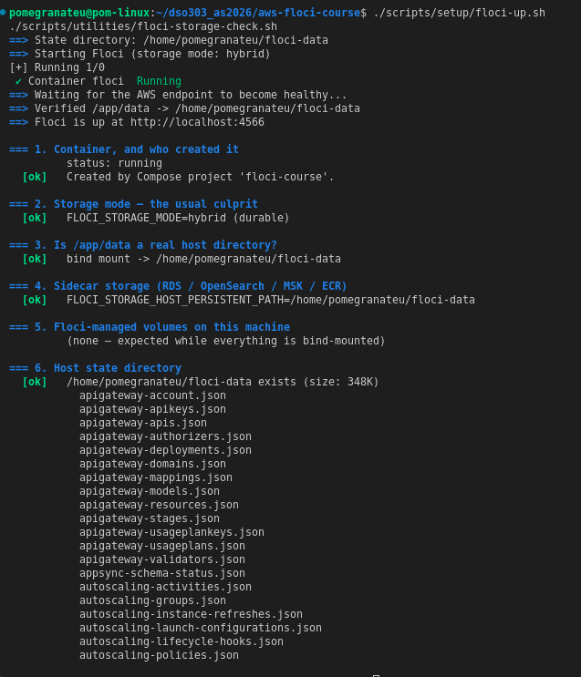

2. **Loaded Lab 01's environment** — sourced `configs/course.env` and `configs/lab-01.env`, and confirmed via `whoami.sh` that the calling identity was the Floci root account before doing anything else.

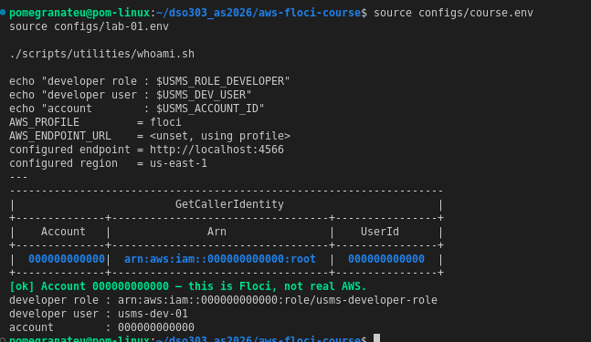

3. **Read `USMSDeveloperBase` before relying on it** — retrieved the policy's default version (now `v3`, following the version bumps performed in Lab 01) and confirmed it contained the `ec2:CreateVpc` family of actions, a `us-east-1` region condition, and the explicit `Deny` guardrail against identity-escalation actions.

4. **Assumed `usms-developer-role`** as `usms-dev-01` (via the `usms-dev` CLI profile, matching the role's trust policy), obtained temporary credentials, and created `usms-vpc` (`10.0.0.0/16`) while holding those credentials — the first genuine use of that role since it was created in Lab 01.

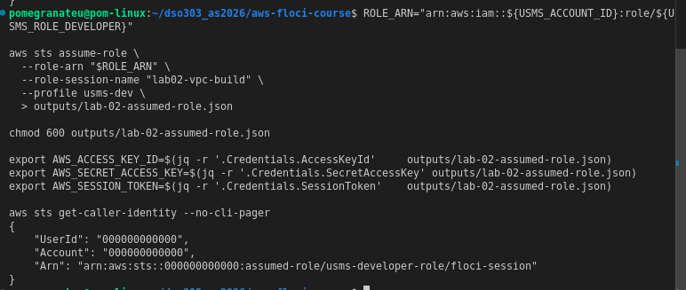
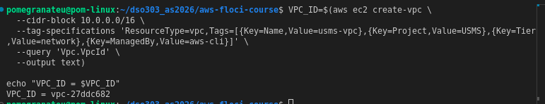

5. **Restored the normal (root) identity** by unsetting the temporary credential environment variables, then read the VPC back as that different identity to confirm it exists at the account level, not merely within the assumed session.

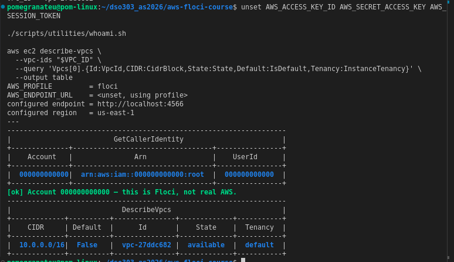

6. **Enabled DNS support and DNS hostnames** on the VPC (both attributes are off by default when a VPC is created via the CLI).

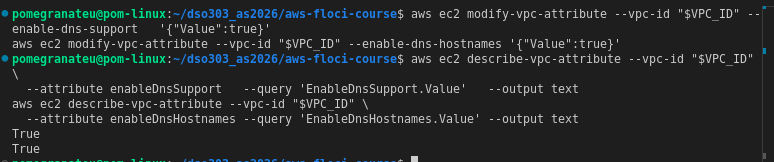

7. **Created and attached an internet gateway** (`usms-igw`), and verified its `Attachments` array named the correct VPC with state `available`.

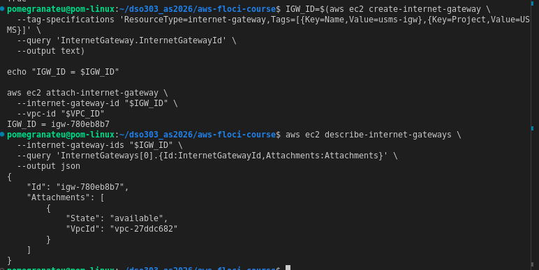

8. **Created the first public subnet** (`usms-public-subnet-a`, `10.0.1.0/24`, `us-east-1a`) and confirmed `AvailableIpAddressCount` read `251`, demonstrating AWS's five reserved addresses per subnet.

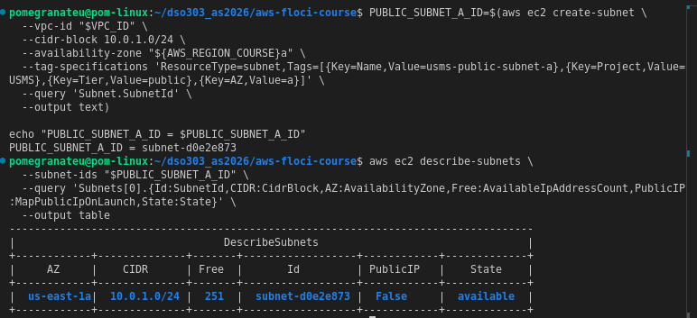

9. **Enabled auto-assign public IPv4** on that subnet, then created the first private subnet (`usms-private-subnet-a`, `10.0.3.0/24`, `us-east-1a`) without that setting.

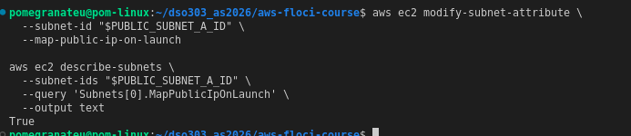
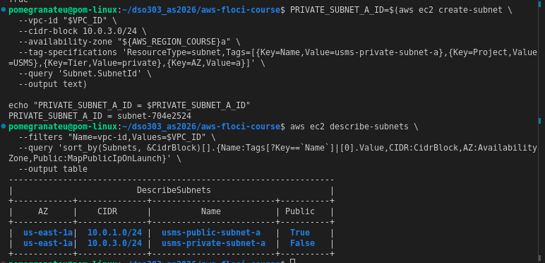

10. **Created the public route table** (`usms-public-rt`) with an explicit `0.0.0.0/0 → usms-igw` route, and associated `usms-public-subnet-a` with it.

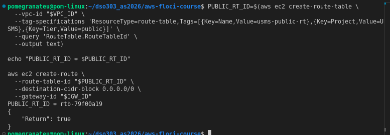
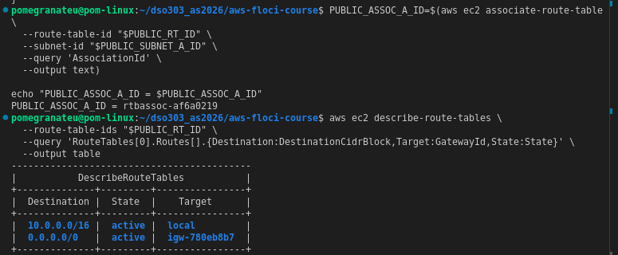

11. Completed the **"Your turn" exercise**: created `usms-public-subnet-b` (`10.0.2.0/24`, `us-east-1b`), enabled its auto-assign public IP, and associated it with `usms-public-rt` — confirmed by an association count of 2.

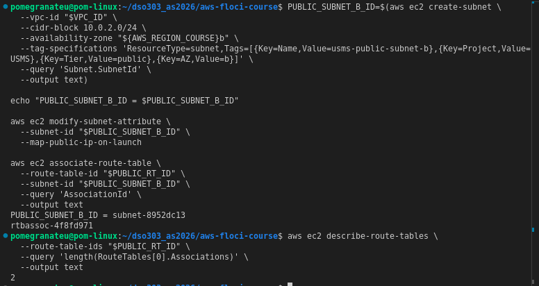

12. **Created the private route table** (`usms-private-rt`) and associated `usms-private-subnet-a` with it — deliberately without any route yet, and without inheriting the VPC's main route table.

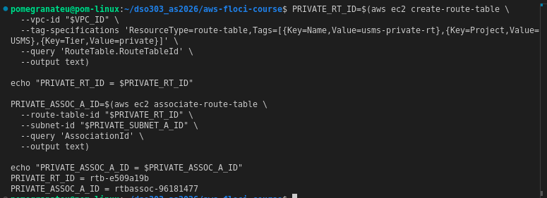

13. **Proved the two subnets are actually different** by reading back each subnet's *effective* route table via `describe-route-tables --filters Name=association.subnet-id`, and extracting the target of its `0.0.0.0/0` route. The public subnet resolved to `igw-780eb8b7`; the private subnet resolved to `None`. This is the entire mechanism behind "public" versus "private" — there is no attribute on a subnet called `Public`.

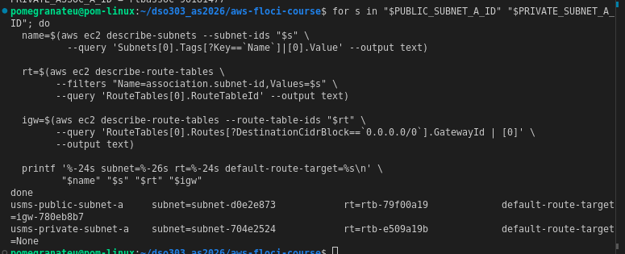

14. **Created `usms-app-sg`** with inbound rules for HTTP (80, from anywhere), SSH (22, restricted to `10.0.0.0/16`), and — via the "Your turn" exercise — HTTPS (443, from anywhere, with a rule description).

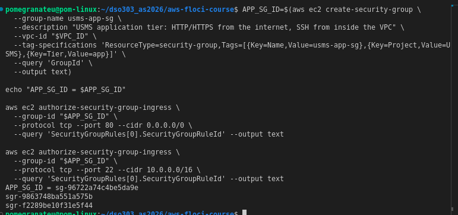

15. **Created `usms-db-sg`**, sourcing its PostgreSQL (5432) ingress rule from `usms-app-sg`'s group ID rather than a CIDR block, using the long-form `--ip-permissions file://` syntax with an *unquoted* heredoc (deliberately, so the shell variable holding the app group's ID was expanded into the JSON file).

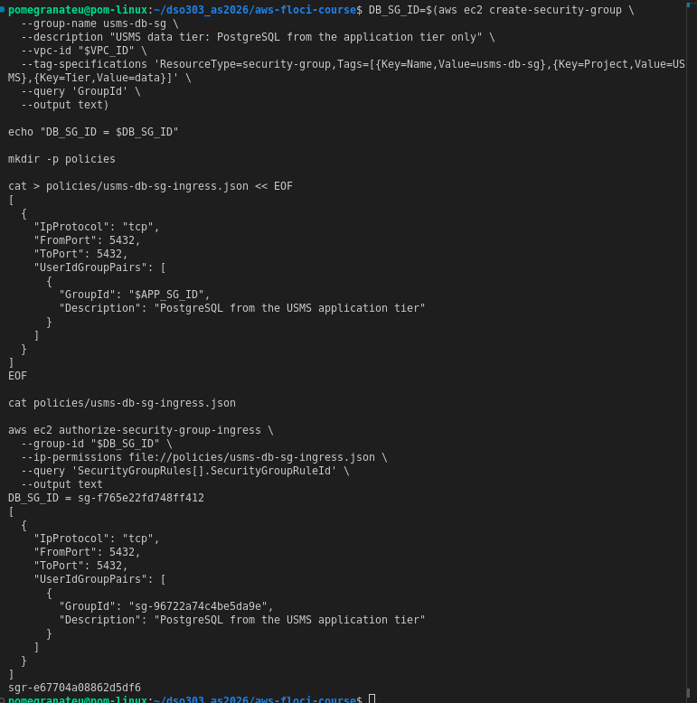

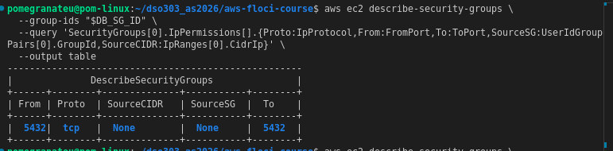

16. **Read both groups back together** and reasoned through a full request path (browser → web tier → database tier → reply) to understand why security groups being stateful meant only two rules were needed to cover five direction-crossing evaluations.

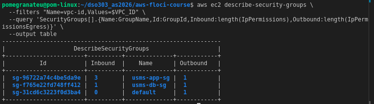

17. **Explored the default network ACL** (confirming its two implicit rules — allow-all at rule 100, deny-all at rule 32767 — in both directions), then created a dedicated `usms-private-nacl` with four explicit rules: inbound PostgreSQL from the VPC, an inbound ephemeral-port rule for return traffic, an outbound rule permitting replies to the app tier, and an outbound HTTPS rule so the data tier can reach the NAT gateway for OS updates.

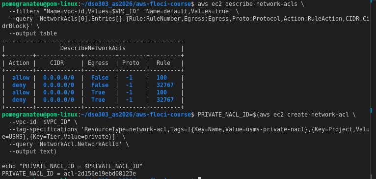

18. **Associated the private NACL with the private subnet.** This step surfaced a genuine mistake, described in full in Section 7 below: the first attempt associated the new NACL with the *public* subnet instead of the private one, because `Associations[0]` on a shared default NACL isl not guaranteed to be the subnet the filter matched on. The error was diagnosed, the public subnet was restored to the default NACL, and the private subnet was correctly re-associated using an explicit `Associations[?SubnetId==...]` filter.

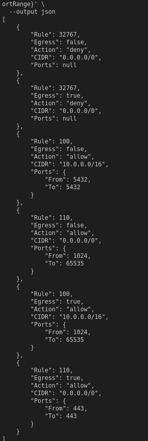
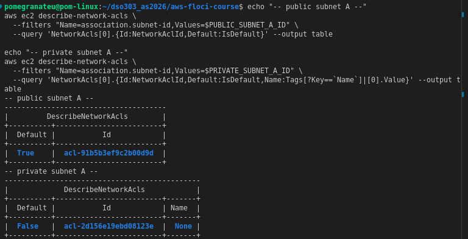

19. **Allocated an Elastic IP and created a NAT gateway** (`usms-nat`) inside the *public* subnet (a NAT gateway must live in a subnet that itself has internet access, even though it exists to serve the private subnet), and waited for it to reach the `available` state.

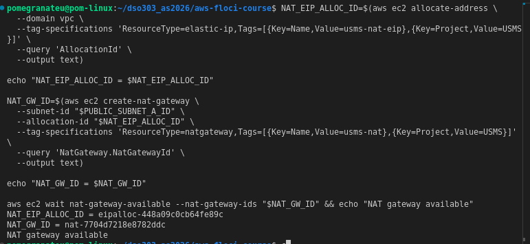

20. **Pointed the private route table's default route at the NAT gateway** rather than the internet gateway, and verified the route table showed `Gateway: None` / `NAT: nat-...` — confirming the private subnet gained outbound-only access without becoming public.

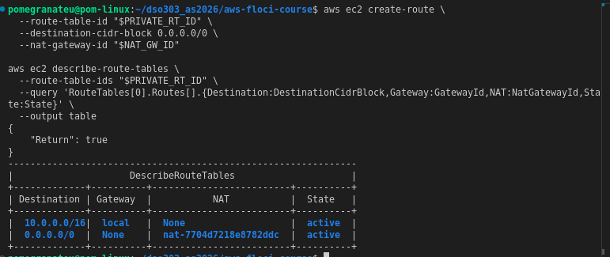

21. **Created a gateway VPC endpoint for S3** (`usms-s3-endpoint`), associated with the private route table, so that traffic to S3 does not need to leave the AWS network via the NAT gateway.

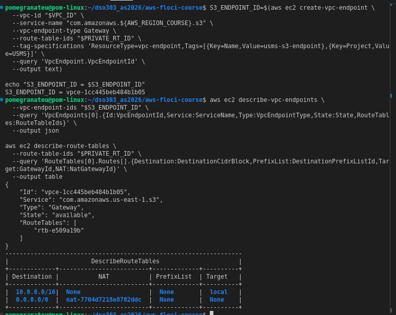

22. **Audited tags** across the VPC using `describe-tags --filters Name=tag:Project,Values=USMS`. This surfaced two further issues — a duplicate S3 endpoint and an untagged NACL — both diagnosed and corrected, described in Section 7.

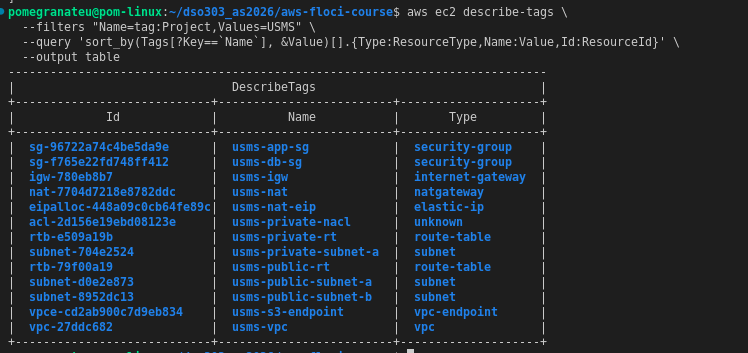

23. **Proved the network survives a restart**: recorded the VPC ID, subnet count, and security group count to a file, stopped and restarted Floci, re-derived the VPC ID *by tag* (not by reusing the shell variable), and confirmed via `diff` that all three values were unchanged.

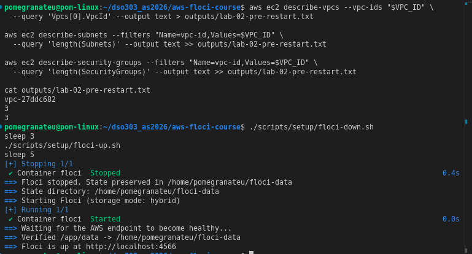

24. **Wrote `configs/lab-02.env`**, looking every resource ID up by tag (never by reusing a shell variable, so that a resource which silently failed to create would show as `None` rather than a stale ID), and confirmed all values were populated except `USMS_PRIVATE_SUBNET_B` (expected, since Exercise 5 had not yet been attempted at that point).

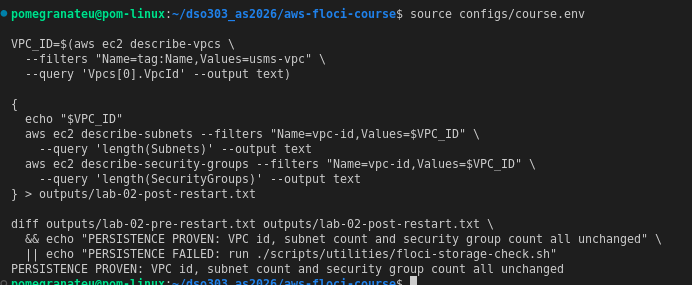

25. **Committed the work** — `configs/lab-02.env`, `policies/usms-db-sg-ingress.json`, and the `COURSE_ROOT` path fix to `configs/course.env` — after confirming via `git check-ignore -v` that `outputs/lab-02-assumed-role.json` was correctly blocked from being tracked.

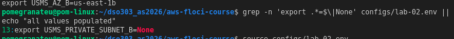

---

## 6. Results and Evidence

### 6.1 Environment and Identity

**[System check and floci-storage-check.sh full six-section output, all ok]**

**[whoami.sh output confirming root identity, account 000000000000]**

**[Lab 01 environment sourced: developer role, developer user, account echoed correctly]**

### 6.2 Assuming the Developer Role and Creating the VPC

**[USMSDeveloperBase policy document read back, showing default version v3 with the EC2 networking actions, region condition, and explicit Deny]**

**[sts assume-role output showing the assumed-role ARN for usms-developer-role]**

**[VPC creation output: VPC_ID assigned]**

**[Identity restored to root after unset; VPC read back via describe-vpcs showing State: available, Default: False]**

### 6.3 DNS, Internet Gateway, and Subnets

**[DNS support and DNS hostnames both confirmed True]**

**[Internet gateway created and attached, Attachments array showing correct VPC and State: available]**

**[Public subnet A created, AvailableIpAddressCount: 251, PublicIP initially False]**

**[Both subnets shown together via describe-subnets: public subnet Public=True, private subnet Public=False]**

### 6.4 Route Tables

**[Public route table created with 0.0.0.0/0 -> igw route, Return: true]**

**[Public subnet B created and associated; route table shows 2 associations]**

**[Private route table created and private subnet A associated, no default route yet]**

**[The core proof: for-loop output showing public subnet's default-route-target as an igw- ID, and private subnet's as None]**

### 6.5 Security Groups

**[usms-app-sg created with HTTP and SSH rules; HTTPS rule added via the "Your turn" exercise]**

**[usms-db-sg created, ingress JSON file shown with the app security group's ID embedded via unquoted heredoc]**

**[usms-db-sg verified as group-referenced: SourceSG populated, SourceCIDR is None]**

**[All three security groups in the VPC shown together: usms-app-sg, usms-db-sg, and the default group]**

### 6.6 Network ACL

**[Default NACL entries: two implicit rules per direction]**

**[Private NACL created and its four explicit rules plus two implicit deny rules, six entries total]**

**[Private NACL correctly associated with the private subnet after the association mistake was corrected — public subnet restored to default NACL, private subnet showing Default: False and the correct NACL ID]**

### 6.7 NAT Gateway and S3 Endpoint

**[Elastic IP allocated and NAT gateway created in the public subnet, reaching state available]**

**[Private route table's default route pointed at the NAT gateway: Gateway: None, NAT: nat-... confirmed]**

**[S3 gateway endpoint created, state available, associated with the private route table]**

### 6.8 Tag Audit and Corrections

**[Initial tag audit showing a duplicate usms-s3-endpoint and a missing usms-private-nacl entry]**

**[Corrected tag audit after removing the duplicate endpoint and tagging the NACL: 13 unique resources, all correctly tagged Project=USMS]**

### 6.9 Persistence Proof

**[Pre-restart snapshot: VPC ID, subnet count 3, security group count 3]**

**[Post-restart: VPC re-derived by tag, diff against pre-restart file, "PERSISTENCE PROVEN" line]**

### 6.10 Final Configuration and Commit

**[configs/lab-02.env generated and populated, only USMS_PRIVATE_SUBNET_B showing None as expected]**

**[Fresh-shell verification: sourcing lab-02.env and echoing key IDs correctly]**

**[git check-ignore -v proof for outputs/lab-02-assumed-role.json]**

**[Final git log showing the Lab 02 commit]**

---

## 7. Analysis and Discussion

### What was achieved

A complete two-tier VPC network was built for USMS: a public tier with two subnets across two Availability Zones routed to an internet gateway, and a private tier with outbound-only access via a NAT gateway, protected by both a stateful security-group layer and a stateless subnet-wide NACL, with a dedicated S3 gateway endpoint to keep bucket traffic off the public internet. The entire build was performed as the least-privileged `usms-developer-role` rather than the account root, and its persistence was independently verified after a full emulator restart.

### Did the results match the expected outcome?

Mostly yes, with 3 mistakes made and corrected along the way which i documented here in detail because diagnosing them was itself the more instructive part of the lab.

### Errors encountered and how they were resolved

**1. NACL association applied to the wrong subnet.** When associating the newly created `usms-private-nacl` with the private subnet, the lookup used `Associations[0]` on the NACL returned by filtering `association.subnet-id`. Because the private subnet was, at that point, still sharing the *default* NACL with every other subnet in the VPC, that NACL's `Associations` array contained an entry for *every* subnet using it — and index `[0]` happened to return the **public** subnet's association, not the private one. The `replace-network-acl-association` call therefore moved the public subnet onto the new private NACL by mistake. This was caught by re-reading the NACL's associations directly (`describe-network-acls --network-acl-ids $PRIVATE_NACL_ID --query 'NetworkAcls[0].Associations'`) and noticing the `SubnetId` did not match the intended private subnet. It was corrected in two steps: the public subnet was first restored to the account's default NACL, and the private subnet was then correctly targeted using an explicit filter — `Associations[?SubnetId=='$PRIVATE_SUBNET_A_ID'].NetworkAclAssociationId | [0]` — rather than blindly indexing the first array element.

**2. A duplicate S3 gateway endpoint.** The tag audit in Step 22 revealed two `usms-s3-endpoint` resources, created roughly 11 seconds apart, both `available` and both associated with the same route table. The likely cause was an earlier command-line typo (`caws` instead of `aws`) during Step 20 causing an unintended retry or duplicate execution nearby in the session. The older of the two endpoints was kept and the newer duplicate was deleted with `delete-vpc-endpoints`.

**3. A shell typo silently skipped a route creation.** In Step 20, a `caws` typo meant the `create-route` command for the private table's NAT route was never actually executed, while the subsequent `describe-route-tables` verification ran normally and simply showed the route was missing (rather than erroring). This was caught by checking the route count in the verification output (1 route instead of the expected 2) and re-running the corrected command.

### Floci Limitations encountered

- **`aws ec2 create-vpc-endpoint`** created the S3 gateway endpoint correctly and reported it `available`, but did **not** inject the managed S3 prefix-list route into the private route table — `describe-route-tables` continued to show only two routes (`local` and the NAT default route) rather than the expected third `pl-...` entry. This matches a limitation the lab document explicitly anticipates: some Floci builds create the endpoint object without wiring the route. The endpoint still functions for the purposes of this course, since Floci routes S3 API calls to its own endpoint regardless of the route table's contents.
- **`describe-tags`** reported `usms-private-nacl`'s `ResourceType` as `unknown` rather than `network-acl`, even after the resource was correctly tagged and verified individually via `describe-network-acls`. This appears to be a gap in how this Floci build classifies NACL resources specifically within the cross-resource tag-search endpoint, rather than a tagging failure.
- **`sts assume-role`** again substituted its own default session name (`floci-session`) into the resulting ARN rather than honouring the `--role-session-name` value (`lab02-vpc-build`) that was explicitly passed — consistent with the same behaviour observed in Lab 01.
- As documented throughout this lab's own material, **none of the security groups, NACL rules, or IAM policies created in this lab are actually enforced against traffic by Floci** — every command succeeded regardless of whether the calling identity's permissions or the resource's own rules would have permitted it on real AWS. Command success is evidence that the configuration was written and stored correctly; it is not evidence that the configuration is correct.

### Observations made during implementation

- The distinction between a "public" and "private" subnet has no attribute of its own — Step 13's explicit read-back of each subnet's effective route table (rather than trusting a name or tag) was the single most clarifying exercise in the lab, and directly explains why the NACL association mistake above was possible: nothing about a subnet's identity prevents it from being pointed at the wrong table or ACL, because subnets and their network behaviour are entirely separable objects connected only by an association record.
- Building the VPC while holding `usms-developer-role`'s temporary credentials — rather than the account root — connected directly back to the least-privilege design decisions made in Lab 01: the policy's explicit `Deny` on identity-escalation actions and its region condition were no longer abstract, since this was the first time an actual resource existed for that policy to govern.

---

## 8. Reflection

The most valuable lesson was learning to distrust command success as proof of correctness, not only in the Floci-specific sense (since policies and security groups are not enforced here), but structurally: the NACL association mistake succeeded without any error message at all, and was only caught by independently reading back *which* subnet the change had actually landed on. 

This is the same discipline Step 13 teaches for public-versus-private subnets, applied to a mistake I made myself rather than to a designed exercise, which made it land more clearly than the exercise alone would have.

In a real-world AWS environment, this network design, public/private subnet separation, a NAT gateway for controlled outbound access, group-referenced security rules, and a gateway endpoint to keep S3 traffic off the public internet is a standard, cost-conscious pattern for exactly the kind of system USMS represents: a public-facing application with a data tier that must never be directly exposed.

In future practical sessions, I would like to explore:
- How security group and NACL enforcement actually behaves against real traffic on a real AWS account
- VPC Flow Logs, to observe traffic patterns directly rather than reasoning about them from configuration alone
- The cost trade-off of a second, AZ-redundant NAT gateway in a real billing account
- VPC peering and Transit Gateway for connecting multiple VPCs

---

## 9. Conclusion

The objectives of this practical were achieved: a fully two-tier, two-Availability-Zone VPC network was built for USMS entirely through the AWS CLI, using the least-privileged `usms-developer-role` established in Lab 01, and its persistence across an emulator restart was independently verified. Three genuine configuration mistakes were made, correctly diagnosed through the same "read the property back, do not trust the command's success" discipline the lab teaches, and resolved. This laboratory reinforced that a subnet's public or private status is entirely a function of its route table rather than any attribute of its own, and that security groups and network ACLs serve complementary, differently-scoped roles in a defence-in-depth network design.

---

## 10. Appendix

### Additional Files
- `policies/usms-db-sg-ingress.json`
- `configs/lab-02.env`
- `configs/course.env` (COURSE_ROOT path corrected)

### Resource Inventory (kept for future labs)

| Category | Resources |
|---|---|
| VPC | `usms-vpc` (`vpc-27ddc682`), `10.0.0.0/16` |
| Internet Gateway | `usms-igw` (`igw-780eb8b7`) |
| Public subnets | `usms-public-subnet-a` (`10.0.1.0/24`, us-east-1a), `usms-public-subnet-b` (`10.0.2.0/24`, us-east-1b) |
| Private subnets | `usms-private-subnet-a` (`10.0.3.0/24`, us-east-1a) |
| Route tables | `usms-public-rt`, `usms-private-rt` |
| Security groups | `usms-app-sg`, `usms-db-sg` |
| Network ACL | `usms-private-nacl` |
| NAT Gateway | `usms-nat` + Elastic IP `usms-nat-eip` |
| VPC Endpoint | `usms-s3-endpoint` (S3, Gateway type) |

*Required for Lab 03: `usms-public-subnet-a`, `usms-private-subnet-a`, `usms-app-sg`, `usms-db-sg`, `configs/lab-02.env`.*

