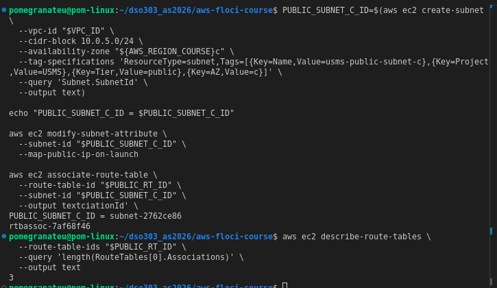
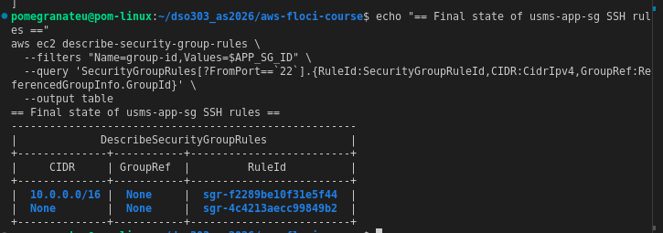
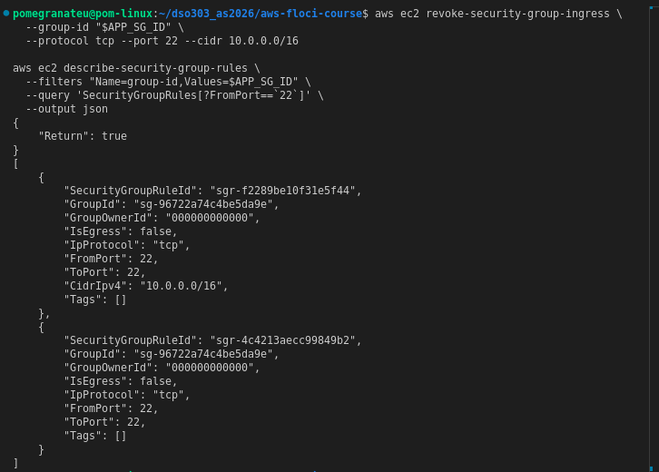
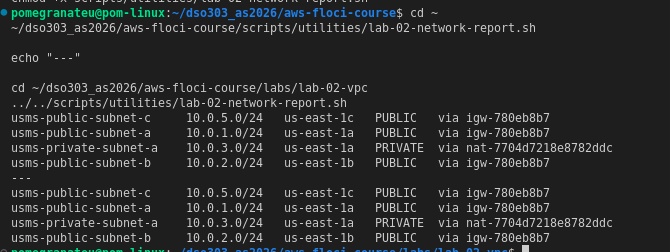
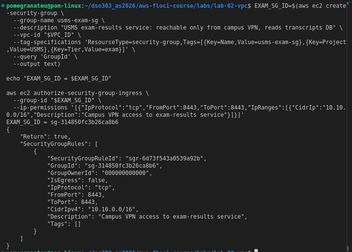
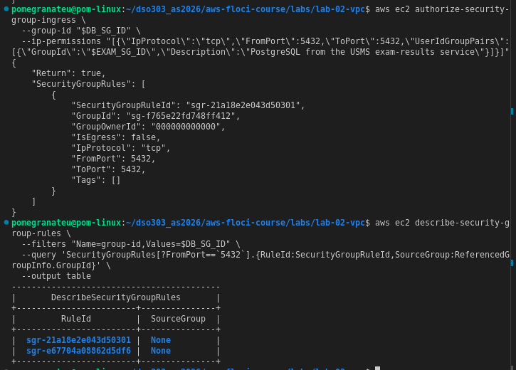

# Lab 02 — VPC — Independent Exercises

## Exercise 1 — Basic: a third public subnet

Created `usms-public-subnet-c` in `us-east-1c`, CIDR `10.0.5.0/24`, tagged consistently with the existing subnets (`Project=USMS`, `Tier=public`), with auto-assign public IPv4 enabled, and associated with `usms-public-rt`.

```bash
PUBLIC_SUBNET_C_ID=$(aws ec2 create-subnet \
  --vpc-id "$VPC_ID" \
  --cidr-block 10.0.5.0/24 \
  --availability-zone "${AWS_REGION_COURSE}c" \
  --tag-specifications 'ResourceType=subnet,Tags=[{Key=Name,Value=usms-public-subnet-c},{Key=Project,Value=USMS},{Key=Tier,Value=public},{Key=AZ,Value=c}]' \
  --query 'Subnet.SubnetId' \
  --output text)

aws ec2 modify-subnet-attribute \
  --subnet-id "$PUBLIC_SUBNET_C_ID" \
  --map-public-ip-on-launch

aws ec2 associate-route-table \
  --route-table-id "$PUBLIC_RT_ID" \
  --subnet-id "$PUBLIC_SUBNET_C_ID" \
  --query 'AssociationId' \
  --output text
```

**Result:** `usms-public-rt`'s association count increased from 2 to 3, confirming the subnet is correctly associated alongside subnets A and B.



---

## Exercise 2 — Intermediate: a bastion security group

Created `usms-bastion-sg`, allowing inbound SSH only from a single trusted address (`203.0.113.10/32`). Added a new group-referenced SSH rule to `usms-app-sg` sourced from `usms-bastion-sg`, added *before* removing the old rule so SSH access was never briefly absent.

```bash
BASTION_SG_ID=$(aws ec2 create-security-group \
  --group-name usms-bastion-sg \
  --description "Jump host for USMS: SSH from a single trusted address" \
  --vpc-id "$VPC_ID" \
  --tag-specifications 'ResourceType=security-group,Tags=[{Key=Name,Value=usms-bastion-sg},{Key=Project,Value=USMS},{Key=Tier,Value=bastion}]' \
  --query 'GroupId' \
  --output text)

aws ec2 authorize-security-group-ingress \
  --group-id "$BASTION_SG_ID" \
  --ip-permissions '[{"IpProtocol":"tcp","FromPort":22,"ToPort":22,"IpRanges":[{"CidrIp":"203.0.113.10/32","Description":"SSH from my trusted workstation"}]}]'

aws ec2 authorize-security-group-ingress \
  --group-id "$APP_SG_ID" \
  --ip-permissions "[{\"IpProtocol\":\"tcp\",\"FromPort\":22,\"ToPort\":22,\"UserIdGroupPairs\":[{\"GroupId\":\"$BASTION_SG_ID\",\"Description\":\"SSH from the USMS bastion host\"}]}]"

aws ec2 revoke-security-group-ingress \
  --group-id "$APP_SG_ID" \
  --security-group-rule-ids sgr-f2289be10f31e5f44
```

**Result — intended vs. actual:**

The new group-referenced SSH rule (sourced from `usms-bastion-sg`) was successfully added to `usms-app-sg`. However, removing the old CIDR-based rule (`10.0.0.0/16`, rule ID `sgr-f2289be10f31e5f44`) did not succeed despite `revoke-security-group-ingress` reporting `{"Return": true}`. This was confirmed independently with both the rule-ID form and the short CIDR form of the revoke command — in both cases the API reported success, but `describe-security-group-rules` immediately afterward still showed the old rule present.

**This is a Floci Limitation**, not a design or command error: on real AWS, this exact sequence of commands would leave `usms-app-sg` with exactly one SSH rule, group-referenced from `usms-bastion-sg`. On this Floci build, the intended new rule and the stale old rule coexist.




---

## Exercise 3 — Problem solving: prove a claim about the network

Built `scripts/utilities/lab-02-network-report.sh`, which classifies every subnet in `usms-vpc` as `PUBLIC`, `PRIVATE`, or `ISOLATED` purely by reading its effective route table's default-route target — never by its name or tags. Verified it produces identical output when run from `~` and from `~/dso303_as2026/aws-floci-course/labs/lab-02-vpc/`.

```bash
#!/usr/bin/env bash
set -uo pipefail
REPO_ROOT="$(cd "$(dirname "${BASH_SOURCE[0]}")/../.." && pwd)"
source "$REPO_ROOT/configs/course.env"
source "$REPO_ROOT/configs/lab-01.env" 2>/dev/null || true
source "$REPO_ROOT/configs/lab-02.env" 2>/dev/null || true

VPC_ID="${USMS_VPC_ID:-$(aws ec2 describe-vpcs --filters "Name=tag:Name,Values=usms-vpc" --query 'Vpcs[0].VpcId' --output text)}"
SUBNET_IDS=$(aws ec2 describe-subnets --filters "Name=vpc-id,Values=$VPC_ID" --query 'Subnets[].SubnetId' --output text)

for s in $SUBNET_IDS; do
  name=$(aws ec2 describe-subnets --subnet-ids "$s" --query 'Subnets[0].Tags[?Key==`Name`]|[0].Value' --output text)
  cidr=$(aws ec2 describe-subnets --subnet-ids "$s" --query 'Subnets[0].CidrBlock' --output text)
  az=$(aws ec2 describe-subnets --subnet-ids "$s" --query 'Subnets[0].AvailabilityZone' --output text)
  rt=$(aws ec2 describe-route-tables --filters "Name=association.subnet-id,Values=$s" --query 'RouteTables[0].RouteTableId' --output text)
  igw=$(aws ec2 describe-route-tables --route-table-ids "$rt" --query 'RouteTables[0].Routes[?DestinationCidrBlock==`0.0.0.0/0`].GatewayId | [0]' --output text 2>/dev/null)
  nat=$(aws ec2 describe-route-tables --route-table-ids "$rt" --query 'RouteTables[0].Routes[?DestinationCidrBlock==`0.0.0.0/0`].NatGatewayId | [0]' --output text 2>/dev/null)

  if [ -n "$igw" ] && [ "$igw" != "None" ]; then
    printf '%-24s %-13s %-12s PUBLIC   via %s\n' "$name" "$cidr" "$az" "$igw"
  elif [ -n "$nat" ] && [ "$nat" != "None" ]; then
    printf '%-24s %-13s %-12s PRIVATE  via %s\n' "$name" "$cidr" "$az" "$nat"
  else
    printf '%-24s %-13s %-12s ISOLATED no default route\n' "$name" "$cidr" "$az"
  fi
done
```

**Result:**

```
usms-public-subnet-c     10.0.5.0/24   us-east-1c   PUBLIC   via igw-780eb8b7
usms-public-subnet-a     10.0.1.0/24   us-east-1a   PUBLIC   via igw-780eb8b7
usms-private-subnet-a    10.0.3.0/24   us-east-1a   PRIVATE  via nat-7704d7218e8782ddc
usms-public-subnet-b     10.0.2.0/24   us-east-1b   PUBLIC   via igw-780eb8b7
```

Identical output was produced whether the script was invoked from the home directory (`~/dso303_as2026/aws-floci-course/scripts/utilities/lab-02-network-report.sh`) or from within `labs/lab-02-vpc/` (`../../scripts/utilities/lab-02-network-report.sh`), confirming the `${BASH_SOURCE[0]}`-based path resolution works correctly regardless of the caller's working directory.



---

## Exercise 4 — Challenge: design and defend

### The brief

> We are adding an exam-results service. It must be reachable by staff on campus only — our campus uses 10.10.0.0/16 and reaches AWS over a VPN, so traffic arrives with campus source addresses. It reads the transcripts database. It must never be reachable from the public internet, but it does need to download security patches.

### Design

**Subnet placement:** The exam-results service belongs in `usms-private-subnet-a`, the existing data-tier subnet. It reads the transcripts database and must never be internet-reachable — exactly the profile the private tier was built for. Creating a new subnet would fragment the address space and duplicate infrastructure (NAT route, NACL) that already exists and already satisfies the requirement.

**Security groups:**
- Create `usms-exam-sg`: inbound TCP 8443 (placeholder application port) from `10.10.0.0/16` only — the campus VPN range. No `0.0.0.0/0` rule anywhere on this group, satisfying "never reachable from the public internet."
- Modify `usms-db-sg`: add a second ingress rule for TCP 5432, sourced from `usms-exam-sg` (group-referenced, matching the existing pattern used for `usms-app-sg`), so the exam-results service can read the transcripts database without opening the database to a wider CIDR range.

**NACL:** No change warranted. `usms-private-nacl` already permits inbound TCP 5432 from `10.0.0.0/16` (covers intra-VPC database traffic) and the ephemeral-port return rule needed for any TCP session. The campus VPN traffic itself arrives at the private subnet from within the VPC's own address space (post-VPN-termination), so no new NACL entry is required — access control for this new service is correctly handled entirely at the security-group layer, consistent with this lab's stated design principle.

**Second NAT gateway in AZ b?** Not recommended yet. A NAT gateway costs approximately USD 32.40/month (at USD 0.045/hour, per the AWS VPC pricing page) plus per-GB data-processing charges, before any bytes are transferred. The current private tier has only one active subnet, in AZ a — adding a second NAT gateway now would double a already-significant recurring cost to protect a failure domain (AZ b) that does not yet host any private-tier resources. Once Exercise 5 brings `usms-private-subnet-b` into active use, this trade-off should be revisited: at that point, a single NAT gateway in AZ a becomes a single point of failure for *two* AZs' worth of private resources, which changes the cost/availability calculation.

**What to delete:**

```
Read before running any delete command

What will be deleted: usms-public-subnet-c (Exercise 1's practice subnet).
What depends on it: nothing — it was created for practice only and is not
  referenced in configs/lab-02.env or by any later lab.
Reversible? Yes — re-run Exercise 1's commands to recreate it identically.
Effect on later labs: none.
```

```bash
# Disassociate the subnet from its route table first, then delete it.
ASSOC_ID=$(aws ec2 describe-route-tables --route-table-ids "$PUBLIC_RT_ID" \
  --query "RouteTables[0].Associations[?SubnetId=='$PUBLIC_SUBNET_C_ID'].RouteTableAssociationId | [0]" \
  --output text)
aws ec2 disassociate-route-table --association-id "$ASSOC_ID"
aws ec2 delete-subnet --subnet-id "$PUBLIC_SUBNET_C_ID"
```

### Implementation (security group parts only, as instructed)

```bash
EXAM_SG_ID=$(aws ec2 create-security-group \
  --group-name usms-exam-sg \
  --description "USMS exam-results service: reachable only from campus VPN, reads transcripts DB" \
  --vpc-id "$VPC_ID" \
  --tag-specifications 'ResourceType=security-group,Tags=[{Key=Name,Value=usms-exam-sg},{Key=Project,Value=USMS},{Key=Tier,Value=exam}]' \
  --query 'GroupId' \
  --output text)

aws ec2 authorize-security-group-ingress \
  --group-id "$EXAM_SG_ID" \
  --ip-permissions '[{"IpProtocol":"tcp","FromPort":8443,"ToPort":8443,"IpRanges":[{"CidrIp":"10.10.0.0/16","Description":"Campus VPN access to exam-results service"}]}]'
```



Also modified `usms-db-sg` to accept PostgreSQL from `usms-exam-sg`, alongside its existing rule from `usms-app-sg`:

```bash
aws ec2 authorize-security-group-ingress \
  --group-id "$DB_SG_ID" \
  --ip-permissions "[{\"IpProtocol\":\"tcp\",\"FromPort\":5432,\"ToPort\":5432,\"UserIdGroupPairs\":[{\"GroupId\":\"$EXAM_SG_ID\",\"Description\":\"PostgreSQL from the USMS exam-results service\"}]}]"
```

**Result:** `usms-db-sg` now has two separate ingress rules for port 5432 — one referencing `usms-app-sg`, one referencing `usms-exam-sg` — confirmed via `describe-security-group-rules` showing two distinct rule IDs for `FromPort==5432`.



---

## Exercise 5 — Integration: complete the second Availability Zone
