# DSO303 Lab 03: Amazon EC2 and Deploying the USMS Application

**Student:** Pema Tshering Yangchen (ID 2230295)
**Module:** DSO303 Cloud Infrastructure, College of Science and Technology, Royal University of Bhutan
**Environment:** Floci v1.5.34, AWS CLI v2.31.35, Docker Compose v2.26.1, Pop!_OS (x86_64)
**Repository:** `~/dso303_as2026/aws-floci-course` (github.com/pomegranateis/dso303_as2026)

> Screenshot placeholders look like ``. Take each screenshot, save it under `img/` with that exact name, and the image will appear. A checklist is at the end.

---

## 1. Objective

Launch a two-tier deployment of the USMS application into the Lab 2 network, using the instance profile from Lab 1: a web instance in the public subnet, a data instance in the private subnet, a stable address, a data volume, and proof that the result survives a Floci restart. The lab also asks that what was **observed** be kept separate from what was **reasoned about**, because Floci does not model everything real AWS does. That distinction is marked throughout.

## 2. What was built

| Resource | ID / value | Location |
|---|---|---|
| Key pair `usms-app-key` | private key in `outputs/`, chmod 600, git-ignored | n/a |
| `usms-web-01` | `i-68c4cb27d85e381e8`, t3.micro | usms-public-subnet-a, us-east-1a |
| `usms-web-02` (exercise) | `i-9a2d1283522be5e45`, t3.micro | usms-public-subnet-b, us-east-1b |
| `usms-db-01` | `i-4fe69d1237fb2fc6a`, t3.micro | usms-private-subnet-a, us-east-1a |
| `usms-db-02` (Exercise 2) | `i-d1df284410caddffb`, t3.micro | usms-private-subnet-b |
| `usms-web-eip` | `eipalloc-f918a282f7ceb3295`, 54.205.147.173 | associated with web-01 |
| `usms-web-data-vol` | `vol-48749885766e1a8dc`, 8 GiB gp3 | us-east-1a (not attached, see 4.15) |
| `usms-web-golden` AMI | **not created** (`create-image` unsupported) | n/a |

Files added: `labs/lab-03-ec2/user-data.sh`, `user-data-db.sh`, `transcript-upload.sh`, `templates/lab-03-run-instances.json` (and `-web02.json`), `configs/lab-03.env`, `scripts/utilities/verify-lab-03.sh`, `scripts/utilities/lab-03-reachability.sh`, `notes/lab-03-notes.md`.

## 3. How to read the results

Three labels are used. **Observed** means I saw it happen. **Conceptual** means it is reasoned from AWS behaviour and was not visible in Floci. **Floci limitation** means Floci behaved differently from real AWS, with what real AWS would do.

---

## 4. Implementation

### Steps 1 and 2: resume the environment and verify Lab 2

Started Floci with `floci-up.sh`, sourced `course.env`, `lab-01.env` and `lab-02.env`, and confirmed six non-empty values (subnets, security groups, profile, AZ). `verify-lab-02.sh` reported `PASS=33 FAIL=0`, so the network was intact before building on it.


### Step 3: choose an AMI

Floci seeds five Amazon images, so no image had to be registered by hand. The first listed image was Amazon Linux 2, but the bootstrap script uses `dnf` (Amazon Linux 2023), so I selected the AL2023 image: `ami-0abcdef1234567891` (`al2023-ami-2023.0.20230315.0-kernel-6.1-x86_64`).

**Floci limitation:** the SSM public parameter lookup returned `ParameterNotFound`. On real AWS this is how the current AMI should be resolved at launch time instead of hard-coding an ID.

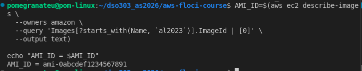

### Steps 4 and 5: key pair, and proving the private key is git-ignored

The private key was written straight to `outputs/usms-app-key.pem` through `--query KeyMaterial > file`, so it never appeared on screen. Permissions are `-rw-------`.

**Floci limitation:** the key is 126 bytes (a real RSA key is about 1,700), the fingerprint is all zeros, and `Type` returns `None`.

`git check-ignore -v` showed the key is ignored by `.gitignore:20` (`*.pem`), not the lab's expected `outputs/*` rule; the file is protected either way. `outputs/.gitkeep` had been lost in the repository consolidation, so I recreated it. The ignore rules (`outputs/*` then `!outputs/.gitkeep`) are correct.

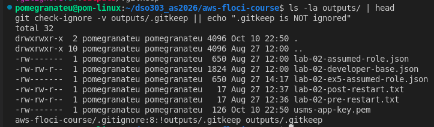

### Step 6: the user-data bootstrap

`labs/lab-03-ec2/user-data.sh` (1,657 bytes, well under the 16 KB limit) installs nginx and writes an identity page and `health.json` using IMDSv2. `bash -n` passed. The outer heredoc is quoted so `$(...)` and `${INSTANCE_ID}` expand on the instance at boot, not in my shell.

### Step 7: request skeleton and request file

`--generate-cli-skeleton` produced a 213-line skeleton (the lab expected about 312; this is a CLI version difference). I wrote `templates/lab-03-run-instances.json` with an unquoted heredoc so the IDs from Labs 1 and 2 expanded: valid JSON, zero literal `$` left.

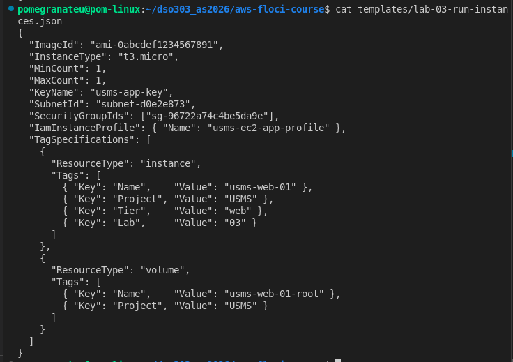

### Steps 8 and 9: launch usms-web-01 and wait

One `run-instances` call combined a subnet and security group from Lab 2, an instance profile from Lab 1, and a key pair and user data from this lab. It returned `i-68c4cb27d85e381e8`.

**Floci limitation:** the waiter took **2 minutes 45 seconds** (the lab expects about 2 seconds on Floci; real AWS takes 30 to 60). Floci starts a real Docker container, and the first launch pulled the Amazon Linux 2023 image.

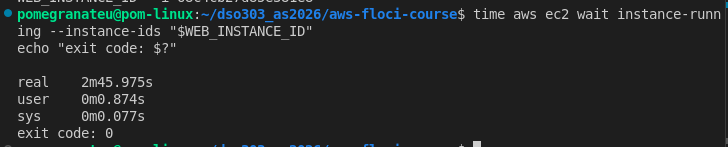

### Step 10: read the instance back

| Field | Result | Expected on real AWS |
|---|---|---|
| State | running | running |
| Subnet | subnet-d0e2e873 (public-a) | same |
| AZ | us-east-1a | same |
| Security group | usms-app-sg | same |
| Instance profile | usms-ec2-app-profile ARN | same |
| Private IP | 172.20.0.3 | an address in 10.0.1.0/24 |
| Public IP | 127.0.0.1 | an auto-assigned public address |

**Floci limitation:** the instance is a Docker container, so its private address comes from Docker's bridge network (`172.20.0.x`), not from the subnet's CIDR, and the "public" address is the localhost port mapping. The subnet association is tracked as metadata.

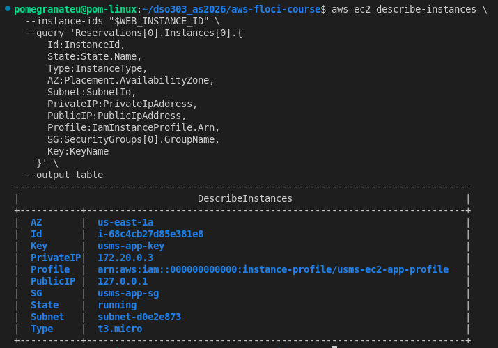

### Step 11: trace the permission chain

Instance → `usms-ec2-app-profile` → `usms-ec2-app-role` → `USMSStudentDataReadWrite`. The policy document grants list, get, put and delete-object on `arn:aws:s3:::usms-student-data` and denies `s3:DeleteBucket`. That bucket does not exist until Lab 4, which is valid: an IAM policy is a statement about ARNs, so it has no effect until something appears at that ARN. (My Lab 1 policy also includes `s3:DeleteObject` and `s3:GetBucketLocation`, which the lab text does not mention.)

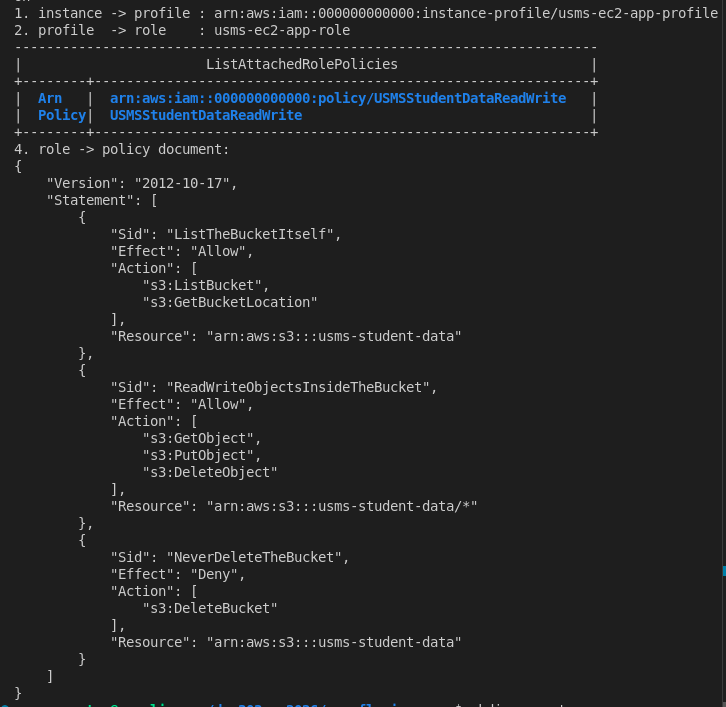

### Step 12: prove the user data arrived

**Floci limitation:** `describe-instance-attribute --attribute userData` returns no `UserData` field at all, so the lab's base64 round-trip and byte-for-byte `diff` could not be done through the API. The first attempt printed `MISMATCH` because `None` was decoded as garbage; those files were deleted and the result is not claimed as a pass.

Instead I inspected the container Floci created (`floci-floci-course-ec2-<instance-id>`). This showed that Floci **did execute the script**, contrary to the lab's expectation:

- `/var/log/usms-bootstrap.log` existed (22,113 bytes) and contained the `set -x` trace with 20 command lines.
- `nginx` was installed (`/usr/sbin/nginx`), so `dnf install` ran.
- No `/var/lib/cloud`: Floci runs the script itself, not through cloud-init.
- The metadata calls returned empty values (`TOKEN=`). Floci serves metadata at `172.20.0.2:9169` (an environment variable in the container), not at `169.254.169.254`, where the script points.
- `systemctl enable --now nginx` failed ("System has not been booted with systemd"), so nginx never started.
- `health.json` and `index.html` were written with **blank** instance, AZ and address fields.

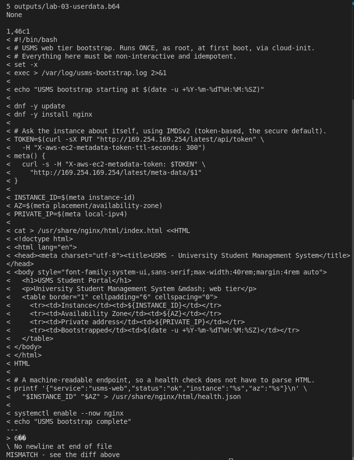
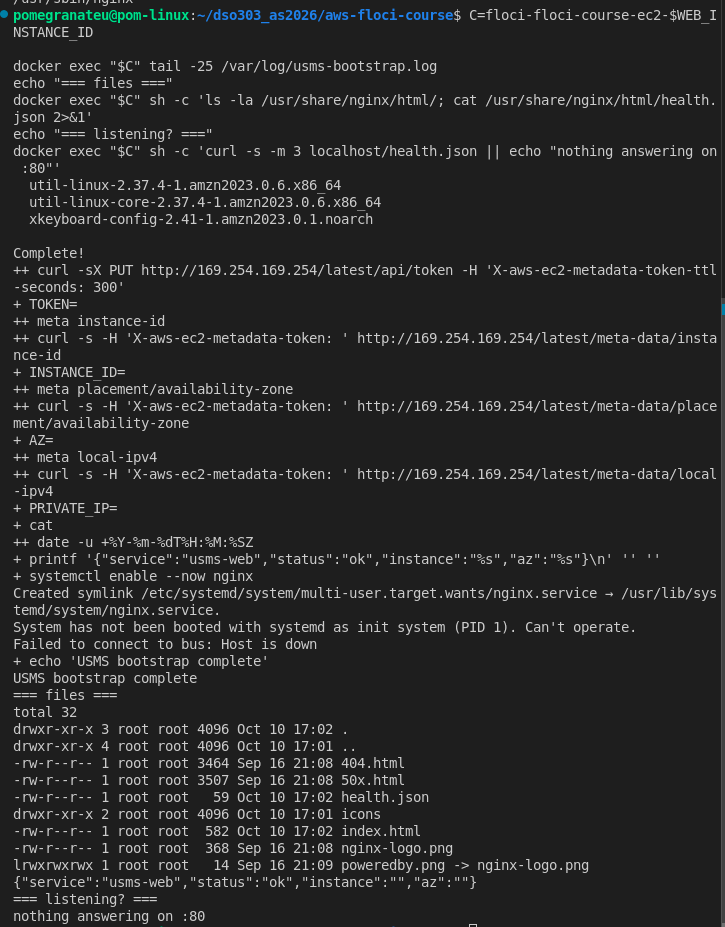
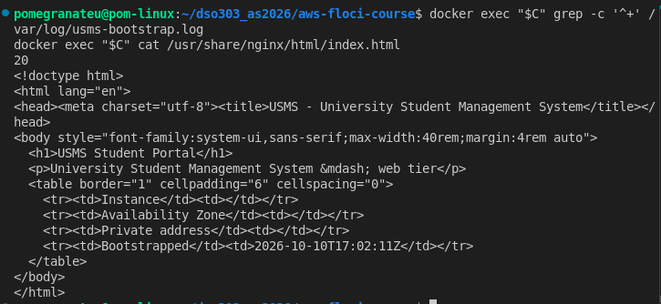

### Step 13: Elastic IP

Allocated `eipalloc-f918a282f7ceb3295` and associated it (`eipassoc-08c2a5ef1a0657b43`), address 54.205.147.173.

**Floci limitation:** the association is recorded on the address, but the instance's own `PublicIpAddress` still reads `127.0.0.1`. Real AWS would swap in the Elastic IP and release the auto-assigned address, and the Elastic IP would be routable.

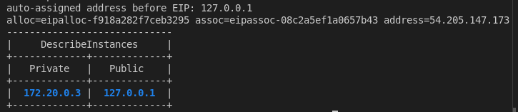
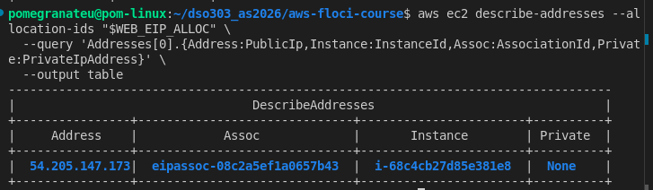

### Step 14: test the application

The request to the Elastic IP timed out. A request to `127.0.0.1:80` was answered by an unrelated service on my laptop (a sign-in redirect), **not** by `usms-web-01`, so it is not counted as evidence. Inside the container nothing was listening on port 80.

All six configuration checks passed:

| # | Check | Result |
|---|---|---|
| 1 | Instance running | running |
| 2 | Subnet route to an internet gateway | igw-780eb8b7 |
| 3 | Gateway attached | available |
| 4 | Security group admits tcp/80 | 0.0.0.0/0 |
| 5 | Public address present | 127.0.0.1 (Floci port mapping) |
| 6 | NACL | acl-91b5b3ef9c2b00d9d (default, allow all) |

Every AWS-side property is correct; the seventh link, a process listening on port 80, fails because `systemctl` cannot run in a container. This is the class of fault configuration checks cannot detect.

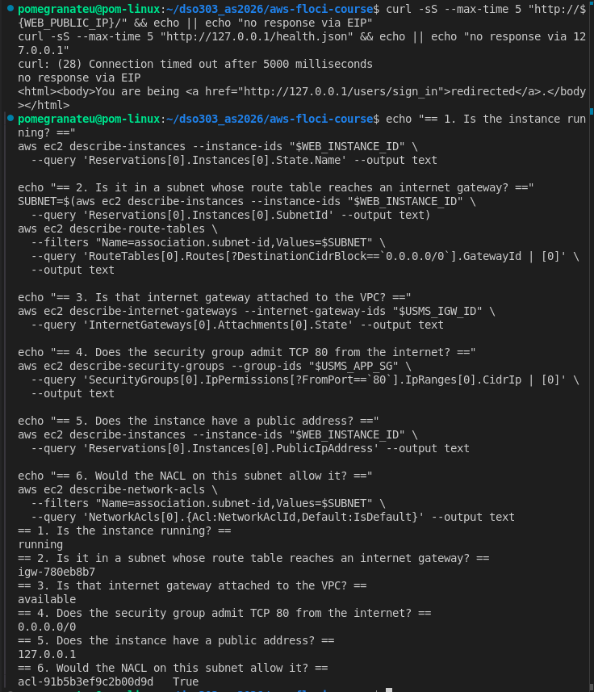

### Step 15: data volume, and the Availability Zone test

Created `vol-48749885766e1a8dc` (8 GiB gp3) in us-east-1a, the same AZ as the instance, derived from the instance rather than typed.

**Floci limitation:** `attach-volume` returns `UnsupportedOperation`, so the volume is not attached and its `DeleteOnTermination` cannot be shown. The root volume correctly shows `DeleteOnTermination = True`. The "your turn" cross-AZ attach test also returned `UnsupportedOperation` instead of `InvalidVolume.ZoneMismatch`; the test volume was deleted and confirmed gone. **Conceptual:** real AWS rejects a cross-AZ attach because a volume lives in one AZ's storage fabric; only a snapshot, which is regional, can move data between AZs.

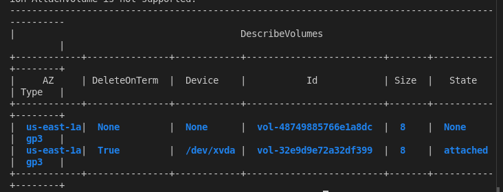

### Steps 16 and 17: the database tier and its wiring

Launched `usms-db-01` (`i-4fe69d1237fb2fc6a`) into usms-private-subnet-a with `usms-db-sg` and no instance profile (deliberate). `MapPublicIpOnLaunch` on the private subnet is `False`.

**Floci limitation:** the instance still shows `127.0.0.1` as a public address (Docker's port mapping); real AWS would show none.

Wiring: the API cannot show the source group of the 5432 rule (`UserIdGroupPairs` and `ReferencedGroupInfo` are empty on this build), and two identical 5432 rules exist, left over from Lab 2 (`revoke-security-group-ingress` is a no-op on Floci). Proof was therefore made from the submitted rule file: `policies/usms-db-sg-ingress.json` names `sg-96722a74c4be5da9e`, the group `usms-web-01` carries, and zero rules admit 5432 by CIDR. This is stated as "matches intent per the rule file", not as an API read-back. The private route table's default route targets `nat-7704d7218e8782ddc`, not an internet gateway, which is why the instance is unreachable from the internet even if its security group were opened.

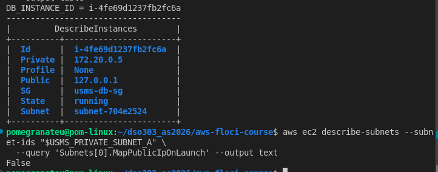
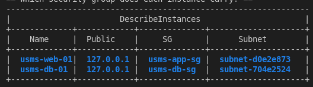
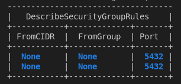
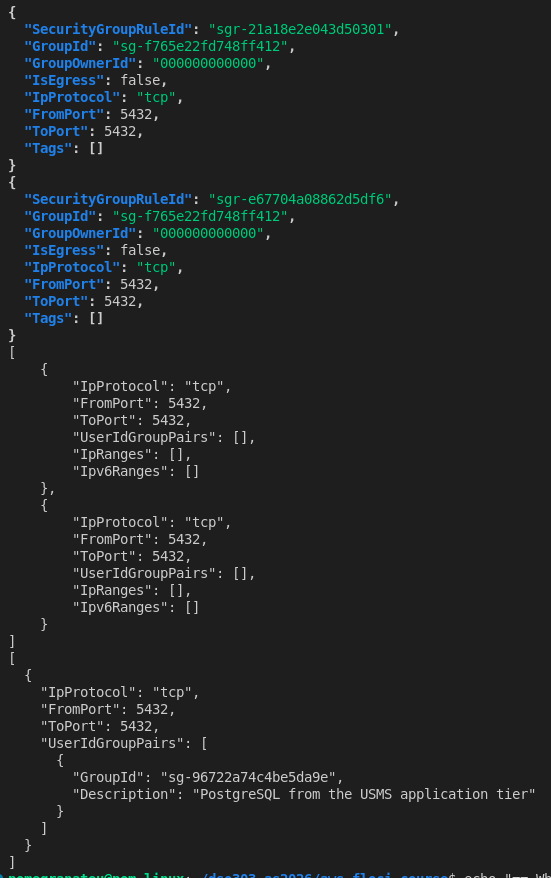
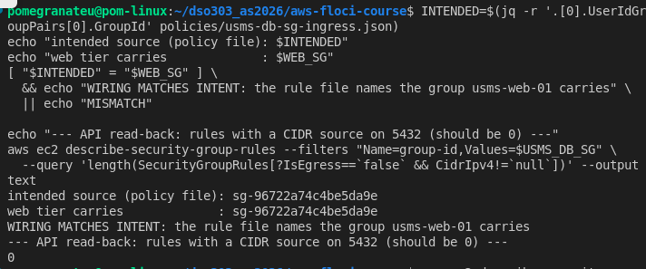
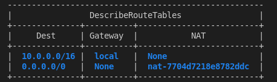

### Step 18: stop and start the web server

Instance ID, private IP (172.20.0.3) and the Elastic IP association all survived a stop/start. **Floci limitation:** the public address field stayed `127.0.0.1` throughout, so the release of an auto-assigned address on stop was not observable (conceptual: on real AWS it is released and an Elastic IP is kept, which is why a DNS record needs an Elastic IP).

I also launched `usms-web-02` (`i-9a2d1283522be5e45`) into usms-public-subnet-b from a copy of the request file; the two instances sit in us-east-1a and us-east-1b with `usms-app-sg`.

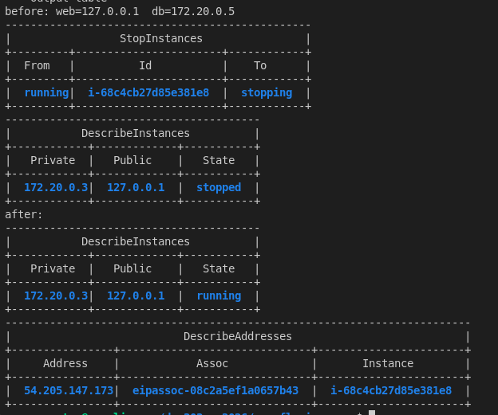
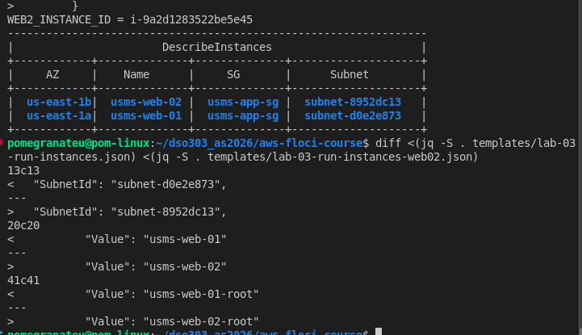

### Step 19: persistence across a Floci restart

I recorded the three instances before the restart, restarted Floci, and read them back **by tag**. The first read-back **failed** (`PERSISTENCE FAILED`): `usms-web-02` was missing.

Diagnosis: the records, subnets, tags and security groups all persisted, but runtime state did not. web-02 came back `stopped`, and web-01 was reported `running` while its container had exited (code 137, killed at shutdown). db-01's container survived. I recovered with `start-instances` for web-02 and a stop/start for web-01 (nothing terminated), and the re-run matched the baseline (`PERSISTENCE PROVEN after recovery`). The Elastic IP association survived. **Floci limitation:** web-01's private IP changed to 172.20.0.4 when its container was recreated; real AWS keeps a private address for the life of the instance. Volume count by `Project=USMS` tag was 1 and Elastic IP count 2, because root volumes ignore tags (see section 5).

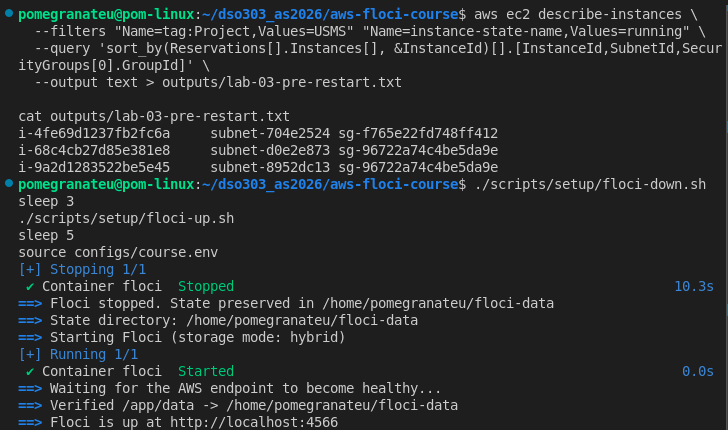
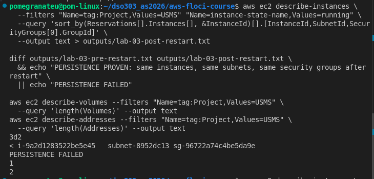
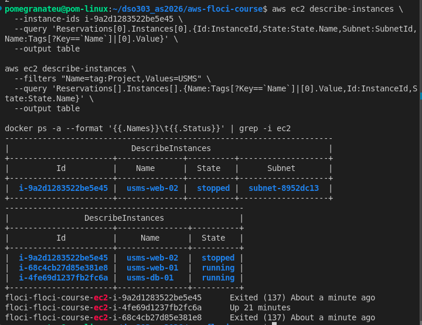
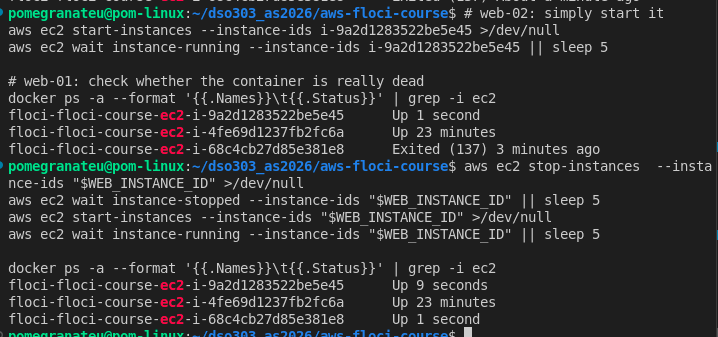
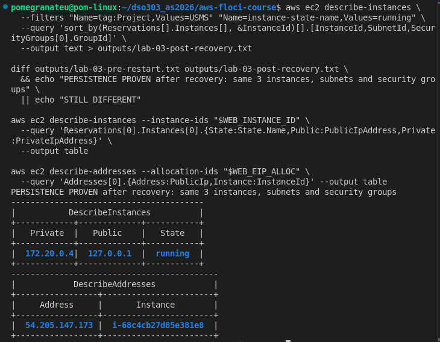

### Step 20: AMI from the configured instance

`create-image` returned `UnsupportedOperation`, so no `usms-web-golden` AMI exists. I did not fake one. **Conceptual:** on real AWS it snapshots the root volume; `--no-reboot` keeps the instance up at the cost of a crash-consistent image, fine for static files and not for a database. Lab 8 will fall back to the base image plus user data.

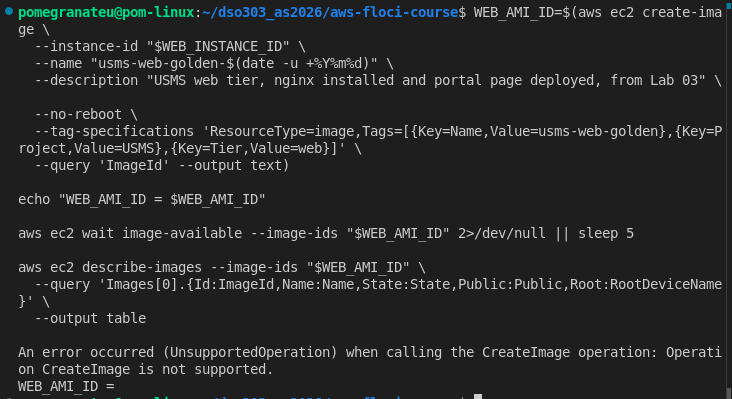

### Steps 21 to 23: audit, env file and commit

The audit listed three web/data instances (later five), four volumes, two Elastic IPs and no images. Root volumes have no `Name` even after `create-tags`. `configs/lab-03.env` was written by tag lookup, with `USMS_WEB_AMI=unavailable-floci-create-image` recorded honestly instead of an empty value, plus `USMS_WEB2_INSTANCE` and `USMS_BASE_AMI`. Committed as `9c30518` and pushed.

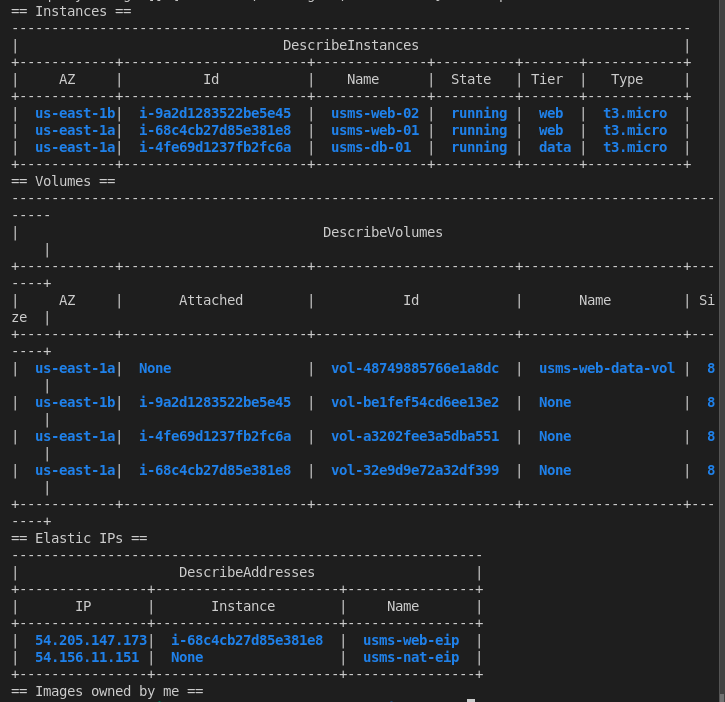
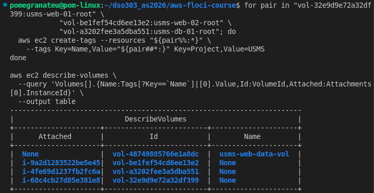
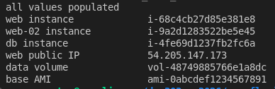

---

## 5. Floci limitations found

| # | Behaviour on Floci | Real AWS |
|---|---|---|
| 1 | SSM public parameter returns `ParameterNotFound` | Returns the latest AMI ID |
| 2 | Dummy key, zero fingerprint, `Type` None | Real RSA key and fingerprint |
| 3 | Launch takes about 2m45s (real container, image pull) | 30 to 60 s |
| 4 | Private IP is Docker's (`172.20.0.x`), public IP is `127.0.0.1` | Private IP from the subnet CIDR, real public IP |
| 5 | `describe-instance-attribute userData` returns nothing | Returns the base64 blob |
| 6 | User data runs once in the container, but metadata is at a non-standard address, there is no systemd, so nginx never started | cloud-init runs the script with working IMDS and systemd |
| 7 | Elastic IP associates but the instance's public address does not change; not routable | Instance gets the Elastic IP; routable |
| 8 | `attach-volume` unsupported | Attaches; `DeleteOnTermination` False |
| 9 | Root volumes ignore tags (`TagSpecifications` and `create-tags`) | Tagged |
| 10 | Security group source group not returned; duplicate 5432 rule cannot be revoked | Group reference returned; revoke works |
| 11 | After a Floci restart: web-02 `stopped`, web-01 reported running with a dead container, private IP changed | Instances run independently of the control plane |
| 12 | `create-image` unsupported | Creates an AMI and snapshot |
| 13 | Failed launches leave their root volumes `in-use` | Deleted with the terminated instance |
| 14 | SSH host-port allocator restarted at 2200 after the restart and collided with live containers (see Exercise 1) | No host-port allocation |
| 15 | `describe-instance-credit-specifications` unsupported | Returns standard or unlimited |

---

## 6. Verification

`./scripts/utilities/verify-lab-03.sh` reports **PASS=32 FAIL=5**. All five failures are labelled `[floci]` and have known causes: user data not readable through the API, data volume not attached, `DeleteOnTermination` not shown, db-01 public address reported as 127.0.0.1, and no golden AMI. No unlabelled check fails. The result was identical after the Exercise 4 cleanup.

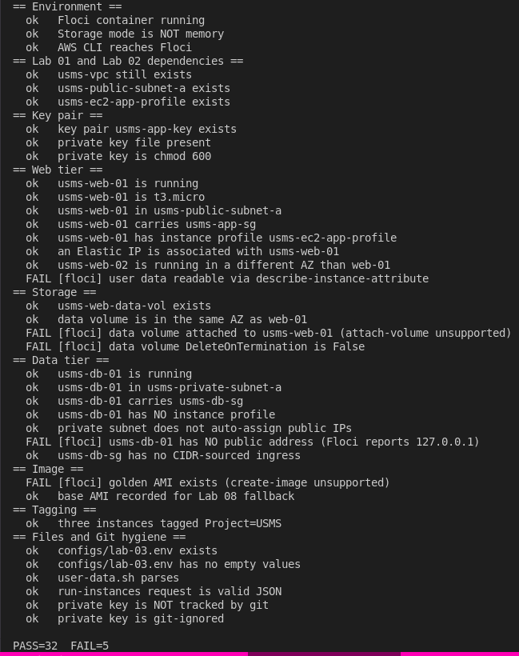

---

## 7. Independent exercises

### Exercise 1: maintenance instance

Launched `usms-admin-01-host` (`i-64b67d0ab35000c43`) in usms-public-subnet-b with the long command form and a waiter, no instance profile, tagged `Ephemeral=true`. The first three launches (`i-df96153d…`, `i-553dde39…`, `i-0f5622fc…`) returned an ID and then ended `terminated` with an empty `StateReason`. Floci's log showed `Bind for 0.0.0.0:2200/2201/2202 failed: port is already allocated`: after the Step 19 restart Floci's SSH port counter restarted at 2200 while recovered containers still held those ports. The fourth launch used a free port and succeeded.


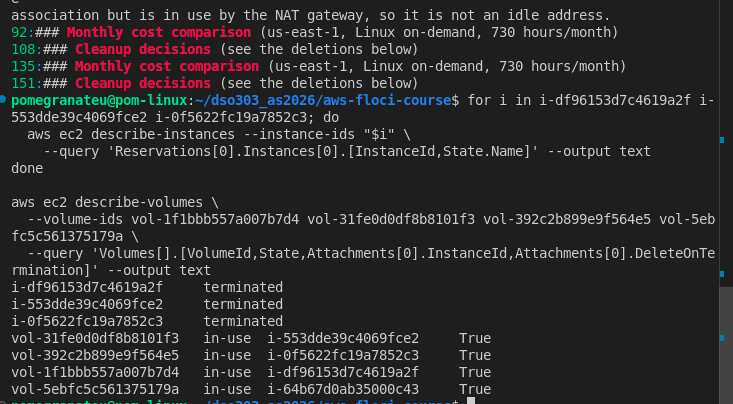
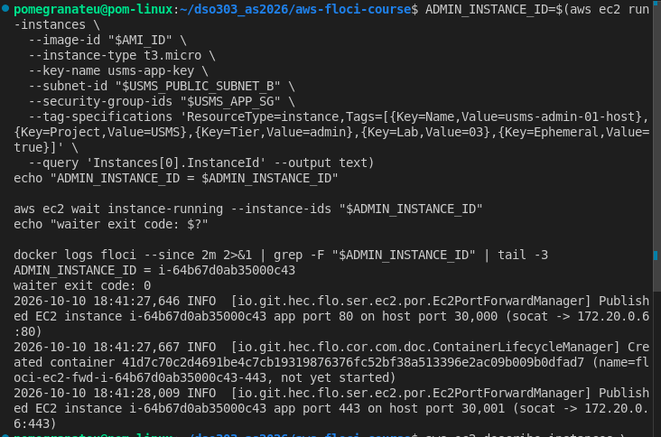
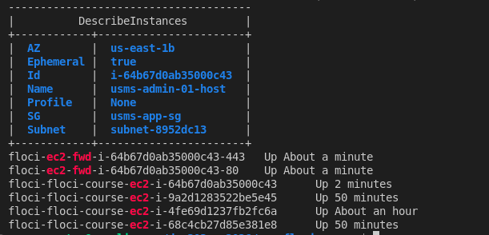

### Exercise 2: self-describing bootstrap

`user-data-db.sh` installs PostgreSQL, creates a `usms` database, writes a marker with the instance ID and timestamp, and exits early if the marker exists. Launched `usms-db-02` in usms-private-subnet-b. The script falls back to `AWS_EC2_INSTANCE_ID` because metadata is not reachable. The marker was written (`i-d1df284410caddffb 2026-10-10T18:59:03Z`) and a second run printed "already done, exiting" with the marker unchanged. **The `usms` database was not created**: `postgresql-setup --initdb` and `systemctl` failed (no systemd) and `sudo` is absent; the marker is still written because the script has no `set -e`. A first idempotence test ran before the original bootstrap finished, so it started a second concurrent run, which shows that a marker protects only after the first run completes (a lock would close the gap). Byte-identity through the API was not possible (limitation 5).

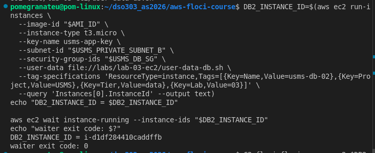
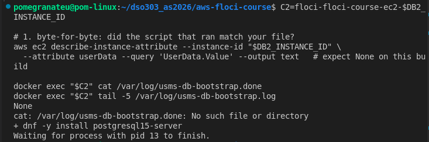

### Exercise 3: reachability report

`lab-03-reachability.sh` computes a verdict from the subnet's route table and the security group, not from names or tags. Output was identical from `~` and from `labs/lab-03-ec2/`. web-01, web-02 and the admin host were REACHABLE; db-01 and db-02 were UNREACHABLE ("no igw route on subnet") even though Floci gives them `127.0.0.1`. The NO-ADDRESS branch cannot trigger on Floci. `set -e` is deliberately off so one missing field does not abort the report.

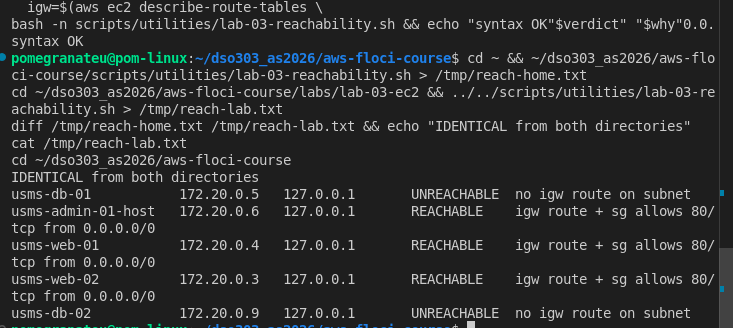

### Exercise 4: right-size and clean up

Written analysis in `exercises.md`: scale out, not up, because it can reduce overnight cost and removes the single point of failure. A t3.micro at 85 percent sustained either throttles or accrues unlimited-mode surcharges. Cost table (us-east-1, Linux on-demand, 730 h): t3.micro 7.59, t3.medium 30.37, 2 x t3.small 30.37, scheduled 2 x t3.small about 22.78 USD per month. Prices come from third-party trackers (doit.com, Holori) and the AWS News Blog for the public IPv4 charge, and should be re-checked on the AWS pricing page. Deleted: the admin host, and three orphaned root volumes left by the failed launches. Kept: the data volume, both Elastic IPs (`usms-nat-eip` looks unassociated but is in use by the NAT gateway) and `usms-db-02`. `verify-lab-03.sh` was unchanged at PASS=32 FAIL=5.


### Exercise 5: S3 hand-off for Lab 4

`transcript-upload.sh` takes a student ID and a file, validates both (exit 64 for usage or a bad ID, 66 for an unreadable file), contains no credential variables, and uploads to `s3://usms-student-data/transcripts/<id>/<file>`. `USMS_BUCKET_NAME` already exists in `lab-01.env`, so it was not added to `lab-03.env`. `usms-app-sg` has one egress rule, all protocols to 0.0.0.0/0, the default; that unwritten rule is what lets the S3 call leave the instance, and the reply returns because security groups are stateful.

`outputs/lab-03-s3-readiness.txt` records the chain and the `head-bucket` failure, which is expected because the bucket does not exist yet. The recorded result:

```
== aws s3api head-bucket --bucket usms-student-data ==
An error occurred (404) when calling the HeadBucket operation: Not Found
exit code: 254
```

Exit code 254 is the AWS CLI's code for a failed service call, and the 404 means the bucket does not exist yet (Lab 4 creates it). The check was run from the host with Floci's root credentials, so it proves only that the bucket is absent; the upload itself could not be run end to end because Floci does not deliver profile credentials to instances.


---

## 8. Review questions

Answered in prose in `notes/lab-03-notes.md` (questions 1 to 7).

## 9. Reflection

The most useful result of this lab was a failure. Every create call appeared to succeed, but the read-backs caught what did not: user data that ran but produced a blank page, an Elastic IP that was recorded but never reached the instance, launches that returned IDs and ended terminated, and a restart that left two instances not running. The six-link reachability list is also worth keeping: every AWS-side link was correct and the service was still down, because the one link configuration cannot show is whether a process is listening.

## 10. Screenshot checklist

| File | Taken |
|---|---|
| lab03-01 to lab03-05 | |
| lab03-06 to lab03-12 | |
| lab03-13 to lab03-16 | |
| lab03-17 to lab03-21 | |
| lab03-22 | |
| lab03-23 to lab03-28 | |

## 11. Commits

`9c30518` (Lab 03 main), `5b87b2d` (review answers), `52e6cbb` and `64bb778` (Exercise 3), `ba777c9` (Exercise 4), `a17f86a` (Exercise 5).
