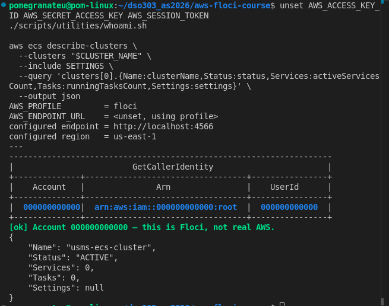
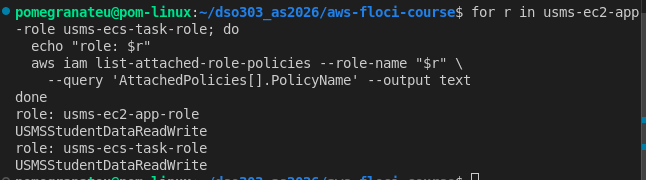
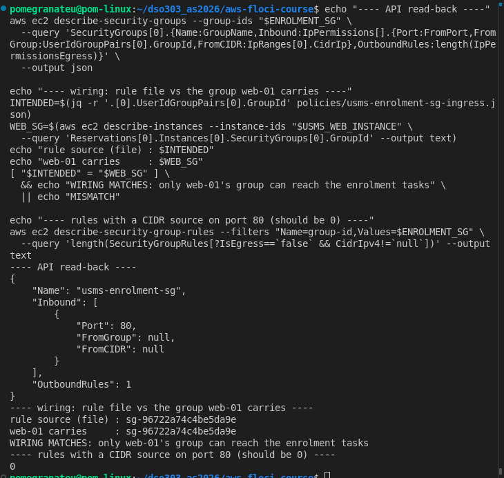
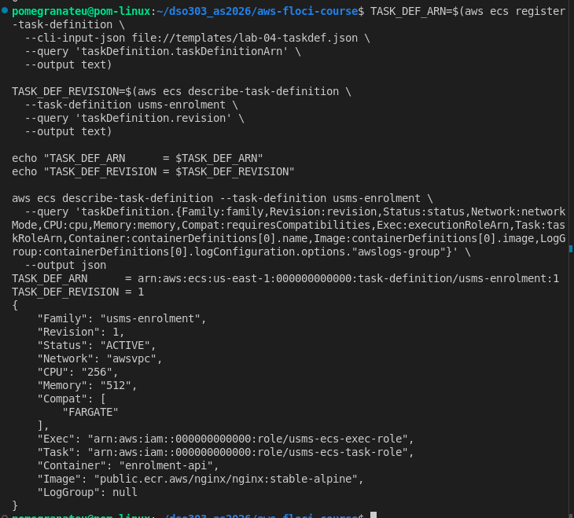
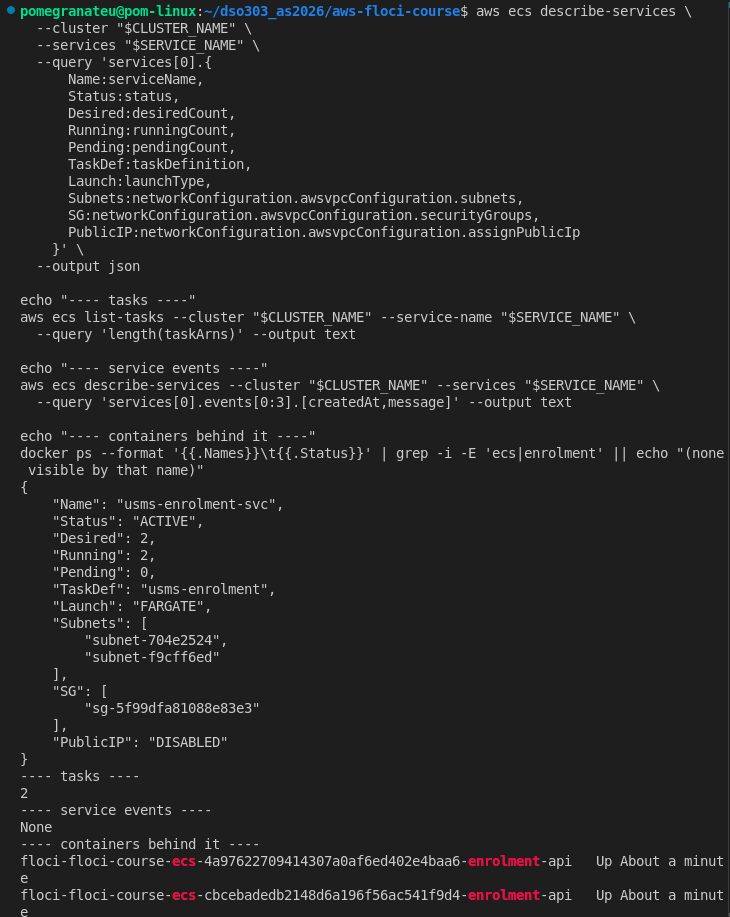
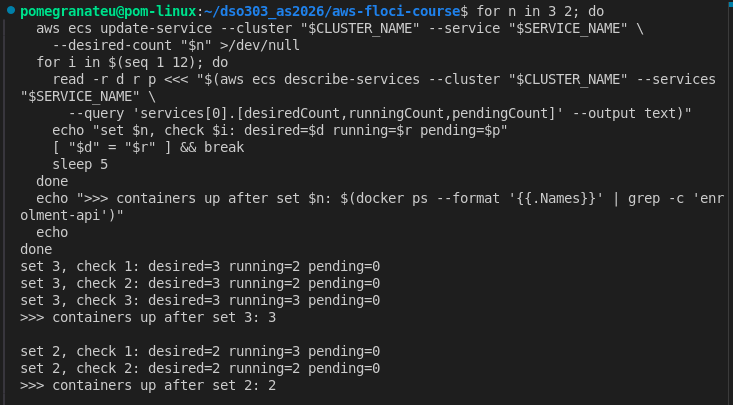
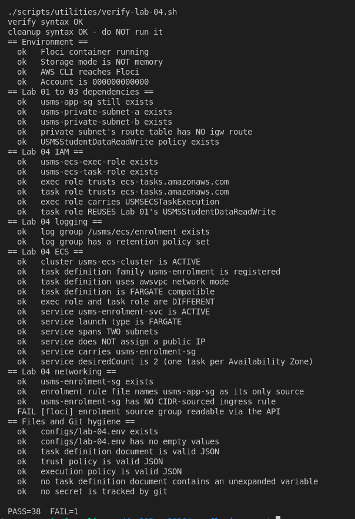
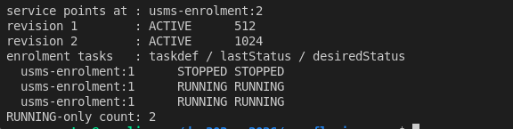
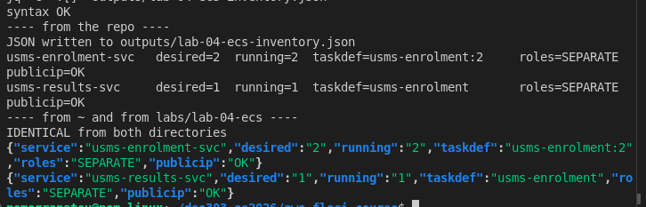
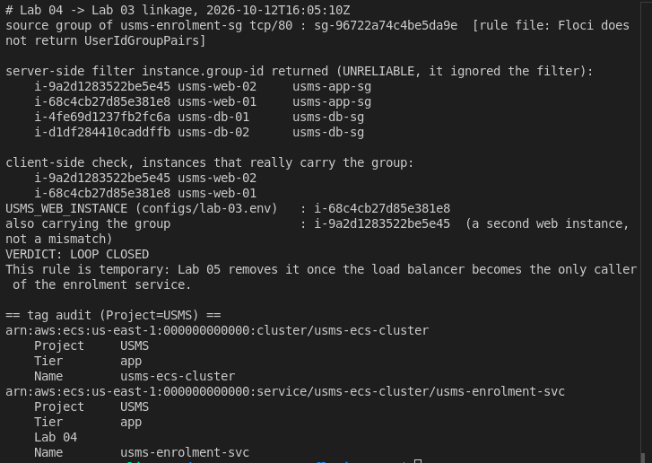

# DSO303 Lab 04: Amazon ECS and the USMS Enrolment Service

**Student:** Pema Tshering Yangchen (ID 2230295)
**Module:** DSO303 Cloud Infrastructure, College of Science and Technology, Royal University of Bhutan
**Environment:** Floci v1.5.34, AWS CLI v2.31.35, Docker Compose v2.26.1, Pop!_OS (x86_64)
**Repository:** `~/dso303_as2026/aws-floci-course` (github.com/pomegranateis/dso303_as2026)

> Screenshot placeholders look like ``. Save each screenshot under `img/` with that exact name and the image will appear. A checklist is at the end.

---

## 1. Objective

Move the USMS enrolment service onto Amazon ECS on Fargate, inside Lab 2's private subnets: a cluster, a log group, a task definition and a service that holds a fixed `desiredCount` of 2 across two Availability Zones. The lab separates the **task execution role** (which ECS uses to pull the image and write logs) from the **task role** (the application's own identity), reuses Lab 1's `USMSStudentDataReadWrite` on the task role, and sources the service's security group from the web tier's `usms-app-sg` instead of a CIDR range. What was **observed** is kept separate from what was **reasoned about**, because Floci does not model everything real AWS does.

## 2. What was built

| Resource | ID / value | Notes |
|---|---|---|
| Cluster `usms-ecs-cluster` | `arn:aws:ecs:us-east-1:000000000000:cluster/usms-ecs-cluster` | ACTIVE |
| Log group `/usms/ecs/enrolment` | 7-day retention | |
| Role `usms-ecs-exec-role` | trusts `ecs-tasks.amazonaws.com` | carries `USMSECSTaskExecution` (new, least privilege) |
| Role `usms-ecs-task-role` | trusts `ecs-tasks.amazonaws.com` | carries Lab 1's `USMSStudentDataReadWrite`, unchanged |
| Security group `usms-enrolment-sg` | `sg-5f99dfa81088e83e3` | tcp/80 from `usms-app-sg` (`sg-96722a74c4be5da9e`) only |
| Task definition `usms-enrolment` | revision 1 (256 CPU / 512 MiB), revision 2 (1024 MiB, Exercise 2) | awsvpc, FARGATE |
| Service `usms-enrolment-svc` | desired 2, subnets `subnet-704e2524` and `subnet-f9cff6ed` | `assignPublicIp` DISABLED |
| `usms-results-svc` (Exercise 1) | created, then deleted in Exercise 4 | |

Files added: `labs/lab-04-ecs/exercises.md`, `labs/lab-04-ecs/lab-04-lab03-linkage.txt`, `policies/trust-ecs-tasks.json`, `policies/usms-ecs-task-execution-policy.json`, `policies/usms-enrolment-sg-ingress.json`, `templates/lab-04-taskdef.json` (plus `-rev1.json` and `-rev2.json`), `configs/lab-04.env`, `scripts/utilities/verify-lab-04.sh`, `scripts/utilities/lab-04-ecs-inventory.sh`, `scripts/cleanup/lab-04-cleanup.sh` (not run, end of course only), `notes/lab-04-notes.md`.

## 3. How to read the results

Three labels are used. **Observed** means I saw it happen. **Conceptual** means it is reasoned from AWS behaviour and was not visible in Floci. **Floci limitation** means Floci behaved differently from real AWS, with what real AWS would do.

---

## 4. Implementation

### Steps 1 and 2: resume and confirm Labs 2 and 3

Started Floci, sourced the four env files and confirmed eight non-empty values (both private subnets, `usms-app-sg`, the VPC, the NAT gateway, `usms-web-01`, region, account). Lab 2 verification reported `PASS=32 FAIL=1`, where it had been `PASS=33 FAIL=0`. The single failure was `no secret is tracked by git`, a **false positive**: the check fails if anything under `outputs/` is tracked, and `outputs/.gitkeep` (recreated in Lab 3) is tracked on purpose. I confirmed `git ls-files outputs/` listed only `.gitkeep`, then fixed the check to ignore that one file. My first attempt with `sed` made the check always pass, which is worse than a false failure, so I replaced the line with a Python edit and re-ran: `PASS=33 FAIL=0`. Lab 3 reported `PASS=32 FAIL=5`, all five labelled `[floci]`, the same as when it was committed.

### Step 3: probe what this Floci build supports

The scripted probe marked any error as "not available", so I ran the two ambiguous calls directly. `ecs describe-services` on a missing cluster returned `ClusterNotFoundException`, a real API answer, so ECS is supported. `application-autoscaling describe-scalable-targets` returned `UnknownOperationException: AnyScaleFrontendService.DescribeScalableTargets`, so Application Auto Scaling is **not implemented**. That makes this **path B (ECS only)**, recorded at the top of `notes/lab-04-notes.md`. Nothing in this lab changes; Lab 6 needs its documented fallback.

### Step 4: create the cluster as the developer role

Assumed `usms-developer-role` (Floci names the session `floci-session` where real AWS shows the name I passed), created `usms-ecs-cluster` with Container Insights requested, then unset the three credential variables and confirmed I was root again. `describe-clusters` showed `ACTIVE`, 0 services, 0 tasks.

**Floci limitation:** `Settings` came back `null`. Floci accepted `containerInsights=enabled` but does not return it, so Lab 6 cannot rely on the `AWS/ECS` CPU and memory metrics here and would need a custom metric.

### Step 5: the log group

`/usms/ecs/enrolment` created with 7-day retention (`put-retention-policy` is a separate call). `describe-log-groups` showed `Retention 7`.

### Steps 6 and 7: the two roles

Wrote one trust policy (`ecs-tasks.amazonaws.com`, not the common typo `ecs.amazonaws.com`) and used it for both roles. The execution role got a new least-privilege policy, `USMSECSTaskExecution`: ECR pull actions with `Resource: "*"` (`ecr:GetAuthorizationToken` takes no resource) and `logs:CreateLogStream` / `logs:PutLogEvents` scoped to the single log group, where AWS's managed execution policy allows any log group. The task role got Lab 1's `USMSStudentDataReadWrite`.

My first attach failed with `NoSuchEntity` because `USMS_POLICY_S3_RW` in `lab-01.env` already holds a full ARN, so the guide's command doubled the prefix (`policy/arn:aws:iam::...:policy/USMS...`). I fixed it by using the value as it is. `iam list-entities-for-policy` is unsupported, so I proved the reuse by asking each role: both `usms-ec2-app-role` (Lab 3) and `usms-ecs-task-role` list `USMSStudentDataReadWrite`.

The policy document is the one Lab 3 printed: list and get-location on the bucket, get/put/delete-object inside it, and an explicit deny on `s3:DeleteBucket`. The bucket does not exist yet, so neither chain has any effect until a later lab creates it.

**Floci limitations:** `list-entities-for-policy` is unsupported; Floci does not serve task-role credentials to containers (stated in the lab text, **not tested by me**), so the association is verified through the task definition and `iam get-role` and not by calling S3 from a task.

### Step 8: the enrolment security group

Created `usms-enrolment-sg` and one inbound rule, tcp/80, whose source is a **group** (`usms-app-sg`), not a CIDR. The heredoc was unquoted so `$USMS_APP_SG` expanded, and `grep -c '\$'` printed 0.

Verification: the API read-back returned `FromGroup: null` and `FromCIDR: null`, the same Floci quirk as Lab 3, so the wiring was proven another way. The rule file names `sg-96722a74c4be5da9e`, web-01 carries `sg-96722a74c4be5da9e` (`WIRING MATCHES`), and zero rules have a CIDR source. `OutboundRules` is 1, the default allow-all egress that Step 10 relies on.

### Step 9: the task definition

Wrote `templates/lab-04-taskdef.json` with an unquoted heredoc (valid JSON, zero literal `$`), registered it as `usms-enrolment:1`: awsvpc, FARGATE, 256 CPU / 512 MiB, and **two different role ARNs** in `executionRoleArn` and `taskRoleArn`.

**Floci limitation:** the `awslogs` `logConfiguration` I sent was **not stored**. My JMESPath query for `options."awslogs-group"` returned `null`, so I read the whole `logConfiguration` field: Floci returned `null` while the file I registered holds it. Ports (80) and the three environment variables survived. On real AWS the task's stdout would go to `/usms/ecs/enrolment`; here nothing would reach the log group. The image is a stand-in (`public.ecr.aws/nginx/nginx:stable-alpine`) for the real service image that would live in a private ECR repository.

### Step 10: the service in the private subnets

Created `usms-enrolment-svc` with desired count 2 in both private subnets, `assignPublicIp=DISABLED`, `--enable-ecs-managed-tags --propagate-tags SERVICE`. The ARN has the shape `service/usms-ecs-cluster/usms-enrolment-svc`, which Lab 6's scalable target needs. `runningCount` reached 2 on the third five-second poll.

**Conceptual:** the tasks sit in private subnets with no route to the internet gateway, yet must reach `public.ecr.aws`. That works only because Lab 2's private route table sends `0.0.0.0/0` to the NAT gateway, which sits in a public subnet with an Elastic IP; layer data also flows through the S3 endpoint. Without the NAT gateway the service would create successfully and every task would fail on the image pull.

### Step 11: read the service back, and scale by hand

`ACTIVE`, FARGATE, desired 2, running 2, pending 0, both private subnets, `usms-enrolment-sg`, public IP DISABLED. `list-tasks` returned 2, and `docker ps` showed two real containers named `floci-floci-course-ecs-<id>-enrolment-api`, both `Up`.

**Your turn:** set the desired count to 3, then back to 2. The service followed in about ten seconds each way and the container count followed it (3, then 2). I did by hand exactly what a scaling policy will later do.

**Floci limitations:** `describe-services` returns `events` as `None` (no service narration, so there is no event trail to cite); the task definition is shown as the family name without a revision for a service created without one.

### Steps 12 and 13: `configs/lab-04.env` and the first commit

`configs/lab-04.env` has 17 exports, every value looked up from the API (so a populated value proves the resource exists). `grep` for empty values or `None` found nothing, and `baseline desired` read 2, which is why the manual scale had to end at 2. Before committing I checked `git status` (nothing under `outputs/`), `git check-ignore -v outputs/lab-04-assumed-role.json` (ignored by `outputs/*`) and `git ls-files outputs/` (only `.gitkeep`). Commit `dd3544d`.

---

## 5. Floci limitations found

| # | Behaviour on Floci | Real AWS |
|---|---|---|
| 1 | Application Auto Scaling not implemented (`UnknownOperationException`) | Full service; Lab 6 builds on it |
| 2 | `containerInsights` setting accepted but `Settings` returns `null` | Setting returned; CPU and memory metrics published |
| 3 | `iam list-entities-for-policy` unsupported | Lists the roles holding a policy |
| 4 | Task definition `logConfiguration` not stored (`null`) | Stored; task logs go to the log group |
| 5 | `describe-services` events list is `None` | Narrates placement, start and stop events |
| 6 | Service created without a revision stores the bare family name | Pinned to a concrete revision at creation |
| 7 | `UserIdGroupPairs` not returned for a group-sourced rule | Returned by `describe-security-groups` |
| 8 | `describe-services` returns no `deployments` list | PRIMARY and ACTIVE deployments reported |
| 9 | Running tasks not replaced by `update-service` or `--force-new-deployment` | Rolling replacement bounded by min/max healthy percent |
| 10 | `list-tasks` with no status filter returns a stale `STOPPED` record | Returns RUNNING tasks only by default |
| 11 | `instance.group-id` filter on `describe-instances` is ignored (returned instances carrying other groups) | Returns only instances carrying the group |
| 12 | Tasks run as Docker containers and start in about ten seconds, with no SSH or network enforcement | 20 to 60 s start on real hardware; security groups enforced on every packet |

---

## 6. Verification

`./scripts/utilities/verify-lab-04.sh` reports **PASS=38 FAIL=1**. The single failure is labelled `[floci]`: the enrolment group's source cannot be read back through the API (limitation 7). The same wiring is proven by two real checks that pass: the rule file names `usms-app-sg`, and the group has no CIDR-sourced ingress rule. I changed three things from the lab text: the `outputs/` check ignores `.gitkeep` (same false positive as Lab 2), the private-route-table check looks the table up through the subnet instead of a variable my env files may not define, and the group-source check is split into those two real checks plus the labelled `[floci]` read-back. The result was unchanged after the Exercise 4 deletion. `scripts/cleanup/lab-04-cleanup.sh` passes `bash -n` and **has not been run**.

---

## 7. Independent exercises

The full write-ups, commands, outputs and sources are in [`exercises.md`](exercises.md). Summary:

1. **Second service.** `usms-results-svc` (desired 1) created from the same task definition and group. `describe-services` showed two `ACTIVE` services with different names and counts.
2. **New revision.** `usms-enrolment:2` (memory 1024, `USMS_LOG_LEVEL=info`) registered from a `jq` copy, the service pointed at it, revision 1 still `ACTIVE` at 512 MiB. The running tasks stayed on `:1` even after a forced deployment, which Floci does not perform.

3. **Inventory script.** `lab-04-ecs-inventory.sh` computes `roles` and `publicip` verdicts from live configuration, prints `N/A` rather than crashing when a service has no network configuration (tested against a mock cluster), and gave identical output from `~` and from `labs/lab-04-ecs/`.

4. **Capacity plan.** A written plan with derived numbers: minimum 2, a scheduled floor of 6 on Monday 07:45 to 09:00, maximum 10, and target tracking on request count per task. The assumptions (3,000 students, 25 requests per second per task) are labelled as assumptions. The scheduled plan costs $18.29 a month against $18.02 for today's fixed 2 and $54.06 for a fixed 6, using AWS's published Fargate rates (read 2026-10-12, to be re-checked before submission). The Exercise 1 service was deleted after a danger notice, and verification was unchanged.
5. **Close the loop to Lab 3.** The enrolment rule's source group resolves to `usms-web-01` (the instance in `configs/lab-03.env`) and also to `usms-web-02`. `LOOP CLOSED`. The server-side `instance.group-id` filter was ignored by Floci (it returned the two database instances as well), so I kept that result as evidence and used a client-side check. The tag audit showed `Project=USMS` on the cluster and the service.

## 8. Review questions

Answered in prose in `notes/lab-04-notes.md`.

## 9. Reflection

Three things stood out. First, the two roles look almost identical on paper (same trust policy, both ending in an ARN in the task definition) but fail in completely different ways, so keeping them separate is what makes a failure diagnosable. Second, the security group rule names a group, not an address range, because tasks have no stable addresses and the web tier will change too. That was easy to say and also checkable (the rule file, the group web-01 carries, and zero CIDR rules). Third, Floci kept confirming the shape of the configuration while quietly dropping parts of it: the log configuration, the deployment record, the group source. Reading the field back after every step caught the log configuration being dropped, which a successful `register-task-definition` message would not have told me.

## 10. Screenshot checklist

`lab04-01-support-probe`, `lab04-02-cluster`, `lab04-03-policy-reuse`, `lab04-04-enrolment-sg`, `lab04-05-taskdef`, `lab04-06-service`, `lab04-07-manual-scale`, `lab04-08-verify`, `lab04-09-ex2-revisions`, `lab04-10-ex3-inventory`, `lab04-11-ex5-linkage`, all `.png`, in `labs/lab-04-ecs/img/`.

## 11. Commits

`983923e` verify-lab-02 `.gitkeep` fix, `dd3544d` Lab 04 main (cluster, task definition, roles, group, service, env file), `53d1fd7` verification and cleanup scripts, `b704ba8` exercises 1 to 5.
