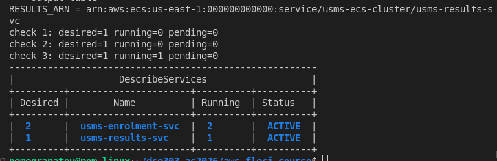
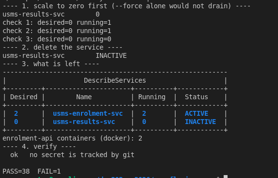

# Lab 04 - Independent Lab Exercises

Environment: Floci v1.5.34, AWS CLI v2, cluster `usms-ecs-cluster`, support path B (ECS only; Application Auto Scaling not implemented).

Labels used throughout: **Observed** (seen in command output), **Conceptual** (reasoned about real AWS, not run), **Floci limitation** (this emulator behaves differently from real AWS).

---

## Exercise 1 - Basic: a second service, deployed

Created `usms-results-svc` from the existing `usms-enrolment` task definition family, desired count 1, in both private subnets, carrying `usms-enrolment-sg`. Every ID came from a lookup (`describe-subnets` and `describe-security-groups` filtered on the `Name` tag, captured with `$(...)` and `--query`), nothing was copied by hand, and the service was not added to `configs/lab-04.env`.

```bash
PRIV_A=$(aws ec2 describe-subnets --filters "Name=tag:Name,Values=usms-private-subnet-a" --query 'Subnets[0].SubnetId' --output text)
PRIV_B=$(aws ec2 describe-subnets --filters "Name=tag:Name,Values=usms-private-subnet-b" --query 'Subnets[0].SubnetId' --output text)
ENR_SG=$(aws ec2 describe-security-groups --filters "Name=tag:Name,Values=usms-enrolment-sg" --query 'SecurityGroups[0].GroupId' --output text)

aws ecs create-service --cluster usms-ecs-cluster --service-name usms-results-svc \
  --task-definition usms-enrolment --desired-count 1 --launch-type FARGATE \
  --network-configuration "awsvpcConfiguration={subnets=[$PRIV_A,$PRIV_B],securityGroups=[$ENR_SG],assignPublicIp=DISABLED}" \
  --enable-ecs-managed-tags --propagate-tags SERVICE \
  --tags key=Name,value=usms-results-svc key=Project,value=USMS key=Tier,value=app key=Lab,value=04 key=Service,value=results \
  --query 'service.serviceArn' --output text
```

Observed: the lookups returned `subnet-704e2524`, `subnet-f9cff6ed` and `sg-5f99dfa81088e83e3`, matching Labs 2 and 4. `running` reached 1 on the third check, and `describe-services` for both services returned:

```
| Desired |        Name          | Running  | Status   |
|  2      |  usms-enrolment-svc  |  2       |  ACTIVE  |
|  1      |  usms-results-svc    |  1       |  ACTIVE  |
```

Two ACTIVE services with different names and different desired counts, as required.



**Floci limitation:** the service's task definition is stored as the bare family name (`usms-enrolment`) and not pinned to a revision. Real ECS pins a service to a concrete revision at creation. This matters in Exercise 2.

---

## Exercise 2 - Intermediate: a new revision, and a deployment that does not drop traffic

The template that produced revision 1 was kept unchanged as `templates/lab-04-taskdef-rev1.json`, and revision 2 was built with `jq` into a new file (`templates/lab-04-taskdef-rev2.json`), so nothing was edited in place.

```bash
cp templates/lab-04-taskdef.json templates/lab-04-taskdef-rev1.json
jq '.memory = "1024" | .containerDefinitions[0].environment += [{"name":"USMS_LOG_LEVEL","value":"info"}]' \
  templates/lab-04-taskdef.json > templates/lab-04-taskdef-rev2.json
diff <(jq -S . templates/lab-04-taskdef-rev1.json) <(jq -S . templates/lab-04-taskdef-rev2.json)
aws ecs register-task-definition --cli-input-json file://templates/lab-04-taskdef-rev2.json \
  --query 'taskDefinition.[family,revision,memory]' --output text
aws ecs update-service --cluster usms-ecs-cluster --service usms-enrolment-svc --task-definition usms-enrolment:2
```

Observed: the diff showed exactly two changes (memory 512 to 1024, and the new `USMS_LOG_LEVEL` entry). Registration printed `usms-enrolment 2 1024`. 1024 MiB is a valid pair with cpu 256.


Observed final state:

```
service points at : usms-enrolment:2
revision 1        : ACTIVE      512
revision 2        : ACTIVE      1024
enrolment tasks   : taskdef / lastStatus / desiredStatus
  usms-enrolment:1      STOPPED STOPPED
  usms-enrolment:1      RUNNING RUNNING
  usms-enrolment:1      RUNNING RUNNING
RUNNING-only count: 2
```

**What changes and what does not (one sentence):** the service's `taskDefinition` pointer changes from `:1` to `:2`, while revision 1 itself (immutable, still `ACTIVE`, still 512 MiB) does not change at all.

**Floci limitations found here:**

- `describe-services` returns no `deployments` list (`length(services[0].deployments)` failed with a null error on every poll). My planned stable-state test (`desired = running` and one deployment) could not be used as written, so `desired = running` was the only readable signal. Rolling deployment state cannot be observed.
- The running tasks **did not move to revision 2**, even after `update-service --force-new-deployment`. Floci moves the service's pointer but never replaces tasks. Real ECS starts new tasks on revision 2 and stops the old ones, governed by `minimumHealthyPercent` and `maximumPercent`, which is what keeps traffic from dropping (**conceptual**).
- `list-tasks` returned 3 records for a service with desired count 2. One is a `STOPPED` record left over from the scale-down in Step 11; `--desired-status RUNNING` returned 2. Real AWS applies that RUNNING filter by default.

---

## Exercise 3 - Problem solving: an ECS configuration drift report

`scripts/utilities/lab-04-ecs-inventory.sh` prints one line per service in the cluster and writes the same data to `outputs/lab-04-ecs-inventory.json`.

Design decisions:

- **No hard-coded names.** It lists services with `list-services`, then describes each one.
- **Runs from any directory.** `REPO_ROOT` is resolved from `${BASH_SOURCE[0]}`, as the verification scripts do.
- **`set -uo pipefail`, no `-e`.** An inventory must report on every service, so one service that fails to describe must not abort the run. Each failure is handled explicitly and printed as an `ERROR` line.
- **Verdicts are computed.** `roles` is `SAME` when `executionRoleArn` equals `taskRoleArn`, `SEPARATE` when both are set and differ, and `N/A` when one is missing (there is nothing to compare, and calling that `SEPARATE` would be misleading). `publicip` is `RISK` for `ENABLED`, `OK` for `DISABLED`, and `N/A` when there is no `awsvpcConfiguration`.
- **Edge cases tested before use** against a mock `aws` returning four services: a normal one, one referenced by full ARN, one with `SAME` roles and a public IP, and an EC2-launch-type service with no `networkConfiguration`. The last printed `roles=N/A publicip=N/A` without crashing.

Observed on the real cluster:

```
usms-enrolment-svc   desired=2  running=2  taskdef=usms-enrolment:2     roles=SEPARATE  publicip=OK
usms-results-svc     desired=1  running=1  taskdef=usms-enrolment       roles=SEPARATE  publicip=OK
```

Output was identical when run from `~` and from `labs/lab-04-ecs/`, and the JSON file held both records.


**Floci limitation:** `usms-results-svc` reports `taskdef=usms-enrolment` with no revision (see Exercise 1), where the enrolment service reports `:2`. The script copes with both forms.

---

## Exercise 4 - Challenge: the enrolment week capacity plan

### Why a fixed desiredCount of 2 cannot answer the 08:03 problem

`usms-enrolment-svc` reads no metric and no clock. Its `desiredCount` changes only when a person (or, in Lab 06, a scaling policy) calls `update-service`, so at 08:03 on Monday it holds the same two tasks it holds at 03:00 on a Sunday. Reacting to the spike would not be fast enough either: real Fargate takes 20 to 60 seconds to start a task, and a metric-driven policy needs the metric to move first, so capacity reacting after 08:03 arrives after the damage. The plan has to put capacity in place before 08:00 on a schedule, and use a metric to cover the remainder.

### Assumptions (replace with real data before using)

The brief gives no request numbers, so these are labelled assumptions, not facts:

- 3,000 students enrol (assumption; the Registrar has the real figure).
- Each makes 10 API requests in the window (list modules, register, confirm).
- 90 percent of those requests fall in the first 20 minutes (given in the brief).
- Burst factor of 3 within the window (assumption).
- One 256 CPU / 512 MiB task serves 25 requests per second (assumption; must be load tested).

Derivation: 3,000 x 10 x 0.9 = 27,000 requests over 1,200 s = **22.5 requests/s average**; x 3 burst = **67.5 requests/s peak**. 67.5 / 25 = 2.7, so 3 tasks just meet peak with no headroom.

### Proposed plan

| Setting | Value | Why | Cost of too high | Cost of too low |
|---|---|---|---|---|
| Minimum | 2 | One task per Availability Zone, as today; survives losing one AZ at normal load | Paying for idle tasks all year | One task and one AZ failure means an outage |
| Scheduled floor | 6, Monday 07:45 to 09:00 (Bhutan time) | 6 x 25 = 150 requests/s is 2.2x peak, and 3 tasks per AZ (75 requests/s) still covers the 67.5 peak if one AZ fails. 07:45 gives start-up time before 08:00 | About 1.25 hours of 4 extra tasks a week, a few cents | Capacity not in place at 08:03, the failure seen last year |
| Maximum | 10 | 10 x 25 = 250 requests/s, 3.7x the estimated peak, so a wrong estimate does not cause a repeat outage | A runaway policy can spend up to 5x the baseline | A bad estimate hits the ceiling and the service falls over again |
| Trigger | Target tracking on `ALBRequestCountPerTarget`, target 20 requests/s per task (80 percent of 25) | The API is I/O-bound, so CPU stays low and would not trigger scaling | Scales too early, higher cost | Scales too late, slow responses |

In UTC (Application Auto Scaling schedules default to UTC): Bhutan is UTC+6, so 07:45 is `cron(45 1 ? * MON *)` and 09:00 is `cron(0 3 ? * MON *)`.

**What I would tell the team building Lab 06's policies:** register the service as a scalable target with min 2 and max 10, add the two scheduled actions above, and add a target-tracking policy on request count per target, not CPU. Use a short scale-out cooldown and a long scale-in cooldown, so capacity arrives fast and leaves slowly. Because this build has no Application Auto Scaling (path B), this is **conceptual** here.

### Monthly cost comparison (us-east-1, Linux/x86, on-demand)

Source: [AWS Fargate Pricing](https://aws.amazon.com/fargate/pricing/), read 2026-10-12. The page lists per-second rates; the hourly figures below are those rates x 3,600: **$0.04048 per vCPU-hour** and **$0.004446 per GB-hour**. Billing is per second with a one-minute minimum.

Per task-hour (0.25 vCPU, 0.5 GB): 0.25 x 0.04048 + 0.5 x 0.004446 = **$0.012343**. Per task-month (730 hours): **$9.01**.

| Option | Task-hours/month | Monthly cost |
|---|---|---|
| Fixed at today's 2 | 2 x 730 = 1,460 | **$18.02** |
| Fixed at the proposed peak, 6 | 6 x 730 = 4,380 | **$54.06** |
| Fixed at the maximum, 10 | 10 x 730 = 7,300 | $90.10 |
| Scheduled plan (2 baseline, 6 for 1.25 h every Monday) | 2 x (730 - 5.42) + 6 x 5.42 = 1,481.7 | **$18.29** |

Monday window hours per month: (52 / 12) Mondays x 1.25 h = 5.42 h. The scheduled plan costs **$0.27 more per month** than doing nothing and **$35.77 less** than running 6 tasks all month, while covering the peak. The lab text estimates roughly USD 15 per month for two tasks; the derivation above gives $18.02, so the lab figure is approximate and the AWS rates above should be re-checked before the report is submitted.

### Cleaning up the Exercise 1 service

> **DANGER**
> **What will be deleted:** `usms-results-svc` only, the Exercise 1 practice service, and its one task.
> **What depends on it:** nothing. It shares the `usms-enrolment` task definition and `usms-enrolment-sg` with the real service, so neither is deleted.
> **Reversible?** Yes. Re-running the Exercise 1 commands recreates it.
> **Effect on later labs:** none. It is not in `configs/lab-04.env` and Labs 05 and 06 do not use it.

Dependency order: scale to 0 first (`--force` alone does not drain), then delete the service. Nothing else is touched.

```bash
aws ecs update-service --cluster usms-ecs-cluster --service usms-results-svc --desired-count 0
# poll until running=0
aws ecs delete-service --cluster usms-ecs-cluster --service usms-results-svc --force
```

Observed: `running` fell from 1 to 0 over three checks, the service went `INACTIVE`, `usms-enrolment-svc` stayed `ACTIVE` at desired 2 with 2 running, and Docker showed 2 `enrolment-api` containers. `./scripts/utilities/verify-lab-04.sh` reported `PASS=38 FAIL=1`; the single failure is the labelled `[floci]` check (the enrolment group's source cannot be read back through the API), unchanged by the deletion. I did not reach `FAIL=0` because of that Floci limitation, and I did not hide it by deleting the check.



---

## Exercise 5 - Integration: close the loop back to Lab 3, and hand Lab 05 what it needs

Goal: resolve `usms-enrolment-sg`'s only inbound source group back to the running instance that carries it, confirm it matches `$USMS_WEB_INSTANCE`, and record the result for Lab 05.

**Floci limitation 1:** `describe-security-groups` returns `UserIdGroupPairs` as null for this group, so the source group was read from the rule file (`policies/usms-enrolment-sg-ingress.json`), which I wrote and which named `sg-96722a74c4be5da9e` (`usms-app-sg`).

**Floci limitation 2, and a mistake I caught:** `describe-instances --filters "Name=instance.group-id,Values=sg-96722a74c4be5da9e"` ignored the filter and returned all four running instances, including `usms-db-01` and `usms-db-02`, which carry `usms-db-sg`. My first version took that result at face value and printed `MISMATCH`, for the wrong reason, because the list also broke my string comparison. I re-ran it with a client-side `jq` check on each instance's actual security groups, and kept the unreliable result in the file as evidence.

Final result (`outputs/lab-04-lab03-linkage.txt`, copied to `labs/lab-04-ecs/lab-04-lab03-linkage.txt` so it can be committed; `outputs/` is git-ignored by design):

```
source group of usms-enrolment-sg tcp/80 : sg-96722a74c4be5da9e
client-side check, instances that really carry the group:
    i-9a2d1283522be5e45 usms-web-02
    i-68c4cb27d85e381e8 usms-web-01
USMS_WEB_INSTANCE (configs/lab-03.env)   : i-68c4cb27d85e381e8
also carrying the group                  : i-9a2d1283522be5e45  (a second web instance, not a mismatch)
VERDICT: LOOP CLOSED
This rule is temporary: Lab 05 removes it once the load balancer becomes the only caller of the enrolment service.
```

The group resolves to `usms-web-01`, the instance recorded in `configs/lab-03.env`. It also resolves to `usms-web-02`, which Lab 3 launched into the second public subnet with the same group; that is a second carrier, not a mismatch. Lab 05 should know that removing the rule affects both web instances.


**Tag audit:** `aws ecs list-tags-for-resource` takes an ARN. The cluster returned `Project=USMS`, `Tier=app`, `Name=usms-ecs-cluster`. The service returned `Project=USMS`, `Tier=app`, `Lab=04`, `Name=usms-enrolment-svc`. Neither resource was untagged, so `tag-resource` was not needed.

---

## Floci limitations found in the exercises

| Limitation | Seen in | What real AWS does |
|---|---|---|
| Service task definition stored as a bare family name | Ex 1, 3 | Pins the service to a concrete revision at creation |
| No `deployments` list in `describe-services` | Ex 2 | Reports a PRIMARY and an ACTIVE deployment during a rollout |
| Running tasks not replaced on `update-service` or `--force-new-deployment` | Ex 2 | Rolling replacement bounded by min and max healthy percent |
| Stale `STOPPED` task record returned by `list-tasks` with no status filter | Ex 2 | `list-tasks` returns only RUNNING tasks unless told otherwise |
| `UserIdGroupPairs` not returned for a group-sourced rule | Ex 4, 5 | Returned in `describe-security-groups` |
| `instance.group-id` filter ignored by `describe-instances` | Ex 5 | Returns only instances carrying the group |
