# DSO303 Lab 05: Putting the ECS Service Behind an Application Load Balancer

**Student:** Pema Tshering Yangchen (ID 2230295)
**Module:** DSO303 Cloud Infrastructure, College of Science and Technology, Royal University of Bhutan
**Environment:** Floci v1.5.34, AWS CLI v2.31.35, Docker Compose v2.26.1, Pop!_OS (x86_64)
**Repository:** `~/dso303_as2026/aws-floci-course` (github.com/pomegranateis/dso303_as2026)

> Screenshots are in `img/` (23, listed at the end). Command output that was saved as text is linked from [`evidence/`](evidence/) instead of screenshotted.

---

## 1. Objective

Give Lab 04's `usms-enrolment-svc` a stable name: an internet-facing Application Load Balancer in Lab 2's two public subnets, with its own security group, a target group of type `ip`, a listener and one listener rule. The ECS service registers and deregisters its own tasks, and the old direct path from the web tier to the tasks is removed only after the new one is proven. What was **observed** is kept separate from what was **reasoned about**, because Floci does not model everything real AWS does.

## 2. What was built

| Resource | ID / value | Notes |
|---|---|---|
| Security group `usms-alb-sg` | `sg-54033edc16ebffd09` | tcp/80 and tcp/443 from `0.0.0.0/0`, Tier=edge |
| Load balancer `usms-enrolment-alb` | `app/usms-enrolment-alb/794a0732ca6d4a09` | internet-facing, application, us-east-1a + us-east-1b, idle timeout 60 s, invalid headers dropped |
| Target group `usms-enrolment-tg` | `targetgroup/usms-enrolment-tg/2414901868f64c56` | ip, HTTP:80, GET / every 30 s, 2/2, matcher 200, deregistration delay 30 s, least outstanding requests |
| Listener | HTTP:80 | default action forward to `usms-enrolment-tg` |
| Rule `usms-enrolment-health-rule` | priority 10 | `/alb-health`, `/alb-health/*` -> fixed-response 200 |
| Ingress on `usms-enrolment-sg` | tcp/80 from `usms-alb-sg` | the Lab 04 rule from `usms-app-sg` removed (Step 13) |
| Service `usms-enrolment-svc` | `loadBalancers`: `usms-enrolment-tg`, `enrolment-api`, 80 | **recreated** with the same name and settings (Step 10) |
| `USMS_ALB_RESOURCE_LABEL` (Exercise 5) | `app/usms-enrolment-alb/794a0732ca6d4a09/targetgroup/usms-enrolment-tg/2414901868f64c56` | for Lab 06's `ALBRequestCountPerTarget` |

Files added: `labs/lab-05-ecs-alb/` (this report, `exercises.md`, `evidence/`), `policies/usms-alb-sg-ingress.json`, `policies/usms-alb-sg-ingress-https.json`, `policies/usms-enrolment-sg-ingress-alb.json`, `templates/lab-05-listener-default-actions.json`, `templates/lab-05-rule-conditions.json`, `templates/lab-05-rule-actions.json`, `templates/lab-05-service-load-balancers.json`, `templates/lab-05-ex1-results-*.json`, `configs/lab-05.env`, `scripts/utilities/verify-lab-05.sh`, `scripts/utilities/usms-lb-report.sh`, `scripts/utilities/usms-resource-label.sh`, `scripts/cleanup/lab-05-cleanup.sh` (not run, end of course only), `notes/lab-05-notes.md`. Changed: `scripts/utilities/verify-lab-04.sh` (Exercise 2).

## 3. How to read the results

Three labels are used. **Observed** means I saw it happen. **Conceptual** means it is reasoned from AWS behaviour and was not visible in Floci. **Floci limitation** means Floci behaved differently from real AWS, with what real AWS would do.

## 4. Deviations from the lab text

Three things were done differently from the lab's instructions. Each is explained in full at its step and in `notes/lab-05-notes.md`.

1. **The ECS service was deleted and recreated (Step 10).** `update-service --load-balancers` returned success but Floci stored nothing, so I took the lab's documented fallback: scale to 0, delete, recreate with the same name, cluster, task definition, count, network and tags. The service ARN is unchanged, so Lab 06 is unaffected.
2. **The cutover removed both rules, and the load balancer's rule was added back (Step 13).** Floci could not revoke a single group-sourced rule: revoke by rule ID did nothing, and revoke by permission removed both tcp/80 rules. I proved this on throwaway groups, then re-added only the `usms-alb-sg` rule. The end state is the one the lab intends.
3. **Restarting Floci stopped the Lab 3 instances (Step 16), and I started them again (Step 17).** All four EC2 instances were left `stopped` after the restart, which made Step 17's check print nothing. I started them, and Labs 2, 3 and 4 verification returned to their earlier counts.

---

## 5. Implementation

### Steps 1 to 3: resume, confirm Labs 2 to 4, probe Elastic Load Balancing

All twelve values loaded; the two public subnets are in us-east-1a and us-east-1b. Verification before starting: Lab 02 `PASS=33 FAIL=0`, Lab 03 `PASS=32 FAIL=5`, Lab 04 `PASS=38 FAIL=1`. The lab asks for `FAIL=0`; the remaining failures are the `[floci]`-labelled checks documented in Labs 3 and 4, not broken resources. The Lab 04 result was saved as the "before" for Step 13 ([evidence](evidence/lab-05-pre-verify-04.txt)).

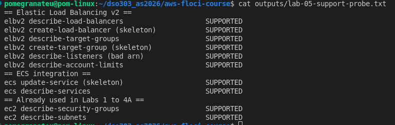

All ten probes answered. Running the ambiguous ones directly gave real answers (empty lists, and account limits such as 50 ALBs and 100 rules per ALB), so this is **path A**. **Floci limitation:** `describe-listeners --load-balancer-arn probe` returned an empty list instead of a `ValidationError`; Floci does not validate ARNs, so a typo looks like "no listeners". Every ARN in this lab was captured with `$(...)` and read back.

### Step 4: the load balancer's security group

`usms-alb-sg` admits tcp/80 from `0.0.0.0/0`, the only such rule in the course, and deliberate: the load balancer forwards only to the target group, whose tasks admit only this group. **Your turn:** tcp/443 added from a JSON document; the group now has two inbound rules and one outbound rule. HTTPS still serves nothing: a rule opens a port, but nothing listens on 443 until there is an HTTPS listener and a certificate (answer in the notes).

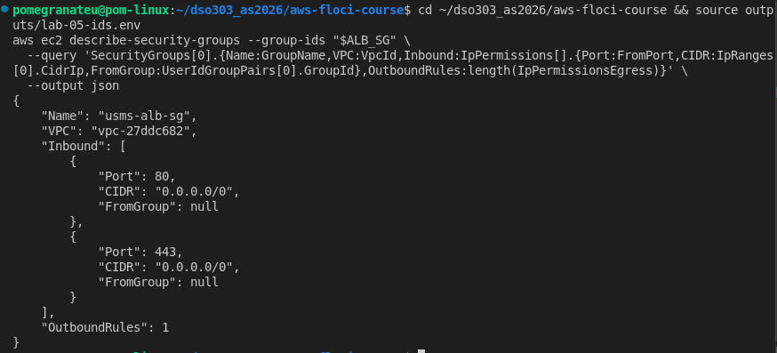

### Step 5: the load balancer

`create-load-balancer` returned an ARN; the read-back showed active, application, internet-facing, two AZs and one security group. Both attributes (idle timeout 60, drop invalid header fields) were set and read back.

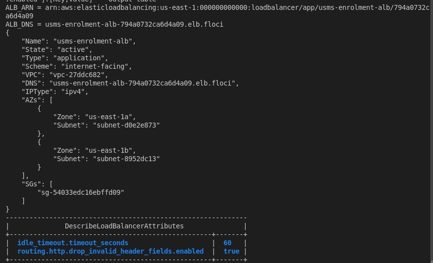

**Floci limitations:** the load balancer was active at once (real AWS: 2 to 4 minutes provisioning), and its DNS name `usms-enrolment-alb-794a0732ca6d4a09.elb.floci` does not resolve on the host.

### Steps 6 and 7: the target group and how a task dies

`usms-enrolment-tg`: type ip, HTTP:80, health check GET / every 30 s, timeout 5, healthy 2, unhealthy 2, matcher 200, no load balancer attached yet, and an empty target list. A dead task keeps receiving traffic for up to 30 x 2 = 60 seconds.

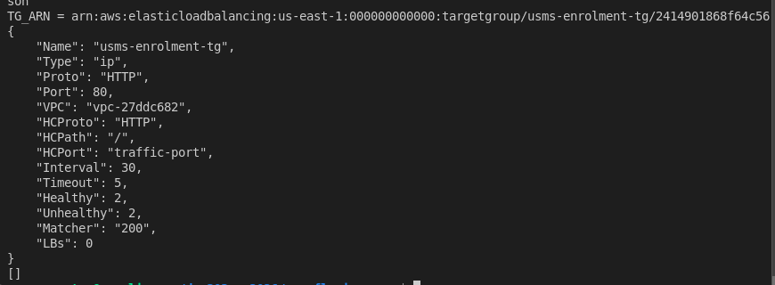

**Your turn:** the matcher was widened to `200-399` and restored to `200`, both in place with the same ARN.

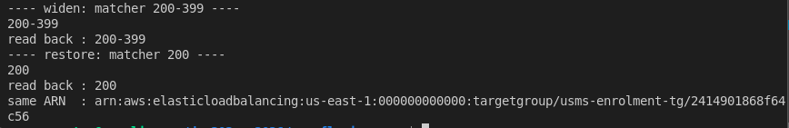

Deregistration delay 30 s (default 300) and `least_outstanding_requests` set and read back.

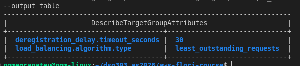

**Floci limitation:** `describe-target-group-attributes` lists only the attributes that were set, not the defaults, so an unset attribute cannot be confirmed by reading it back.

### Step 8: the listener

HTTP:80, default action forward to `usms-enrolment-tg`; the listener ARN nests the load balancer's ID, and the target group now reports one attached load balancer. Floci returns `SslPolicy` as `""` rather than omitting it.

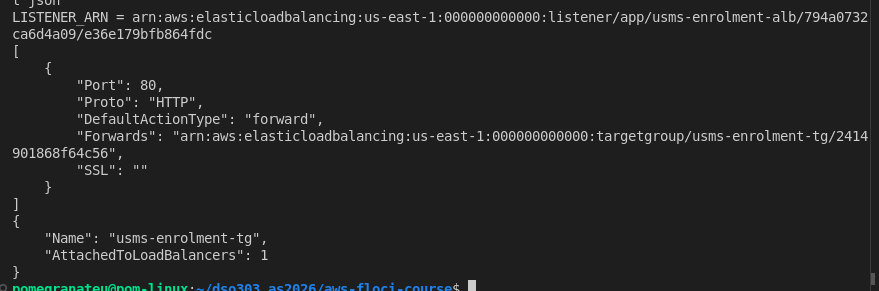

### Step 9: let the load balancer reach the tasks

`policies/usms-enrolment-sg-ingress-alb.json` (unquoted heredoc, zero literal `$`) admits tcp/80 from `usms-alb-sg`; both paths now coexist.

**Floci limitation:** the lab's check should show one port-80 permission with two source groups. Floci returns two separate permissions with no source group on either. I proved the wiring another way ([evidence](evidence/lab-05-step9-wiring.txt)): 2 inbound rules, 0 with a CIDR; the Lab 04 rule file names the group `usms-web-01` carries; the Lab 05 rule file names the group the load balancer carries (`NEW PATH WIRED`).

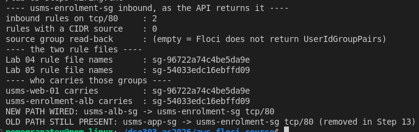

### Step 10: attach the service (deviation 1)

`templates/lab-05-service-load-balancers.json` names `enrolment-api` on port 80. `update-service --load-balancers ... --health-check-grace-period-seconds 60` exited 0, but the response and a fresh read both showed `loadBalancers: null` and the grace period `null` ([evidence](evidence/lab-05-step10-update-raw.json)). The lab's own query also failed, because Floci returns no `deployments` list.

**Floci limitation:** `update-service` silently ignores `--load-balancers`. Real AWS either applies it or rejects it with `InvalidParameterException`; it never reports success and drops it.

Because a silent no-op has the same effect as a rejection, I took the lab's documented fallback, after reading its danger notice:

> **DANGER**
> **What will be deleted:** the ECS service `usms-enrolment-svc` and its two tasks. Task definition, cluster, roles, security group and log group untouched.
> **What depends on it:** Lab 06's scalable target names the service. It was recreated with the same name, cluster, `usms-enrolment:2`, desired count 2, subnets, security group, `assignPublicIp` DISABLED and the same four tags (saved first, [evidence](evidence/lab-05-pre-recreate-tags.json)).
> **Reversible?** The object is not recoverable, but an identical one was recreated in the same command block.
> **Effect on later labs:** none. The service ARN is unchanged.

Running count went 2 to 0, `delete-service` returned `INACTIVE`, and `create-service` with `--load-balancers` stored the entry. `templates/lab-04-deployment-config.json` from the lab text does not exist in my repository (my Lab 04 service had none), so that flag was omitted, matching the original.

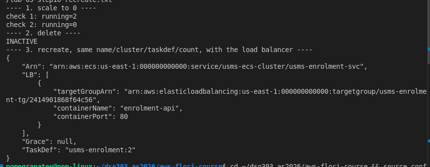

**Floci limitation:** `healthCheckGracePeriodSeconds` is not stored on `create-service` either; it reads `None`.

### Step 11: the service fills the target group

Without a single `register-targets` call, both targets appeared on the first poll as `initial` and became `healthy` within about 50 seconds. **Floci runs real health checks**: every task's access log shows `GET /` from Floci every 30 seconds.

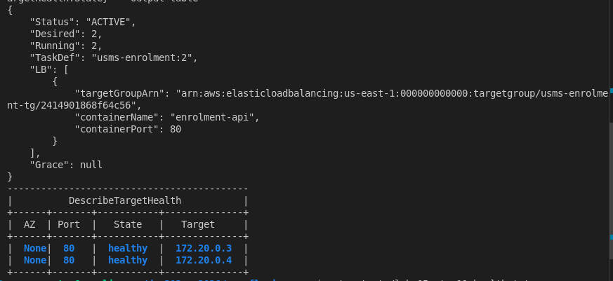

ECS reports `healthStatus` None (real AWS: UNKNOWN, because `usms-enrolment:2` has no container health check), and the targets are healthy: the "UNKNOWN / healthy, not a fault" row of the diagnosis table (copied into the notes).

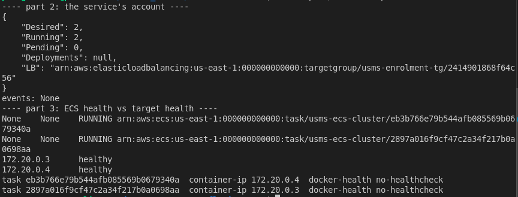

**Your turn:** desired count 3 then 2. The third target appeared and disappeared with no manual registration. If the service did not do this, every new task's IP would have to be registered by hand after every scaling event, which Lab 06's automatic scaling would make impossible.

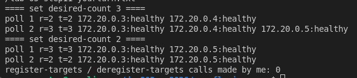

**Floci limitations:** targets are Docker bridge addresses (`172.20.0.x`) with zone `None`, not addresses in 10.0.3.0/24 and 10.0.4.0/24, so "one address per private subnet" cannot be shown; `describe-tasks` returns no network interface, so tasks were matched to addresses with `docker inspect`; the scaled-in target was never shown as `draining`.

### Step 12: proving the path

**From the host: not available.** The DNS name does not resolve and curl returned `000`. Only port 4566 is published, and I published no extra ports.

**A false positive I did not count.** `localhost:4566` with the load balancer's name in the `Host` header returned 200, but the body was S3's `ListAllMyBucketsResult`, and a made-up host name returned 200 too. Floci answers any request on 4566 as S3.

**Inside Floci's network: available.** Floci listens on port 80 inside its own container (`172.20.0.2`). A throwaway curl container on that network sent a tagged request and got `200`, `Server: nginx`; the request appears in task `172.20.0.5`'s access log with source `172.20.0.2`. So the request went listener -> target group -> registered task -> back.

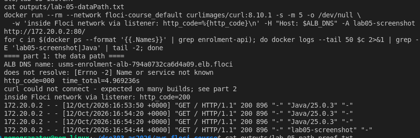

The lab's control-plane proof was also run, as written ([evidence](evidence/lab-05-path-proof.txt)). Block 3 prints "NOT in a Lab 02 private subnet" (Docker addresses) and block 5 is empty (no source groups returned); I added the explanation and the rule-file proof as blocks 6 and 7.

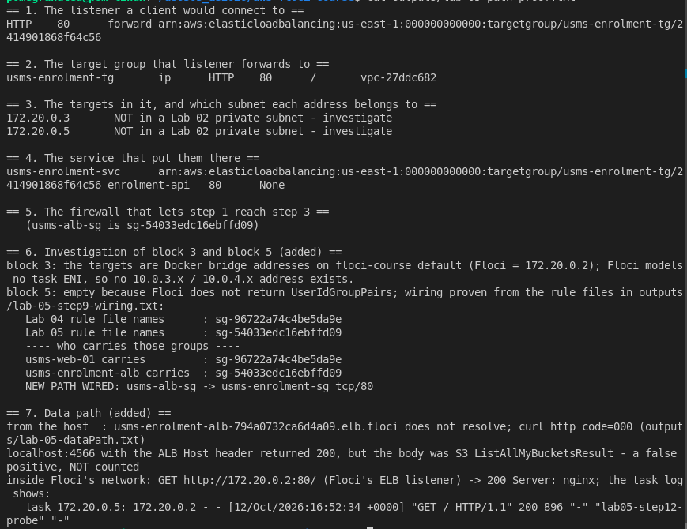

**Floci limitations:** security groups are not enforced, so this proves forwarding, not the firewall; the load balancer adds no `X-Forwarded-For` header.

### Step 13: the cutover (deviation 2)

The danger notice was read first: one rule deleted, nothing depends on it because Step 12 proved the new path, reversible from the Lab 04 rule file.

1. The lab's query finds the old rule by `ReferencedGroupInfo.GroupId`, which Floci returns as null, so it gave `None`. I identified it by elimination: of the two tcp/80 rules, one is Step 9's `sgr-8db86d3a75cd980cd`, so the Lab 04 rule is `sgr-34325defd1d1ba040`.
2. `revoke-security-group-ingress --security-group-rule-ids sgr-34325defd1d1ba040` returned `True` and **removed nothing**.
3. Revoking with the Lab 04 rule file returned `true` and **removed both tcp/80 rules**, including the load balancer's.
4. I reproduced both behaviours on throwaway groups, which I deleted afterwards ([evidence](evidence/lab-05-step13-revoke-test.txt)): revoke by rule ID never changes anything; revoke by permission removes every same-port group rule, because Floci stores them without their group and cannot tell them apart.
5. I re-added only the `usms-alb-sg` rule from its own file.

Final state ([evidence](evidence/lab-05-step13-cutover.txt)): `describe-security-groups` shows **one** inbound permission, written from the `usms-alb-sg` file; no CIDR rules; requests through the listener still return 200. `describe-security-group-rules` still lists three rules, because Floci's revoke never updates that view.

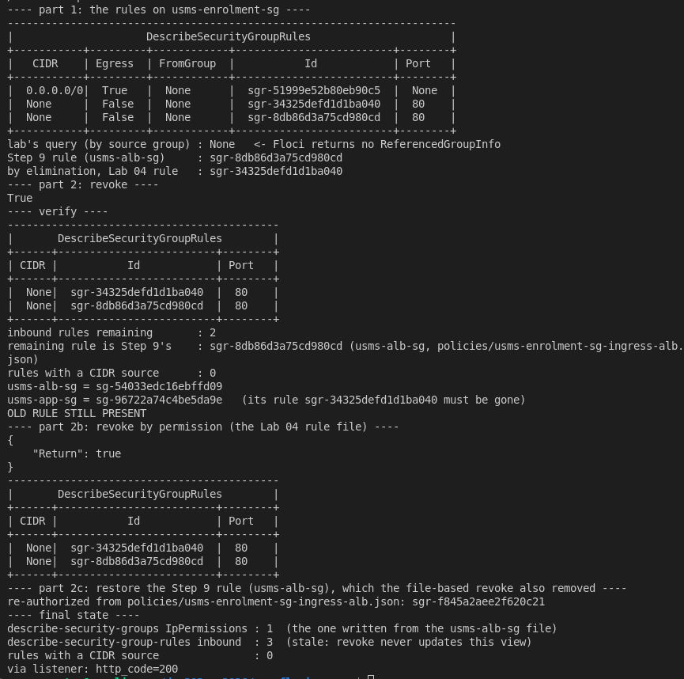

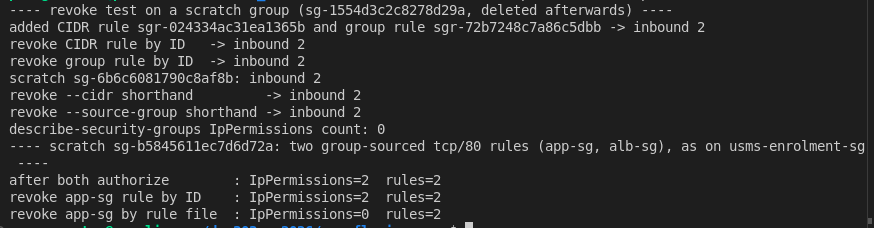

**Lab 04's script did not change: 38/1 before and after.** The lab expects one check to flip (49/0 to 48/1). My Lab 04 workaround read the Lab 04 rule *file*, which still names `usms-app-sg`, so it could not see the cutover. Exercise 2 fixes this.

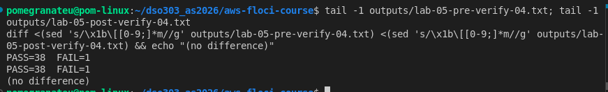

**Floci limitations:** revoke by rule ID is a no-op that reports success; revoke by permission removes all same-port group permissions; the two read views disagree after a revoke. On real AWS the lab's two commands remove exactly one rule.

### Step 14: a deployment behind the load balancer

`--force-new-deployment` returned `deployments: null`; over 12 polls (80 seconds) nothing changed, and the before and after snapshots have the same task IDs and addresses. The lab's poll loop cannot run as written, because it stops on `length(deployments)`.

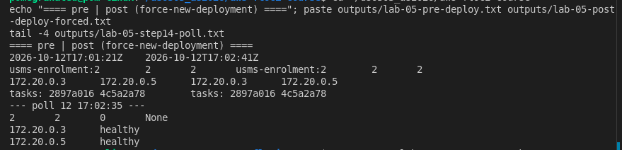

Extra observation: I stopped one task with `ecs stop-task` and polled every second. Its target vanished within a second (never `draining`), the service registered a replacement as `initial` at 3 s, and it became `healthy` at 23 s. So the health check does gate new tasks, but deregistration is instant: the 30-second draining delay is stored and never applied.

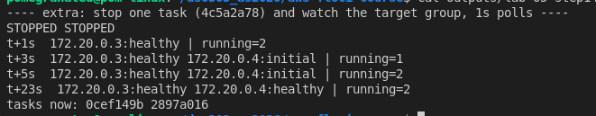

**Conceptual:** on real AWS the stopped task's target would stay `draining` for up to 30 seconds, receiving no new requests while in-flight ones finish, and only then would ECS send SIGTERM.

### Step 15: a listener rule

Priority 10, `/alb-health` and `/alb-health/*`, fixed-response 200; the default action forwards to the target group. Floci stores the paths only under `PathPatternConfig.Values`.

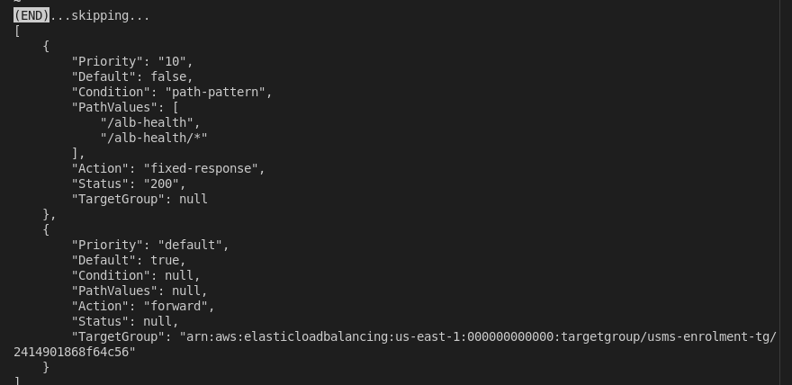

Tested through the listener: `/` returned 200 from nginx; `/alb-health` and `/alb-health/x` returned the 22-byte fixed response with no `Server` header; `/alb-healthcheck-internal` fell through to nginx's 404, which is why the rule uses two patterns. The tasks' access logs never show `/alb-health`, so the load balancer answered it itself.

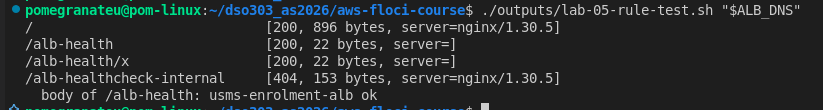

### Step 16: survives a restart

Floci was stopped (state kept) and started. Every ARN was re-derived from the API and matched, and the lab's seven facts were unchanged: **PERSISTENCE PROVEN**. My extra facts were unchanged too (attributes, the rule's paths, both groups' permission counts).

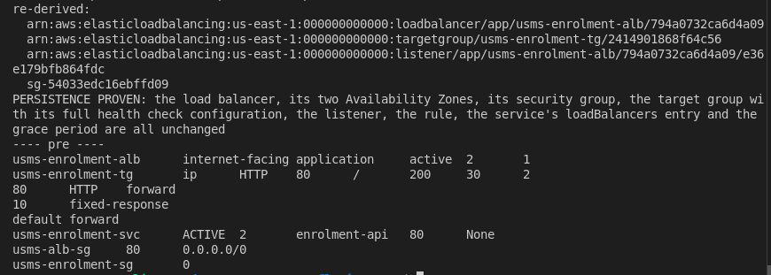

Two honest caveats: the grace period is `None` on both sides, so "unchanged" means "still not stored"; and the lab's enrolment-group fact counts source groups, which is 0 either way on Floci. After the restart the service started two new tasks. The screenshot below is the first check: `172.20.0.4` read `unhealthy` (`Target.FailedHealthChecks`) while requests through the listener already worked again. A follow-up poll, recorded in the notes, showed it turn healthy about 20 seconds later. That early failure is what the grace period exists for, which Floci does not store.

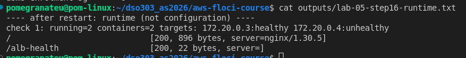

### Step 17: close the loop and audit (deviation 3)

Run as written ([evidence](evidence/lab-05-step17-loop.txt)): block 1 correct; block 2 `MISMATCH` (source group `None`, a false result); block 3 printed nothing; block 4 shows `usms-alb-sg` as the only Lab=05 group and Lab=05 on the load balancer and target group.

Block 3 was empty because **the Step 16 restart had left all four Lab 3 instances stopped**. **Floci limitation:** restarting Floci stops every EC2 instance, and they stay stopped (the ECS service restarts its own tasks, EC2 instances do not). I started them again; `usms-web-01` kept its Elastic IP, and Labs 2, 3 and 4 verification returned 33/0, 32/5 and 38/1.

Re-run: Floci ignored the `instance.group-id` filter (all four instances returned, as in Lab 04 Exercise 5), so the lab's test printed `NOTE`. A client-side check shows only `usms-web-01` and `usms-web-02` carry `usms-app-sg`: **LOOP CLOSED (client-side)**. Stand-in for block 2: one inbound permission (two before Step 13), no CIDR, written from the `usms-alb-sg` file, which the load balancer carries: **CUTOVER CONFIRMED (by stand-in)**.

### Steps 18 and 19: `configs/lab-05.env` and the commit

`configs/lab-05.env` has 15 exports, all looked up from the API, plus `USMS_ALB_RESOURCE_LABEL` from Exercise 5 (16). One value is `None`: `USMS_SVC_GRACE_PERIOD`, the value Floci actually returns. I left it as the read-back with a comment rather than writing 60, so the file stays a record of what exists. Because `outputs/` is git-ignored, the evidence files were copied to `labs/lab-05-ecs-alb/evidence/` (no secrets: IDs and command output only).

---

## 6. Floci limitations found

| # | Behaviour on Floci | Real AWS |
|---|---|---|
| 1 | ELBv2 does not validate ARNs (`describe-listeners` on `probe` returns `[]`) | `ValidationError` |
| 2 | Load balancer active at once; DNS name `*.elb.floci` does not resolve on the host | 2 to 4 minutes provisioning; public DNS name |
| 3 | Target group attributes list only what was set | Full list including defaults |
| 4 | `SslPolicy` is `""` on an HTTP listener | Omitted |
| 5 | Group source of a security group rule not returned; same-port group rules not merged | `UserIdGroupPairs` returned and merged into one permission |
| 6 | `update-service` silently ignores `--load-balancers` and the grace period | Applied, or rejected with an error |
| 7 | `healthCheckGracePeriodSeconds` never stored | Stored; ECS ignores early target health |
| 8 | Targets are Docker bridge addresses with no AZ; tasks have no network interface | Task ENI private IPs, one per AZ |
| 9 | `describe-services` has no `deployments` or `events` | PRIMARY/ACTIVE deployments and service events |
| 10 | Deregistration is instant; no `draining` state | Draining for up to the deregistration delay |
| 11 | `--force-new-deployment` replaces no tasks | Rolling replacement |
| 12 | Data path only inside Floci's Docker network; no `X-Forwarded-For` | Public, with `X-Forwarded-For` |
| 13 | Revoke by rule ID is a no-op; revoke by permission removes all same-port group rules; the two read views disagree | Exactly the named rule removed, consistently |
| 14 | Security groups not enforced | Enforced on every packet |
| 15 | Restarting Floci leaves every EC2 instance stopped | No equivalent |
| 16 | `instance.group-id` filter ignored | Returns only instances carrying the group |
| 17 | Rule path values only in `PathPatternConfig.Values` | Also in `Values` |

---

## 7. Verification

`./scripts/utilities/verify-lab-05.sh` reports **PASS=52 FAIL=3** ([evidence](evidence/lab-05-verify.txt)). Run exactly as the lab gives it, the script reported PASS=44 FAIL=5. I kept every check and changed three things:

- The three Floci checks are labelled `[floci]`: the enrolment group's source read back through the API, the grace period, and exactly one deployment.
- Each is paired with a stand-in that can fail: the enrolment rule file names the group the load balancer carries; `usms-enrolment-sg` has exactly **one** inbound permission (it had two after Step 9, so a skipped cutover fails); no CIDR ingress; running equals desired with nothing pending; healthy targets equal desired.
- The lab's "cutover done" check passes even if Step 13 is skipped, because Floci's source list is always empty. The one-permission check is the one that can actually catch it.

Also: the `None` in `lab-05.env` is allowed only for the documented grace period, and the git-hygiene check ignores `outputs/.gitkeep` (as in Labs 2 and 4). `scripts/cleanup/lab-05-cleanup.sh` passes `bash -n` and **has not been run**. I fixed one typo in it from the lab text ("run AFTER lab-04-cleanup.sh and BEFORE lab-04-cleanup.sh" now reads Lab 06, then Lab 04).

After Exercise 2, `verify-lab-04.sh` reports **PASS=39 FAIL=1**, the `[floci]` read-back.

---

## 8. Independent exercises

The full write-ups, commands, outputs and sources are in [`exercises.md`](exercises.md). Summary:

1. **A second path.** `usms-results-tg` and a priority-20 rule for `/results`. Rules read back in evaluation order (10, 20, default). A request to `/results` with no targets returned **503 from the load balancer itself**, observed through the listener.
2. **Repair the verification script.** The old check asserted "only a named group may reach the tasks, never a CIDR"; it now asserts that group is `usms-alb-sg` (read from `configs/lab-05.env`, optional), plus a new check that `usms-app-sg` is no longer a source. It also exposed that my Lab 04 check had been reading a file, not the environment.
3. **Load balancer report tool.** `usms-lb-report.sh` prints each `usms-` ALB's decision table, identical from three directories, tested against a mock for missing listeners, empty target groups, `"9"` vs `"10"` ordering, redirects, weighted forwards and a failing call.
4. **Exposure review.** Written for the security officer: what changed, a recommendation for `--scheme internal` (the portal is the only client), the exposure table, a cited monthly cost (**$23.73 idle, $24.07 under load**, against $18.02 for the two tasks; new connections, not bytes, dominate the LCU charge), and an HTTPS plan separating what opens port 443 from what listens on it. The two practice objects were deleted after danger notices, and verification was unchanged.
5. **ResourceLabel for Lab 06.** `usms-resource-label.sh` derives and validates `app/usms-enrolment-alb/.../targetgroup/usms-enrolment-tg/...`; it is now in `configs/lab-05.env`. The forced-deployment measurement is meaningless on Floci (nothing is replaced), so I measured a stop-task replacement instead: **33.7 s**.

## 9. Review questions

Answered in prose in `notes/lab-05-notes.md`.

## 10. Reflection

Three things stood out. First, the order of Steps 9, 12 and 13 is the whole lesson: build the new path, prove it, then remove the old one. Doing it in that order meant the Step 13 problems could not cause an outage, because the load balancer's path was already proven and was the one I put back. Second, a check that reads a file instead of the environment looks like verification but is not. My Lab 04 workaround passed straight through a change it existed to catch, and the same trap was hiding in the lab's own "cutover done" check. Third, Floci reported success for operations it did not perform (`update-service --load-balancers`, `revoke-security-group-ingress`), and a 200 from the wrong service looked like a working load balancer. Reading the result back after every change, and checking what actually answered, caught all three.

## 11. Screenshot checklist

`lab05-01-support-probe`, `lab05-02-alb-sg`, `lab05-03-alb`, `lab05-04-target-group`, `lab05-05-matcher`, `lab05-06-tg-attributes`, `lab05-07-listener`, `lab05-08-wiring`, `lab05-09-recreate`, `lab05-10-checkpoint4`, `lab05-11-health-side-by-side`, `lab05-12-scale-yourturn`, `lab05-13-data-path`, `lab05-14-path-proof`, `lab05-15-cutover`, `lab05-16-revoke-test`, `lab05-17-verify04-diff`, `lab05-18-checkpoint5`, `lab05-19-stoptask`, `lab05-20-rules`, `lab05-21-rule-test`, `lab05-22-checkpoint7`, `lab05-23-restart-runtime`, all `.png`, in `labs/lab-05-ecs-alb/img/`, all present. Checkpoints 4, 5 and 7, which the lab requires, are screenshots 10, 18 and 22.

## 12. Commits

`7620cf5` main lab (load balancer, target group, listener, rule, service attachment, cutover, evidence), `7acac5c` verification and cleanup scripts, `59f58be` `verify-lab-04` repaired for the new caller (Exercise 2) and exercises 1 to 2, `a293e99` exercises 3 to 5, `7c751b1` review question answers.
