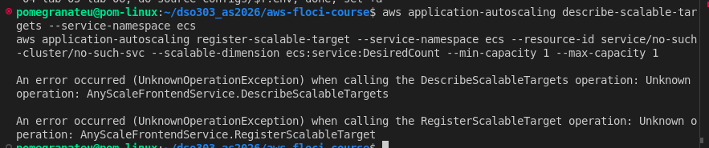
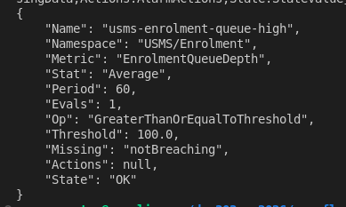
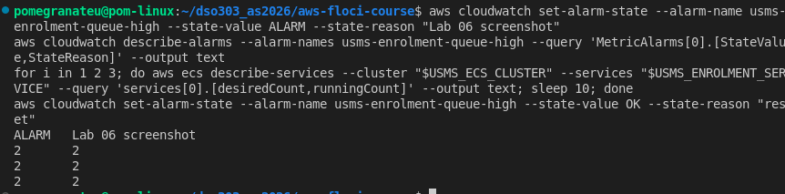
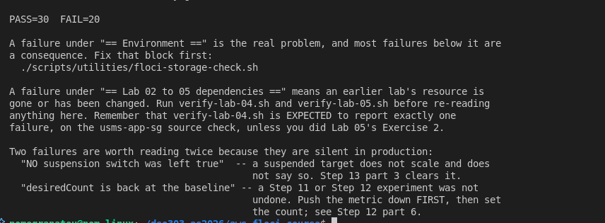
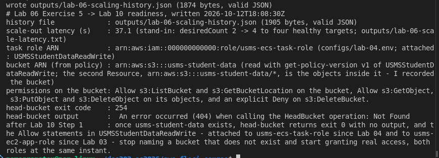

# DSO303 Lab 06: Implementing Auto Scaling for an ECS-Based Application

**Student:** Pema Tshering Yangchen (ID 2230295)
**Module:** DSO303 Cloud Infrastructure, College of Science and Technology, Royal University of Bhutan
**Environment:** Floci v1.5.34, AWS CLI v2.31.35, Docker Compose v2.26.1, Pop!_OS (x86_64)
**Repository:** `~/dso303_as2026/aws-floci-course` (github.com/pomegranateis/dso303_as2026)

> Screenshots are in `img/` (listed at the end). Command output that was saved as text is linked from [`evidence/`](evidence/).

---

## 1. Objective, and the result in one line

The lab registers `usms-enrolment-svc` as a scalable target (min 2, max 10), adds CPU and request-count target tracking, a step scaling policy driven by a custom CloudWatch alarm and two scheduled actions, then fires the alarm and proves that something other than me moved `desiredCount`.

**On this Floci build that was not possible: it has no Application Auto Scaling at all, which makes this support path C.** I built and tested everything the build does support (the custom metric and alarm, the ECS service, the request bodies for every Application Auto Scaling call), and did Exercises 4 and 5 and the review questions, as the lab's path table asks.

## 2. What was built

| Item | Status | Notes |
|---|---|---|
| Service-linked role `AWSServiceRoleForApplicationAutoScaling_ECSService` | **not created** | `CreateServiceLinkedRole` unsupported |
| Scalable target `service/usms-ecs-cluster/usms-enrolment-svc`, min 2, max 10 | **not created** | `register-scalable-target`: `UnknownOperationException` |
| Target tracking: CPU 50, requests 1000 | request bodies only | `templates/lab-06-target-tracking-*.json` |
| Step scaling `usms-enrolment-queue-step-out` (+1, +3) | request body only | `templates/lab-06-step-scaling-out.json` |
| Scheduled actions, morning floor 4 / evening floor 2 | commands only | conceptual (Section 5) |
| Custom metric `USMS/Enrolment EnrolmentQueueDepth` | **built** | published and listed |
| Alarm `usms-enrolment-queue-high` (Average >= 100, 60 s, 1 period) | **built**, no action | forced to ALARM and back |
| `configs/lab-06.env` | 24 exports | unsupported values read `not-created` |

Files added: `labs/lab-06-ecs-autoscaling/` (this report, `exercises.md`, `evidence/`), `templates/lab-06-target-tracking-cpu.json`, `templates/lab-06-target-tracking-requests.json`, `templates/lab-06-step-scaling-out.json`, `templates/lab-06-suspended-state.json`, `configs/lab-06.env`, `scripts/utilities/verify-lab-06.sh`, `scripts/utilities/usms-scaling-history.sh`, `scripts/cleanup/lab-06-cleanup.sh` (not run, end of course only), `notes/lab-06-notes.md`.

## 3. How to read the results

**Observed** means I saw it happen. **Conceptual** means it is reasoned from AWS behaviour and was not visible in Floci. **Floci limitation** means Floci behaved differently from real AWS, with what real AWS would do.

---

## 4. Implementation

### Steps 1 and 2: resume and confirm Labs 2 to 5

All fourteen values loaded. Verification: Lab 02 `PASS=33 FAIL=0`, Lab 03 `PASS=32 FAIL=5`, Lab 04 `PASS=39 FAIL=1` (Lab 05 Exercise 2 applied), Lab 05 `PASS=52 FAIL=3`, every failure `[floci]` ([evidence](evidence/lab-06-pre-verify-05.txt)). The service was at its baseline: desired 2, running 2, one load balancer. Two configuration values differ from the lab's example: `USMS_SVC_GRACE_PERIOD` is `None` (Floci never stored it, Lab 05 Step 10), and the task memory reads 512 because `configs/lab-04.env` records revision 1. All four Lab 3 instances were running, which I checked because Lab 05's restart had stopped them.

### Step 3: the probe, and path C

All four Application Auto Scaling reads return `UnknownOperationException: AnyScaleFrontendService.<Operation>`. The two writes show SUPPORTED, but those probes use `--generate-cli-skeleton`, which the CLI answers offline. Real calls to `register-scalable-target` and `put-scaling-policy`, made against a service that does not exist so nothing could be created, return the same error ([evidence](evidence/lab-06-support-probe.txt)). Lab 04's probe found the same, so this build has never had the service. CloudWatch, IAM, ECS and ELBv2 all answer.

### Step 4: the service-linked role

`create-service-linked-role --aws-service-name ecs.application-autoscaling.amazonaws.com` returned `UnsupportedOperation`, and `get-role` returned `NoSuchEntity` ([evidence](evidence/lab-06-step4-slr.txt)). I did not fake the role with `create-role`: a hand-made role would sit under path `/` instead of `/aws-service-role/ecs.application-autoscaling.amazonaws.com/`, with a trust policy I wrote and no AWS-owned permissions, so it would not be the same thing. **Conceptual:** on real AWS this role is the identity that calls `ecs:UpdateService` when a policy fires, and CloudTrail names it as the caller.

### Steps 5 to 9, 11 and 13: written, not run

Every one of these calls Application Auto Scaling. The request bodies are written and validated, so they run unchanged on real AWS ([evidence](evidence/lab-06-templates.txt)):

| Document | Contents | Heredoc |
|---|---|---|
| `lab-06-target-tracking-cpu.json` | `ECSServiceAverageCPUUtilization`, target 50.0, out 60, in 300, scale-in enabled | quoted, 0 `$` |
| `lab-06-target-tracking-requests.json` | `ALBRequestCountPerTarget`, target 1000.0, `ResourceLabel` re-derived by Lab 05's `usms-resource-label.sh` (6 segments, equal to `USMS_ALB_RESOURCE_LABEL`) | unquoted, 0 `$` |
| `lab-06-step-scaling-out.json` | `ChangeInCapacity`, `Average`, cooldown 60, `[0,100)` +1, `[100, open)` +3 | quoted, 0 `$` |
| `lab-06-suspended-state.json` | scale-in suspended only, the safe direction | quoted, 0 `$` |

**Conceptual, the scheduled actions (Step 11):** `cron(45 7 ? * MON-FRI *)` and `cron(0 20 ? * MON-FRI *)` with `--timezone Asia/Thimphu`, setting the floor to 4 in the morning and 2 in the evening (UTC equivalents 01:45 and 14:00). **Conceptual, the asymmetric cooldowns:** scale out after 60 s and scale in after 300 s, because adding capacity late drops requests while removing it late only costs money.

### Step 10: the custom metric and the alarm

Published 3, 5 and 4 to `USMS/Enrolment EnrolmentQueueDepth` (dimension `Service=enrolment`), and `list-metrics` lists it. Created `usms-enrolment-queue-high`: Average >= 100 over one 60-second period, missing data `notBreaching`, tagged Lab=06 ([evidence](evidence/lab-06-step10-alarm.txt)).

It was created **without `--alarm-actions`**. On real AWS the action is the step policy's ARN, so the policy must exist first (otherwise `put-metric-alarm` fails with "Invalid metrics or alarm actions"), and on this build no policy can exist.

### Step 12: fire the alarm, and be honest about what moved

Before: desired 2, running 2, pending 0. I published 260 three times, 5 s apart. The minute's statistics read **Average 132.0, Maximum 260.0**, not 260, because Step 10's three small datapoints fell in the same minute; 132 is still above 100. My prediction for real AWS, written before looking: a breach of 160 falls in the open-ended step, so +3 tasks, 2 to 5.

**Floci limitation:** the alarm is never evaluated. Over six polls in 80 s it stayed `INSUFFICIENT_DATA` with reason `Unchecked`. Real CloudWatch evaluates every period and would have gone to ALARM within a minute.

`set-alarm-state --state-value ALARM` worked: the alarm showed ALARM with my reason. `desiredCount` then stayed at **2 for six polls over 55 s**. That is the correct result, because the alarm has no action and no policy exists. `describe-scaling-activities` and `describe-alarm-history` are both unsupported. I set the alarm back to OK afterwards ([evidence](evidence/lab-06-step12-fire.txt)).

**Nothing other than me moved `desiredCount`, and I make no claim that anything did.**

### Step 14 (persistence) and Step 15 (close the loop)

Not run. Step 14 re-reads the scalable target, policies and scheduled actions after a restart, and none exist; restarting Floci would also stop the Lab 3 instances again (Lab 05). **Conceptual, Step 15:** the nine lines from a click to a new task are written out in Review Question 1 in the notes. This lab owns three of them: the alarm, the policy and the number it writes.

### Steps 16 and 17: `configs/lab-06.env` and the commit

22 exports, every value looked up. Values that would come from Application Auto Scaling or the service-linked role read `not-created`, the lab's own convention for an unsupported policy: the bounds, the three policy ARNs and the role. So the file records what exists rather than what was intended. Exercise 5 added two more, giving 24.

**I did not run Step 17's "stale string" repair.** It replaces every `lab-04-cleanup.sh` with `lab-06-cleanup.sh` in the Lab 04 and Lab 05 cleanup scripts. In my `lab-05-cleanup.sh` the one wrong line was already fixed during Lab 05, and the two remaining mentions ("run BEFORE lab-04-cleanup.sh", "lab-04-cleanup.sh may now run") are correct. A blanket replace would make them wrong. `lab-04-cleanup.sh` does not contain the string.

---

## 5. Floci limitations found

| # | Behaviour on Floci | Real AWS |
|---|---|---|
| 1 | No Application Auto Scaling: every operation `UnknownOperationException` | Full service |
| 2 | `CreateServiceLinkedRole` unsupported | Creates the AWS-owned role |
| 3 | Alarms are never evaluated (`INSUFFICIENT_DATA`, `Unchecked`) | Evaluated every period |
| 4 | `describe-alarm-history` unsupported | State changes and actions recorded |
| 5 | `set-alarm-state` works, but there is no scaling policy for it to invoke | Invokes the alarm's actions |
| 6 | `AvailableIpAddressCount` ignores instances and tasks in the subnet | Counts every interface |
| 7 | A task reaches `RUNNING` in about 13 s with no image pull | 20 to 60 s on Fargate |

From the lab's Section 11, here is what ended up in which list. **Observable** on this build: the custom metric and alarm, `set-alarm-state`, the request bodies. **Conceptual**: the role, scalable target, policies, managed alarms, `ResourceLabel` in a policy, step table in a policy, scheduled actions, suspension, persistence of all of those, alarm evaluation, scaling activities, the capacity calculation, cooldowns, scheduled firing.

---

## 6. Verification

`./scripts/utilities/verify-lab-06.sh` reports **PASS=30 FAIL=20**, and all 20 failures are labelled `[floci]` ([evidence](evidence/lab-06-verify.txt)). Run exactly as the lab gives it, the script reported PASS=22 FAIL=20 ([evidence](evidence/lab-06-verify-asgiven.txt)). I changed three things:

- Every check that needs Application Auto Scaling is labelled `[floci]` and kept exactly as written.
- **A check that could not fail now can.** "NO suspension switch was left true" passed because there is no scalable target, so nothing was suspended because nothing existed. It now requires the target first, so it fails honestly as `[floci]`.
- **Stand-ins that can fail on this build** follow each group: the resource ID is the service ARN's suffix with three segments; the bounds are recorded as `not-created` rather than invented; the three request bodies have exactly the right contents, with the `ResourceLabel` re-derived live; the alarm has the right statistic, operator, threshold, period, evaluations and missing-data treatment, and was not left in ALARM; running equals desired with nothing pending.

The git-hygiene check ignores `outputs/.gitkeep`, as in Labs 2, 4 and 5. `scripts/cleanup/lab-06-cleanup.sh` passes `bash -n` and **has not been run**; on this build only its alarm deletion would do anything.

---

## 7. Independent exercises

The full write-ups are in [`exercises.md`](exercises.md).

- **Exercises 1 to 3** need Application Auto Scaling, so they are recorded as not possible. Exercise 5's export script covers the same reads.
- **Exercise 4, capacity plan.** Written for the project lead:
  - Reactive scaling cannot cover the first twenty minutes, because 2 to 10 tasks takes about 5 to 6 minutes. Forty times the traffic is a timing problem: it needs 2.4 to 4.05 tasks, well inside 10.
  - The ceiling of 10 means 166.7 requests per second at the target. The subnets hold about 500 tasks, but the default Fargate quota (6 vCPU) caps the account at **24 tasks**.
  - The plan: scheduled floors for the cohort mornings (6) and the three-week window (4), with every change reversible in one command.
  - Cost: about **$4.67 to $5.51** of extra Fargate, plus $0.80 a month of CloudWatch (free under the free tier).
  - What I need from the project lead: the cohort dates, last year's real request rates, and a load test.
  - The tidy-up has nothing to delete, because Exercises 1 and 2 could create nothing.
- **Exercise 5, hand-off to Lab 10.** `usms-scaling-history.sh` exports a valid 1,905-byte JSON document: real service and alarm data, and an error record for each section the missing service cannot give. My scale-out stand-in took **37.1 s** from `desiredCount` 4 to four healthy targets. The readiness file reads the bucket ARN from the policy; `head-bucket` fails with exit code 254 (404) until Lab 10 creates the bucket.

## 8. Review questions

Answered in prose in `notes/lab-06-notes.md`, all conceptual on this build.

## 9. Reflection

Three things stood out. First, a build that does not have a service is easier to be honest about than one that half-has it: every Application Auto Scaling call failed loudly, so there was no temptation to read a stored object as a working one. Second, the most useful thing I could still do was write every request body so that it runs unchanged on real AWS, and make the verification script check those bodies, so "not runnable" did not become "not checked". Third, the lab's own script had a check that could only pass on this build, "no suspension switch left true", for the same reason as Lab 05's cutover check: it tested the absence of a problem without first checking that the thing exists. That is now the first thing I look for in any verification script.

## 10. Screenshot checklist

`lab06-01-support-probe`, `lab06-02-alarm`, `lab06-03-alarm-fired`, `lab06-04-verify`, `lab06-05-readiness`, all `.png`, in `labs/lab-06-ecs-autoscaling/img/`.

## 11. Commits

`a3c33d4` support path C: metric, alarm, request bodies, env file, verification and cleanup scripts; `5a72af5` exercises 4 and 5 and review answers; the report.
