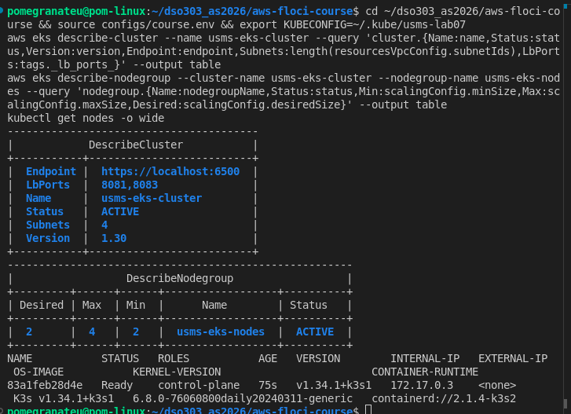
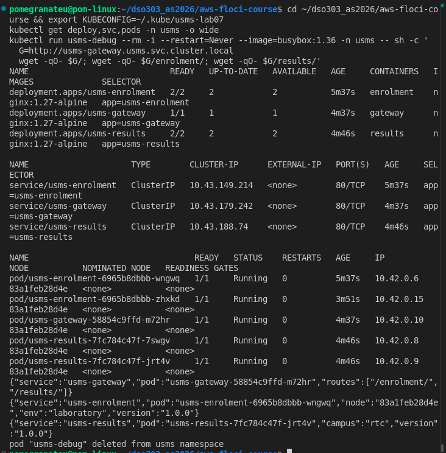
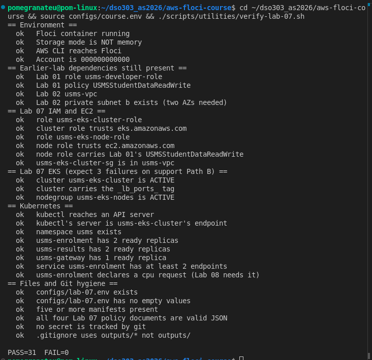

# DSO303 Lab 07: Deploying a Microservices Application on Amazon EKS

**Student:** Pema Tshering Yangchen (ID 2230295)
**Module:** DSO303 Cloud Infrastructure, College of Science and Technology, Royal University of Bhutan
**Environment:** Floci v1.5.34 (EKS backed by `rancher/k3s`), AWS CLI v2.31.35, kubectl v1.36.0, Docker, Pop!_OS (x86_64)
**Repository:** `~/dso303_as2026/aws-floci-course` (github.com/pomegranateis/dso303_as2026)

> Screenshots are in `img/` (listed at the end). Command output saved as text is linked from [`evidence/`](evidence/).

---

## 1. Objective

Create an EKS cluster and a managed node group in Lab 2's VPC, each with its own IAM role. Deploy three microservices (`usms-gateway`, `usms-enrolment`, `usms-results`) from declarative manifests. Prove they find each other by DNS name, then do a rolling update, a rollback and three deliberate failure diagnoses, use a ConfigMap and a Secret, and test persistence across a restart.

**Support path A:** Floci implements the EKS API and starts a real k3s cluster, so both the AWS half and the Kubernetes half of this lab ran. What Floci does not model is stated at each step.

## 2. What was built

| Resource | Value | Notes |
|---|---|---|
| `usms-eks-cluster-role` | trusts `eks.amazonaws.com` | `USMSEKSClusterPolicy` (local stand-in for `AmazonEKSClusterPolicy`) |
| `usms-eks-node-role` | trusts `ec2.amazonaws.com` | `USMSEKSNodePolicy` + Lab 1's `USMSStudentDataReadWrite` (its third holder) |
| `usms-eks-cluster-sg` | `sg-77d25192a5b480a71` | tcp/443 from 10.0.0.0/16 only |
| `usms-eks-cluster` | ACTIVE, 1.30 requested, `https://localhost:6500` | 4 subnets, `_lb_ports_=8081,8083` |
| `usms-eks-nodes` | ACTIVE, private-a + private-b, 2/4/2 | a record only on Floci (Section 5) |
| Namespace `usms` | `usms-enrolment` 2, `usms-results` 2, `usms-gateway` 1, `usms-timetable` 1 (Ex 1) | ClusterIP Services, 5 ConfigMaps, 1 Secret, 1 ServiceAccount, 1 PodDisruptionBudget (Ex 4) |

Files added: `labs/lab-07-eks/` (this report, `exercises.md`, `evidence/`), `manifests/lab-07/` (`00-namespace` to `70-timetable`, a new top-level folder the lab justifies), four `policies/*eks*.json`, `templates/lab-07-create-cluster.json` and `-nodegroup.json`, `configs/lab-07.env`, `scripts/utilities/eks-support-probe.sh`, `scripts/utilities/verify-lab-07.sh`, `scripts/cleanup/lab-07-cleanup.sh` (not run), `notes/lab-07-notes.md`.

## 3. Deviations from the lab text

1. **A separate kubeconfig.** My default `kubectl` context is `kind-dso202`, from another module. To leave it alone, Lab 07 uses its own file, `~/.kube/usms-lab07`, through `KUBECONFIG`. Every `kubectl` command in this lab assumes `export KUBECONFIG=~/.kube/usms-lab07`; `verify-lab-07.sh` uses it automatically.
2. **Load balancer ports 8081 and 8083**, not 8081 and 8082: host port 8082 was already in use by a local program. Lab 08 must use 8083 where it says 8082. This is recorded in `configs/lab-07.env`.
3. **The other module's cluster was paused.** Only 1.8 GiB of memory was free, so I stopped the `dso202` kind cluster with `docker stop` for this session. Its data and volumes are kept, and it was started again at the end.
4. **The first `create-cluster` failed and was redone.** Floci pulls the k3s image inside the call; on this connection the pull outran both the CLI's timeout and Floci's own 5-minute limit, leaving a FAILED cluster. I pulled the image directly, deleted the FAILED record and created the cluster again.
5. **The cluster was rebuilt after Step 22.** The restart removed the k3s container (Section 4, Step 22), so I recreated the cluster and restored the application with `kubectl apply -f manifests/lab-07/`.

---

## 4. Implementation

### Steps 1 to 3: environment, probe, the control plane and data plane split

Verification before starting: Lab 02 `PASS=33 FAIL=0`, Lab 04 `PASS=39 FAIL=1` (the `[floci]` read-back). All four subnets are present. The probe ([evidence](evidence/lab-07-support-probe.txt)) found `eks list-clusters` answering and `kubectl` installed, so the verdict is **PATH A**. `describe-cluster` and `list-nodegroups` on a missing name return proper `ResourceNotFoundException`s. The Step 3 answer ("EKS is just ECS with different names") is in the notes.

### Steps 4 to 7: IAM and the cluster security group

The two trust policies, the two permissions policies (3 and 5 statements, each ending in the region Deny) and the cluster security group (tcp/443 from the VPC CIDR only) were created as written ([evidence](evidence/lab-07-steps4-7.txt)). `USMSStudentDataReadWrite` now has three holders: `usms-ec2-app-role` (Lab 3), `usms-ecs-task-role` (Lab 4) and `usms-eks-node-role`. That was checked role by role, because `list-entities-for-policy` is unsupported. **Floci limitation:** policies are stored, not enforced.

### Steps 8 and 9: the cluster

Created from `templates/lab-07-create-cluster.json` as `usms-developer-role`, with my identity restored afterwards ([evidence](evidence/lab-07-step8.txt)). After deviation 4, the cluster was **ACTIVE** on the first poll: endpoint `https://localhost:6500`, four subnets, the cluster security group, and `_lb_ports_=8081,8083`. Your turn: version and OIDC issuer print `1.30  None`. The issuer is what lets IAM trust a service account's tokens (IRSA), and **None** means IRSA cannot be set up on this build.

**Floci limitations:** the cluster's `vpcId` is empty; the API is on port 6500, not 6443; an image pull slower than the CLI's timeout leaves a FAILED cluster instead of one that finishes later.

### Step 10: the managed node group

`usms-eks-nodes` is ACTIVE at once: private subnets only, min 2, max 4, desired 2, node role correct, labels `workload=usms tier=app` ([evidence](evidence/lab-07-nodegroup.json)). **Floci limitation:** it is a record only. No instances are created and `t3.small` is not provisioned.

### Steps 11 and 12: kubectl and the namespace

`aws eks update-kubeconfig --kubeconfig ~/.kube/usms-lab07` wrote a context whose user runs `aws eks get-token`, and it works against Floci. `can-i create deployments` answers `yes`. Namespace `usms` was created and set as the context default.

Taken on the first cluster, before the Step 22 restart (node `83a1feb28d4e`); the rebuilt cluster's single node has a different name.

**Floci limitations:**
- **One node**, the k3s server itself, rather than two workers in the private subnets, and the node group's labels never reach it.
- The cluster runs **Kubernetes v1.34**, not the requested 1.30, because Floci starts `rancher/k3s:latest`.
- The node's address is a Docker address, not a VPC address.

### Steps 13 to 16: three microservices and service discovery

All three Deployments rolled out: 2/2, 2/2 and 1/1, each with a ClusterIP Service and the right number of endpoints. `usms-enrolment` uses `maxUnavailable 0`, `usms-results` the default 25%. From a busybox pod:

- CoreDNS resolved both service names to their ClusterIPs.
- The gateway answered on `/` and routed `/enrolment/` and `/results/`.
- 12 requests through the gateway were answered by both enrolment pods.
- The gateway's configuration contains **no IP addresses**.

**Your turn:** I deleted an enrolment pod while 40 requests went through the gateway. Result: `ok=40 failed=0`. The ReplicaSet created the replacement in the same second, and its name appears in the tally ([evidence](evidence/lab-07-step16-yourturn.txt)).

Also taken before the restart. Pod `…zhxkd` is the replacement the ReplicaSet created in the Your-turn test; the ClusterIPs changed when the cluster was rebuilt.

Pod addresses are `10.42.0.x`, from k3s's own pod network, not VPC addresses as with the real EKS VPC CNI.

### Step 17: ConfigMaps and Secrets

`manifests/lab-07/50-secret.yaml` was generated with `--dry-run=client` and holds two **labelled dummy values**. It is committed only because the lab uses it as a Git-hygiene example.

- **base64 is not a lock:** `base64 -d` gave back `floci-dummy-token-not-a-real-secret` with nothing but `get secret` access.
- **Consuming it:** `kubectl set env --from=secret/…` rolled out a new ReplicaSet. This `kubectl` writes one `secretKeyRef` per key rather than an `envFrom` block; the effect is the same.
- **Inside the container** the token is plain text: four `APP_*` and two `ENROLMENT_*` variables ([evidence](evidence/lab-07-step17.txt)).

### Step 18: roll out, roll back

([evidence](evidence/lab-07-step18.txt))

- **Changing the ConfigMap** to 1.1.0 changed nothing in the running pods.
- **`annotate`** did not roll anything, because it changes the Deployment's own metadata, not the pod template.
- **`rollout restart`** produced a new ReplicaSet, and the pods answered 1.1.0.
- **`rollout undo`** scaled an old ReplicaSet back up as revision 4, but the pods still said **1.1.0**: undo reverts the pod template, not the ConfigMap.
- **Restored:** the ConfigMap is back at 1.0.0.

**Your turn** (image `nginx:1.27-alpine` to `nginx:1.27` and back on `usms-results`): peak 3 pods, two revisions in the history, image restored. With two replicas the default strategy rounds to `maxSurge 1, maxUnavailable 0`, so its shape was **the same** as enrolment's ([evidence](evidence/lab-07-step18-yourturn.txt)).

### Step 19: three failures, diagnosed

([evidence](evidence/lab-07-step19.txt))

- **Missing image:** `ErrImagePull` then `ImagePullBackOff` ("not found"), while both old pods kept serving. Fixed with `rollout undo`.
- **Requests too big:** `Pending`, `FailedScheduling`, "0/1 nodes are available: 1 Insufficient cpu, 1 Insufficient memory". The lab's example says 0/3; this build has one node.
- **Crashing container:** `CrashLoopBackOff`, exit code 1; `logs --previous` shows "fatal: no database configured".

All three temporary objects were deleted.

### Steps 20 and 21: the ECS comparison and IRSA

The eight-row comparison, filled in with both platforms running, is in the notes. **IRSA:** the OIDC issuer is `None`, so none of the six IRSA steps can complete on this build. The ServiceAccount `usms-enrolment-sa` was created anyway (`60-serviceaccount.yaml`). Until IRSA exists, `USMSStudentDataReadWrite` on the node role reaches every pod on the node.

### Step 22: persistence - failed for the Kubernetes half

Before the restart: cluster ACTIVE, node group ACTIVE, Deployments 2/1/2. After `floci-down.sh` and `floci-up.sh`:

- **The AWS half survived:** the cluster and node group were re-derived from `list-clusters` and `list-nodegroups`, both ACTIVE.
- **The Kubernetes half did not.** Floci logged "Stopped k3s container" on shutdown and did not create a new one, and there was no k3s volume. `kubectl` got "connection refused", and the namespace, Deployments, ConfigMaps and Secret were gone. The lab's diff printed "differences above", **not** PERSISTENCE PROVEN ([before](evidence/lab-07-before-restart.txt), [after](evidence/lab-07-after-restart.txt)).

**Floci limitation:** an ACTIVE cluster record survives a restart with nothing behind it. On real EKS, the control plane's etcd is run by AWS and outlives anything on your side. As in Lab 05, the restart also left the four Lab 3 instances stopped; I started them again.

**Rebuild** ([evidence](evidence/lab-07-rebuild.txt)): I deleted the node group and the empty cluster record, recreated both from the same request files, refreshed the kubeconfig (a new certificate authority, the same endpoint) and ran **`kubectl apply -f manifests/lab-07/`**. Every object came back in one command, in the order the numeric prefixes set. The one exception was the Secret wiring from Step 17, which was an imperative `kubectl set env` and so lives in no manifest; I had to repeat it by hand. The Services got new ClusterIPs and the gateway still worked, because it uses names.

### Steps 23 and 24: `configs/lab-07.env` and the commit

21 exports, all populated and looked up from the API. Its header records the kubeconfig path and the port change. Before committing, I checked that nothing under `outputs/` was staged (`.gitignore:7:outputs/*`), that `git ls-files outputs/` lists only `.gitkeep`, and that no credential or certificate is in the committed paths.

---

## 5. Floci limitations found

| # | Behaviour on Floci | Real EKS |
|---|---|---|
| 1 | The k3s image is pulled inside `create-cluster`; a slow pull leaves a FAILED cluster | `create-cluster` returns at once and provisions in the background |
| 2 | Kubernetes v1.34 whatever version is requested | The requested version |
| 3 | One node; the node group is a record with no instances, and its labels are never applied | Nodes in the private subnets, labelled |
| 4 | `vpcId` empty; API on port 6500 | VPC derived from the subnets; endpoint on 443 |
| 5 | Node and pod addresses come from Docker and k3s (`172.17`, `10.42`) | Pods get VPC addresses from the VPC CNI |
| 6 | No OIDC issuer, so no IRSA | Every cluster has an issuer; IRSA and Pod Identity both work |
| 7 | IAM policies stored, not enforced; `list-entities-for-policy` unsupported | Enforced on every call |
| 8 | A Floci restart removes the k3s container; all Kubernetes objects are lost | The control plane and its state persist |
| 9 | A Floci restart leaves EC2 instances stopped | No equivalent |

What Floci does model well here: the EKS API calls and their errors, `update-kubeconfig` with `get-token`, and a genuine Kubernetes cluster with CoreDNS, kube-proxy, metrics-server, probes, rollouts, PodDisruptionBudgets and eviction.

---

## 6. Verification

`./scripts/utilities/verify-lab-07.sh` reports **PASS=31 FAIL=0** ([evidence](evidence/lab-07-verify.txt)). Run exactly as the lab gives it, the script reported PASS=29 FAIL=1, the `outputs/.gitkeep` false positive ([evidence](evidence/lab-07-verify-asgiven.txt)). I changed three things:

- The git check ignores `.gitkeep`, as in earlier labs.
- The script uses `~/.kube/usms-lab07` when `KUBECONFIG` is not set.
- **A new check, "kubectl's server is usms-eks-cluster's endpoint".** "kubectl reaches an API server" passes for any cluster, so with the default kubeconfig and the other module's cluster running, every Kubernetes check would have tested the wrong cluster. Negative test, pointed at the default kubeconfig: PASS=23 FAIL=8, as it should.

`scripts/cleanup/lab-07-cleanup.sh` passes `bash -n` and **has not been run**.

Taken on the rebuilt cluster, after the exercises.

---

## 7. Independent exercises

Full write-ups in [`exercises.md`](exercises.md).

1. **A fourth microservice.** `70-timetable.yaml`, hand-written, with requests, limits and a readiness probe; it answers with its own pod name.
2. **Route to it.** Applying the new gateway ConfigMap changed nothing (`/timetable/` returned 404) until `rollout restart` created a new ReplicaSet and revision 2. After that, all three routes answered in one command.
3. **Find the misconfiguration.** Found with commands: the Service selected `version: v2` against pods labelled `v1`, and the readiness probe asked plain nginx for `/healthz`, which returns 404. One line fixes each fault; fixing only the selector left the pods in `notReadyAddresses`. I also record a mistake I made while copying the manifest, and why it did no harm.
4. **Survive a node going away.** A topology spread constraint (advisory) and a PodDisruptionBudget with `minAvailable 1` (enforced). With one node the spread cannot spread. I ran a real drain under traffic: one pod was evicted, the PDB **refused** the second, and the smoke test got **60 of 60**.
5. **Lab 08 readiness.** The metrics API is present, so the CPU baseline is measured: 8% and 2% of the 50m request. The policy ARN, its three roles and the bucket and object ARNs were all read from IAM. The bucket does not exist yet (404). Which env variables Lab 08 needs is in the notes.

## 8. Review questions

Answered in prose in `notes/lab-07-notes.md`.

## 9. Reflection

Three things stood out. First, the split between control plane and data plane was not abstract here: an ACTIVE cluster record survived the restart while everything I had deployed into it vanished, which is that split made visible. Second, the restart turned the lab's point about declarative manifests into a demonstration: one `kubectl apply -f manifests/lab-07/` rebuilt the whole application on a new cluster, and the only thing that did not come back was the one change I had made imperatively. Third, more than one check in the provided verification script would have passed against the wrong cluster. Checking *which* thing answered, not just *that* something answered, caught the same class of problem as Lab 05's S3 false positive.

## 10. Screenshot checklist

`lab07-01-cluster-nodes`, `lab07-02-app-routing`, `lab07-03-verify`, all `.png`, in `labs/lab-07-eks/img/`, all present.

## 11. Commits

`e449419` main lab (IAM, cluster, node group, manifests, env file, scripts); `8b54338` exercises 1 to 5 and review answers; the report.
