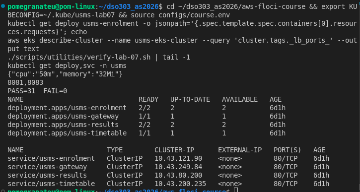
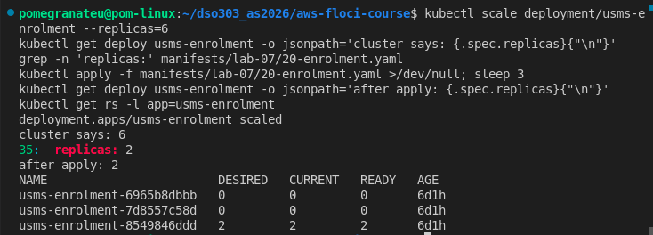
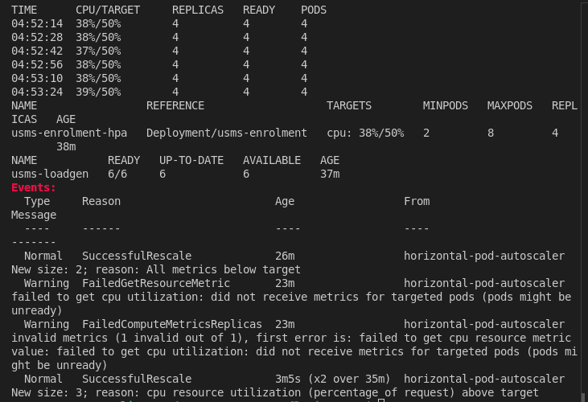
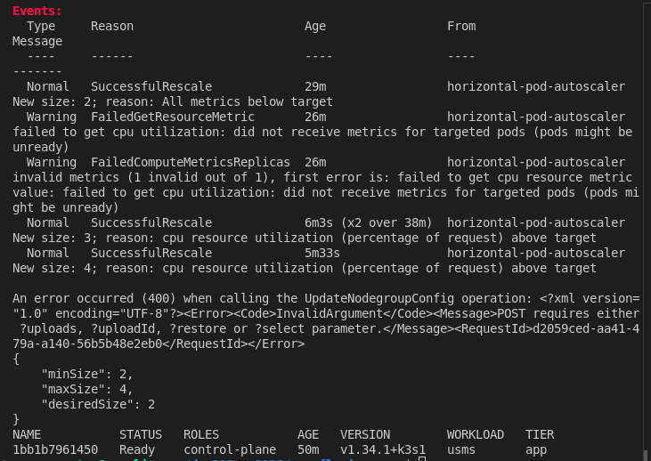
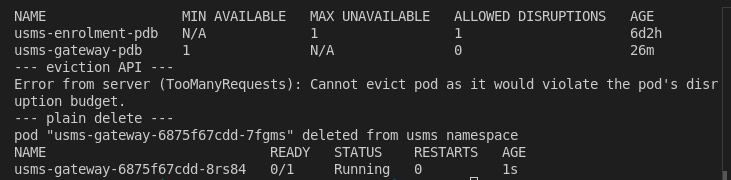
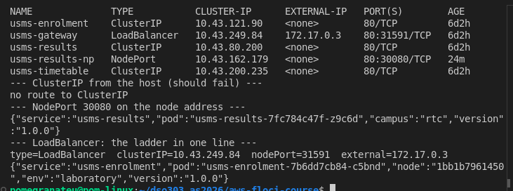
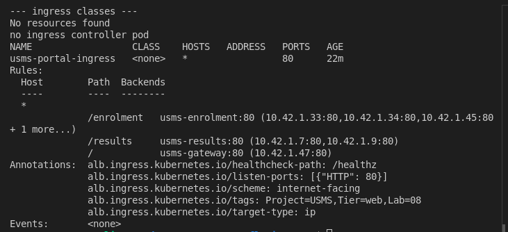
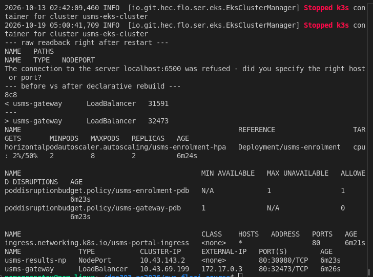
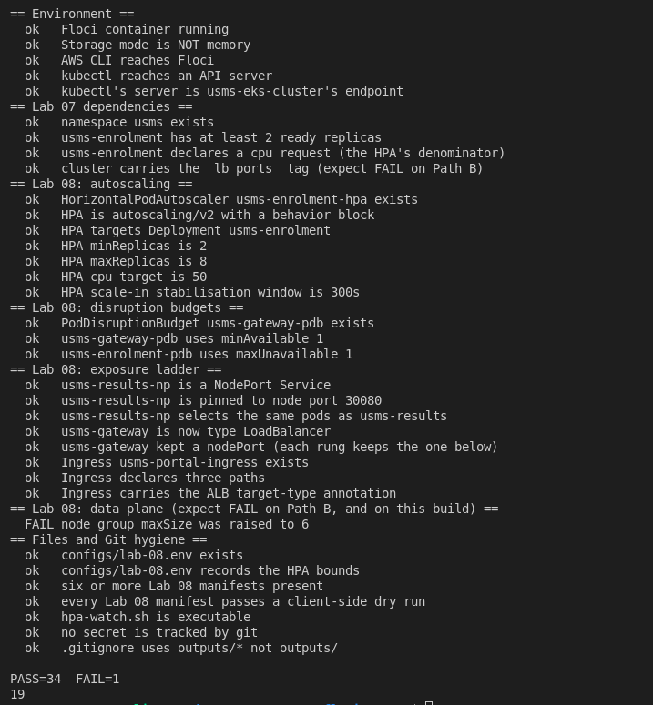
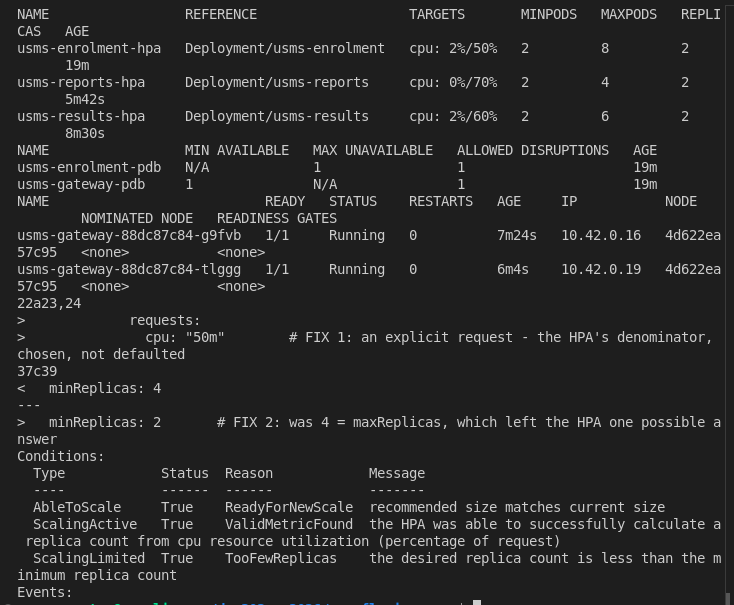

# DSO303 Lab 08: EKS Scaling and Service Exposure

**Student:** Pema Tshering Yangchen (ID 2230295)
**Module:** DSO303 Cloud Infrastructure, College of Science and Technology, Royal University of Bhutan
**Environment:** Floci v1.5.34 (EKS backed by `rancher/k3s`, Kubernetes v1.34), AWS CLI v2.31.35, kubectl v1.36.0, Docker, Pop!_OS (x86_64)
**Repository:** `~/dso303_as2026/aws-floci-course` (github.com/pomegranateis/dso303_as2026)

> Screenshots are in `img/` (listed at the end). Command output saved as text is linked from [`evidence/`](evidence/).

---

## 1. Objective

Scale Lab 7's `usms-enrolment` by hand, by manifest and with an `autoscaling/v2` HorizontalPodAutoscaler, and compare it with Lab 6's Application Auto Scaling. Change the node group's scaling from the AWS side. Use requests, QoS classes, a `nodeSelector` and PodDisruptionBudgets. Climb the exposure ladder (`port-forward`, `NodePort`, `LoadBalancer`, `Ingress`) and compare Ingress with Lab 5's ALB. Prove the configuration survives a restart, and record it in `configs/lab-08.env`.

**Support path A.** The Kubernetes half ran in full against a real k3s cluster, with metrics. On the AWS side, one operation (`update-nodegroup-config`) is not implemented on this build. That is the lab's documented known issue, and I used its alternative (Section 4, Step 10).

## 2. What was built

| Resource | Value | Notes |
|---|---|---|
| `usms-enrolment-hpa` | `autoscaling/v2`, min 2, max 8, CPU 50% of the 50m request | scale-up instant (Percent 100 / Pods 2 per 15 s, Max); scale-in 300 s window, 1 pod/min |
| `usms-results-hpa` (Ex 1) | min 2, max 6, CPU 60% | +2 pods per 30 s; 180 s scale-in window |
| `usms-gateway-pdb` | `minAvailable 1` | allowed disruptions 0, then 1 after Exercise 2 (gateway at 2 replicas) |
| `usms-enrolment-pdb` | `maxUnavailable 1` | was Lab 07 Exercise 4's `minAvailable 1`; now owned by Lab 08 |
| `usms-results-np` | NodePort, pinned `80:30080` | a second Service over the results pods |
| `usms-gateway` | LoadBalancer, `external 172.17.0.3` | fulfilled by k3s's svclb; NLB annotations for real EKS |
| `usms-portal-ingress`, `usms-results-ingress` (Ex 4) | `/enrolment`, `/results`, `/` and `/exam-results`, IngressGroup `usms-portal` | stored, not fulfilled: no ingress controller |
| `nodeSelector workload=usms` | on `usms-enrolment` | enforcement proven with a bad value |
| `usms-eks-nodes` | **still 2/4/2** | `update-nodegroup-config` to 2/6/3 not implemented on this build |
| `usms-loadgen` | used, then removed | not re-applied after the Step 18 rebuild |

Files added: `labs/lab-08-eks-scaling/` (this report, `exercises.md`, `evidence/`, `img/`), `manifests/lab-08/` (`10-hpa-enrolment`, `11-hpa-results`, `20-loadgen`, `30-pdb-gateway`, `40-service-nodeport`, `50-service-loadbalancer`, `60-ingress`, `61-ingress-results`), `configs/lab-08.env` (19 exports), `scripts/utilities/verify-lab-08.sh`, `scripts/utilities/hpa-watch.sh`, `scripts/cleanup/lab-08-cleanup.sh` (not run), `notes/lab-08-notes.md`. Changed: `manifests/lab-07/20-enrolment.yaml` (nodeSelector added; PDB moved out), `manifests/lab-07/40-gateway.yaml` (2 replicas and spread, Ex 2; Service moved out), `scripts/utilities/verify-lab-07.sh` (gateway replica check).

## 3. Deviations from the lab text

1. **Lab 07's kubeconfig and ports, as before.** `kubectl` uses `~/.kube/usms-lab07`, and `_lb_ports_` is `8081,8083` (the lab says 8082). The dso202 kind cluster from another module was paused with `docker stop` for the session, because of memory and because its control plane publishes host port 8081. It was started again at the end.
2. **The cluster was recreated at the start.** Floci had restarted since Lab 07, so `usms-eks-cluster` was an ACTIVE record with no k3s container behind it. I deleted and recreated the node group and cluster records from Lab 07's request files ([evidence](evidence/lab-08-rebuild.txt)). The k3s Docker volume still existed, so the new container came up with all of Lab 07's objects, plus a ghost Node (`NotReady`) holding six stale pods. I deleted that Node object, and the ReplicaSets rescheduled the pods onto the live node.
3. **Two manifests declaring one object, fixed twice.**
   - Lab 07 Exercise 4 declared `usms-enrolment-pdb` inside `20-enrolment.yaml`, and Step 12 redefines it. I moved it into `30-pdb-gateway.yaml`.
   - Exercise 2 showed that re-applying `40-gateway.yaml` turned the gateway back into ClusterIP. I moved that Service into `50-service-loadbalancer.yaml`.
   - Both old locations carry a comment saying where the object went. Rule used: one object, one file.
4. **Step 11's python snippet was replaced.** It would not have matched our enrolment manifest (the Exercise 4 block sits between `spec:` and `containers:`), and it prints "nodeSelector added" even when nothing was replaced. My version anchors on the Exercise 4 comment and stops if the anchor is missing.
5. **The load was raised in Step 9.** Three load generators held CPU at 51–54%, inside the HPA's default 10% tolerance, so nothing scaled. I raised `usms-loadgen` to 6, as the lab's troubleshooting section suggests.
6. **Step 10 used the known-issues alternative.** `update-nodegroup-config` fails, and the Known Issues page's alternative for Lab 08 is the HPA drill from Steps 8–9, which I had already run. The original error and the unchanged readback are kept, and `verify-lab-08.sh`'s node-group check is left failing.
7. **After the Step 18 restart, the cluster was rebuilt again**, this time from the manifests, because Floci deleted the k3s volume too (Section 4, Step 18). `20-loadgen.yaml` was not re-applied, because its `replicas: 3` would start load.

---

## 4. Implementation

### Steps 1 and 2: the two checks, and a baseline

`usms-enrolment` requests `{"cpu":"50m","memory":"32Mi"}`, and the cluster carries `_lb_ports_=8081,8083`. `verify-lab-07.sh` gives **PASS=31 FAIL=0** ([evidence](evidence/lab-08-step1.txt)). The baseline ([evidence](evidence/lab-08-baseline.txt)) shows four Deployments (Lab 07's Exercise 1 added `usms-timetable`), every Service ClusterIP with no external address, and one node with 20 CPUs.

### Step 3: the four dimensions

My ten-times plan (in the notes) goes in the order 1, 3, 2: more pods, then more nodes when pods go Pending, then bigger pods only if they throttle. Dimension 4 is a new node group plus a drain, never an in-place change.

### Steps 4 and 5: by hand, then by file

([evidence](evidence/lab-08-step4.txt), [evidence](evidence/lab-08-step5.txt))

- `kubectl scale` from 2 to 5 left the ReplicaSet count at **3 before and 3 after**, so there was no rollout. Forty requests through the gateway reached all five pods.
- The watch shows the readiness gate: each new pod was `Running 0/1` at 1 s and `1/1` at 7 s, and joined the endpoints only then.
- On scale-in, nginx exited about a second after SIGTERM, well inside the 30 s grace period.
- **Drift:** the cluster said 6 and the file said 2; `kubectl apply` set it back to 2. `kubectl diff` showed `replicas: 2 → 3` and **exited 1**.
- `apply` kept the Secret env vars added by `kubectl set env`, because they were never in the last-applied annotation.

### Step 6: requests, limits and QoS

([evidence](evidence/lab-08-step6.txt))

- All pods are `Burstable`.
- Requested on the node: 500m CPU (2%) of 20 allocatable. On this k3s, **allocatable equals capacity**, because nothing is reserved for the system, unlike an EKS AMI.
- **Your turn:** the gateway went `Burstable → Guaranteed → Burstable`, and every change **replaced** the pod. That is dimension 2, and it is why VPA is rarely used on live services.

### Steps 7 and 8: metrics and the HPA

metrics-server ships with k3s, so the metrics API was **AVAILABLE** without `--kubelet-insecure-tls`. Idle enrolment pods use 1m each (2% of the request). The HPA moved from `<unknown>/50%` in its first seconds to `cpu: 2%/50%`, with `ScalingActive True ValidMetricFound`, and its `behavior` read back exactly as written ([evidence](evidence/lab-08-step7-8.txt)).

### Step 9: load, observed

([evidence](evidence/lab-08-hpa-watch.txt), [evidence](evidence/lab-08-step9-scalein.txt))

- **Tolerance:** with 3 load generators, CPU sat at 51–54% and the HPA did nothing. 54/50 = 1.08 is within its default 10% tolerance.
- **Scale-out:** with 6 load generators, CPU reached 67% and replicas went 2 → **3**, since `ceil(2 × 67/50) = ceil(2.68) = 3`. CPU then settled at exactly 50% on three pods.
- **Correction to the lab's example.** The sample output goes to 4 at 71% and credits `selectPolicy: Max`. Scale-up policies only **limit** how much one step may add; they never raise the result above `desiredReplicas`. And `ceil(2 × 71/50)` is 3.
- **The stabilisation window, observed:** the load was removed at 04:21:42 and CPU was at 2% by 04:23:06. Replicas held at 3 until **04:27:27**, then dropped to 2, five minutes after the last recommendation of 3.
- The HPA's own reasons: *"New size: 3; reason: cpu resource utilization (percentage of request) above target"* and *"New size: 2; reason: All metrics below target"*.
- In a second run for the screenshot, it went to 4 (*"New size: 4"*) and settled at 38%.

The two `FailedGetResourceMetric` warnings in the next screenshot are from the Step 11 rollout: new pods have no metrics until their first scrape.

### Step 10: the node group, from the AWS side

([evidence](evidence/lab-08-step10.txt))

- **Before:** ACTIVE, 2/4/2, `t3.small`, private-a and private-b, labels `tier=app workload=usms`.
- **The update:** `update-nodegroup-config --scaling-config minSize=2,maxSize=6,desiredSize=3` returns **HTTP 400 `InvalidArgument: POST requires either ?uploads, ?uploadId, ?restore or ?select parameter`**. `list-updates` and `describe-update` return **404 `NoSuchBucket`**. All three EKS update calls fall through to Floci's S3 handler.
- **After:** the readback is still 2/4/2.

This is the lab's known issue. It was recorded on Floci 2.0.1 and is also true of 1.5.34. **Alternative used:** the HPA drill from Steps 8–9. It proves that load changes the number of pods; it proves nothing about nodes, and no node was added.

### Step 11: autoscalers for nodes, and a nodeSelector

Cluster Autoscaler raises the desired capacity of node groups you defined in advance. Karpenter launches an instance type that fits the pending pods. Neither is installed: both need IRSA, and there is no OIDC issuer here.

([evidence](evidence/lab-08-step11.txt))

- The node group's labels **did not reach the node**, so I applied them by hand.
- With `nodeSelector: workload=nonexistent`, the new pod stayed **Pending**: *"0/1 nodes are available: 1 node(s) didn't match Pod's node affinity/selector"*. Both old pods kept serving, because of `maxUnavailable: 0`.
- After restoring the selector, I added it to `manifests/lab-07/20-enrolment.yaml` (deviation 4). `kubectl diff` exits 0.

### Step 12: PodDisruptionBudgets

([evidence](evidence/lab-08-step12.txt))

- **Allowed disruptions:** gateway 0, enrolment 1.
- **Eviction API:** refused with *"TooManyRequests: Cannot evict pod as it would violate the pod's disruption budget"*.
- **`kubectl delete pod`:** went straight through, and the pod was replaced.
- **`drain --dry-run=client`:** printed "evicting" for the gateway. A client-side dry run does not ask the eviction API, so it hides the fact that a real drain would hang on the gateway.

### Steps 13 to 15: ClusterIP, port-forward, NodePort, LoadBalancer

([evidence](evidence/lab-08-step13-14.txt), [evidence](evidence/lab-08-step15.txt))

- **ClusterIP:** not routable from the host.
- **`port-forward`:** answered on all three routes. It is one tunnel to one pod that exists only while my terminal runs it.
- **NodePort `usms-results-np`:** answered on the node address and spread requests across both results pods. Docker's bridge network is routable from a Linux host, so **`http://172.17.0.3:30080/` answered from my machine directly**, without port-forward. `localhost:30080` is not published.
- **LoadBalancer:** after about 17 s at `<pending>`, **k3s's service load balancer** (svclb) gave it `EXTERNAL-IP 172.17.0.3`, and `http://172.17.0.3/` answered from the host on port 80.
- **The `_lb_ports_` host ports 8081 and 8083 do not answer**, because this k3s container publishes only 6500.
- **The ladder on one line:** `type=LoadBalancer  clusterIP=10.43.249.84  nodePort=31591  external=172.17.0.3`.

### Step 16: Ingress

([evidence](evidence/lab-08-step16.txt))

There is no IngressClass and no controller (this k3s runs without traefik). The Ingress is stored with three rules and resolved backends: `CLASS <none>`, no address, `Events: <none>`. I did not install traefik, because its LoadBalancer would need port 80 on the only node, which the gateway's svclb pod already holds.

**Conceptual:** the AWS Load Balancer Controller would run `create-target-group --target-type ip` (one per backend), then `create-load-balancer --scheme internet-facing` in the public subnets, then `create-listener --port 80`, then one `create-rule` per path, registering pod IPs as targets. Those are Lab 5's commands, from one object. The Ingress picks the longest matching prefix; Lab 5 used numeric rule priority.

### Step 17: Practical 2 against Practical 4

Both stacks are running ([evidence](evidence/lab-08-step17.txt)): ECS `usms-enrolment-svc` at 2/2 behind `usms-enrolment-tg` (type `ip`), and the EKS objects above. Application Auto Scaling answers `UnknownOperationException` (Lab 6 was path C), so the ECS scaling column describes Lab 6's written configuration, not a running policy. Both tables and the two paragraphs are in the notes.

### Step 18: persistence - only through Git

([before](evidence/lab-08-before-restart.txt), [raw after](evidence/lab-08-after-restart-raw.txt), [rebuild](evidence/lab-08-rebuild2.txt), [after rebuild](evidence/lab-08-after-restart.txt))

At `floci-down`, Floci logged *"Stopped k3s container for cluster usms-eks-cluster"* (as it did on 13 October). This time it removed **both the container and its volume**, so the raw readback got *"connection refused"* and `PERSISTENCE PROVEN` **was not printed**. Only the node group's 2/4/2, from the AWS half, came back.

Recovery took two `kubectl apply` commands: `manifests/lab-07/` first, then `manifests/lab-08/`. Before that I recreated the cluster records and labelled the node, and I had to repeat the imperative `kubectl set env` by hand again.

After the rebuild, the readback is **identical except for the gateway's auto-allocated nodePort (31591 → 32473)**. The pinned 30080 did not change, which is the argument for pinning. The smoke test passed.

**Floci limitation:** the Kubernetes objects survive a restart because they are in Git, not because Floci kept them. On real EKS, AWS runs the control plane's etcd. As in Labs 5 and 7, the restart also stopped the four Lab 3 instances; I started them again.

### Steps 19 and 20: `configs/lab-08.env` and the commit

`configs/lab-08.env` has **19 exports**, all looked up live:

- `hpa: 2..8 at 50% cpu, scale-in window 300s`
- `nodeport: 30080`, `gateway: LoadBalancer`
- `USMS_INGRESS_CLASS` is empty: no controller, one of the lab's expected exceptions.
- The node group reads 2/4/2.
- The header records why each of those values looks the way it does.

Before committing I checked that nothing under `outputs/` was staged (`.gitignore:7:outputs/*`).

### Section 16: backup before the next lab

([evidence](evidence/lab-08-backup.txt), [rebuild](evidence/lab-08-backup-rebuild.txt))

- **`floci snapshot save lab-08-complete` failed:** the CLI has the command, but the server returned `HTTP 400`; the snapshot API is not available on server 1.5.34.
- **I used the lab's fallback instead:** `floci-down.sh`, then `tar -czf ~/floci-data-lab-08.tar.gz -C ~ floci-data` (107 KB, 92 files, outside the repository), then `floci-up.sh`.
- **The archive covers the AWS side only** (IAM, VPC, EC2, ECS, ELB, the EKS records). The Kubernetes objects live in a Docker volume, and their backup is the manifests in Git.
- **This restart kept the k3s volume**, unlike Step 18. So after recreating the cluster records, the old state returned, including a ghost `NotReady` node holding every pod. I deleted that Node object and the pods rescheduled.
- **Afterwards:** the smoke test passed, `verify-lab-07.sh` PASS=31 FAIL=0, `verify-lab-08.sh` PASS=34 FAIL=1, and the Lab 3 instances were started again.
- **Floci limitation:** whether a restart keeps the k3s volume is not predictable on this build (deleted on 13 October and in Step 18, kept this morning and here).

---

## 5. Floci limitations found

| # | Behaviour on Floci | Real EKS |
|---|---|---|
| 1 | `update-nodegroup-config`, `list-updates`, `describe-update` not implemented (answered by the S3 handler) | Changes the ASG; returns an Update object to poll |
| 2 | One node; node group labels never reach it | Nodes from the group, in the private subnets, labelled |
| 3 | Allocatable equals capacity (no system reservation) | The AMI reserves CPU and memory for the kubelet and system |
| 4 | No ingress controller; Ingress objects stored, never fulfilled | AWS Load Balancer Controller builds an ALB from them |
| 5 | LoadBalancer fulfilled by svclb on a Docker address; `_lb_ports_` not published | An NLB in the public subnets with pod IPs as targets |
| 6 | No OIDC issuer: no IRSA, so no Cluster Autoscaler, Karpenter or AWS Load Balancer Controller | All three are routine |
| 7 | A Floci restart removes the k3s container, and this time its volume | The control plane and etcd persist |
| 8 | Application Auto Scaling absent (Lab 6) | Full service |
| 9 | A restart leaves EC2 instances stopped | No equivalent |

What Floci does model well here: a real Kubernetes cluster with metrics-server. The HPA (tolerance, policies, stabilisation window), PDBs and the eviction API, scheduling constraints, Service types and kube-proxy all behaved exactly as documented upstream.

**Observed / recorded only / conceptual** (Section 11): *observed* covers everything in Steps 4–9 and 11–15 above; *recorded but not enacted* covers the AWS annotations, the Ingress, and the node group sizes (here, not even recorded); *conceptual* covers the AWS Load Balancer Controller, Cluster Autoscaler, Karpenter, custom metrics and cost.

---

## 6. Verification

`./scripts/utilities/verify-lab-08.sh` reports **PASS=34 FAIL=1** ([evidence](evidence/lab-08-verify.txt)). The one failure, "node group maxSize was raised to 6", is the Step 10 gap, left failing on purpose: a substitute must not turn a failed check into a pass.

Run exactly as the lab gives it ([evidence](evidence/lab-08-verify-asgiven.txt)):
- **With `KUBECONFIG` unset:** PASS=9 FAIL=25. Every Kubernetes check aimed at the default context, the other module's stopped cluster.
- **With `KUBECONFIG` set:** PASS=32 FAIL=2. One is the real gap; the other is the `outputs/.gitkeep` false positive, the same one fixed in earlier labs.

I made the same three changes as in Lab 07: a kubeconfig fallback, a new check that **kubectl's server is usms-eks-cluster's endpoint**, and the `.gitkeep` exception.

`verify-lab-07.sh` stays at **PASS=31 FAIL=0** after I changed its gateway check from exactly 1 replica to at least 1. Exercise 2 sets 2 replicas, and the lab's Section 16 asks for "at least 2, 2 and 1". `scripts/cleanup/lab-08-cleanup.sh` passes `bash -n` and **has not been run**.

---

## 7. Independent exercises

Full write-ups in [`exercises.md`](exercises.md).

1. **A second autoscaler.** `11-hpa-results.yaml`: min 2, max 6, 60%, +2 pods per 30 s, a 180 s window; dry-run first. Both HPAs report percentages.
2. **A drainable gateway.** Two replicas and a spread constraint, with the PDB unchanged. `ALLOWED DISRUPTIONS` went 0 → 1, an eviction succeeded (`201`) and a second one was refused. It also exposed the Service clash in deviation 3; both diffs now exit 0.
3. **The autoscaler that will not act.** `minReplicas = maxReplicas = 4` gives `ScalingLimited TooFewReplicas`. The missing request did **not** give `<unknown>`, because Kubernetes defaults requests to limits (the pods were `Guaranteed`, with an implicit 200m). I showed the `<unknown>` / `missing request for cpu` case with the resources removed. Two one-field fixes, then cleaned up.
4. **Results for the Examinations Office.** A second Ingress in the same IngressGroup (one ALB, one bill), on `/exam-results`, restricted to the university network by an ALB source-IP condition. Cost and failure modes are written out.

5. **For Lab 10.** `lab-08-scaling-evidence.json` (valid JSON, from live calls, stating the node group's real 2/4/2), and the readiness file re-derived from IAM: the bucket ARN read from the policy, three roles found role by role, the bucket absent, and a new IRSA role for `usms-enrolment-sa`, not the node role.

## 8. Review questions

Answered in prose in `notes/lab-08-notes.md`, with the Step 17 tables and the 317-word "ECS or Kubernetes for USMS".

## 9. Reflection

Three things stood out.

First, an autoscaler that "doesn't work" was working perfectly. The HPA refused to move at 54% because of a tolerance I had never heard of, and in Exercise 3 the "missing request" was silently filled in by a default. In both cases the explanation was in `kubectl describe`, in the controller's own words, and in neither case was it what the lab text predicted. Reading the conditions taught me more than the expected output did.

Second, two files declaring one object is a quiet way to break things. The PDB and the gateway Service both flipped back and forth depending on which file was applied last, and `kubectl diff` is what showed it.

Third, persistence again. The scaling and exposure configuration survived the restart only because every piece of it was a file in Git; the one imperative command (`set env`) had to be repeated by hand, exactly as in Lab 07.

## 10. Screenshot checklist

`lab08-01-baseline`, `lab08-02-drift`, `lab08-03-hpa-scaleout`, `lab08-04-scalein-nodegroup`, `lab08-05-pdb-eviction`, `lab08-06-nodeport-lb`, `lab08-07-ingress`, `lab08-08-persistence`, `lab08-09-verify`, `lab08-10-exercises`, all `.png`, in `labs/lab-08-eks-scaling/img/`, all present.

## 11. Commits

The main lab (manifests, scripts, env file, notes and evidence); the exercises; this report.
