# DSO303 Lab 09: Securing the USMS Application with IAM Roles and Security Groups

**Student:** Pema Tshering Yangchen (ID 2230295)
**Module:** DSO303 Cloud Infrastructure, College of Science and Technology, Royal University of Bhutan
**Environment:** Floci v1.5.34, AWS CLI v2.31.35, Docker, Pop!_OS (x86_64)
**Repository:** `~/dso303_as2026/aws-floci-course` (github.com/pomegranateis/dso303_as2026)

> Screenshots are in `img/` (listed at the end). Command output saved as text is linked from [`evidence/`](evidence/). Access key IDs are redacted in every committed file.

---

## 1. Objective

Review everything Labs 1–6 built on two axes, *who can call what* (IAM) and *what can reach what* (security groups and routing), using read-only audit scripts. Then fix the findings:
- **Identity:** a read-only transcripts policy, confused-deputy conditions on trust policies, a scoped `iam:PassRole`, a permissions boundary, a session policy, an access-key rotation, and IMDSv2.
- **Network:** written egress on three groups, bastion-only SSH, and a five-control proof that the database is unreachable.

Then prove that persistence holds and nothing broke, and record the result in `configs/lab-09.env`.

**Support path A.** IAM management works on this build, and so does `iam simulate-principal-policy`, which *evaluates* policies. That's better than the lab's expected path B: a control here can be judged by a decision, not only by reading. Nothing is enforced on real traffic or real calls, though. Floci accepts any credentials and carries no traffic for security groups.

## 2. What was built

| Resource | Value | Notes |
|---|---|---|
| `USMSStudentDataReadOnly` | Allow ListBucket, GetObject; explicit Deny PutObject, DeleteObject, DeleteBucket, PutBucketPolicy | on `usms-transcripts-reader-role` |
| `usms-transcripts-reader-role` | trusts `ecs-tasks.amazonaws.com` with `aws:SourceAccount` + `aws:SourceArn` | 3600 s |
| `usms-ecs-task-role` trust | same principal, two conditions added | undo saved in `outputs/` |
| `USMSPermissionsBoundary` | a ceiling, AttachmentCount 0 | boundary of `usms-deploy-role` and `usms-breakglass-role` |
| `USMSDeployBase` / `usms-deploy-role` | PassRole to three named roles, only to ECS; Deny PassRole to EC2 | trusts `user/usms-admin-01` |
| `usms-dev-01` access key | rotated: exactly one Active key, created 2026-10-21 | old key deactivated, then deleted |
| IMDSv2 on `usms-web-01` | **not applied**: the call is not supported on this build | recorded, alternative run |
| Egress on `usms-enrolment-sg`, `usms-alb-sg`, `usms-db-sg` | tcp/443 (S3 prefix list and 0.0.0.0/0); tcp/80 to `usms-enrolment-sg`; tcp/443 | no allow-all left |
| SSH on `usms-app-sg` | tcp/22 from `usms-bastion-sg` only; the `10.0.0.0/16` rule revoked | bastion group reused from Lab 02 Exercise 2 |
| Exercise 1: `usms-app-sg` egress | S3, HTTPS, the ALB, PostgreSQL, DNS udp and tcp to 10.0.0.2 | no allow-all left |
| Exercise 2: `usms-breakglass-role` | usms-admin-01 with MFA AND an external ID, 3600 s, boundary, two scaling calls | trusts of `usms-ecs-exec-role` and `usms-lambda-exec-role` scoped |

Files added:
- **Report:** `labs/lab-09-security/` (this report, `exercises.md`, `evidence/`, `img/`).
- **Policies:** fourteen `policies/` documents. These are the lab's ten (`usms-student-data-ro-policy`, `usms-deploy-policy`, `usms-permissions-boundary`, `trust-ecs-tasks-scoped`, `trust-deploy`, `usms-alb-sg-egress`, `usms-enrolment-sg-egress`, `usms-db-sg-egress`, `usms-egress-allow-all`, `usms-app-sg-ssh-bastion`) plus four from the exercises (`usms-app-sg-egress`, `trust-breakglass`, `usms-breakglass-policy`, `trust-lambda-scoped`).
- **Configs:** `configs/lab-09.env` (17 exports) and `configs/usms-iam-accepted-findings.json`.
- **Scripts:** `scripts/utilities/` gains `usms-iam-audit.sh`, `usms-sg-audit.sh`, `usms-reachability-matrix.sh`, `usms-exposure-report.sh`, `usms-bucket-policy-draft.sh`, `verify-lab-09.sh` and `student-fallback-demo.py` (from the course's Known Issues page). `scripts/cleanup/lab-09-cleanup.sh` is written but not run.
- **Notes:** `notes/lab-09-notes.md`.

Changed: `configs/lab-07.env`'s `USMS_EKS_ENDPOINT` was updated to the rebuilt cluster's port (Section 4, Step 18).

## 3. Deviations from the lab text

1. **The account is larger than the lab's example.** It has 7 roles, not 5: Lab 07 added the two EKS roles. `USMSStudentDataReadWrite` is on **three** roles, not two, because `usms-eks-node-role` (Lab 07) carries it too; Section 16 of the lab already expects 3. There are 8 security groups, not 5. Every count below differs from the lab's examples for these reasons.
2. **Tags `Lab=09`.** The lab text's `Lab=05` on the new policies and roles is a copy-paste slip.
3. **`list-entities-for-policy` is unsupported.** Every "who carries this policy" question was answered role by role, user by user and group by group.
4. **Step 9 needed one extra line.** Our `USMSDeveloperBase` (v3) already allows all four session actions. To show "a session cannot grant what the role lacks", I repeated the calculation with `s3:PutObject` added.
5. **The key rotation's quiet period was minutes, not days**, because this is a lab. Lab 1's key file did not exist under `outputs/`. A temporary copy of `~/.aws/credentials` taken before the change was deleted once the old key was gone.
6. **I made a mistake in Steps 13 and 16, and fixed it.** I set `S3_PREFIX_LIST` and `BASTION_SG` inside a `{ …; } | tee` block, which is a subshell, so the policy documents written afterwards contained `""` for those IDs. Screenshot 7 showed it. I rewrote both documents with the real IDs and re-authorised. On this build the empty-source rules can't be removed (see limitation 4), so they remain as indistinguishable duplicates.
7. **The lab's own queries contain two bugs, which I fixed** (they fail on real AWS as well; details in Section 6):
   - `length(IpPermissions…)` is missing `SecurityGroups[0].`;
   - `` IpProtocol==`-1` `` compares the string `"-1"` with the number −1, so it never matches.
8. **Step 2's `tail -1`** picks up a footnote line for lab-05 and lab-06, so I grepped the `PASS=` line instead.
9. **The EKS cluster was rebuilt after the Step 18 restart.** That needed dso202 paused briefly (Step 18 explains why) and `configs/lab-07.env`'s endpoint updated. The host also rebooted twice during the lab; both times everything in Lab 09 survived.

---

## 4. Implementation

### Steps 1 to 3: environment, baseline, and the support probe

All 17 Step 1 values are populated. `lab-01.env` holds the role variables as ARNs, so I printed `${VAR##*/}`. The baseline ([evidence](evidence/lab-09-pre-verify.txt)) is exactly what each earlier report recorded:

| Lab | Result |
|---|---|
| 02 | 33/0 |
| 03 | 32/5 |
| 04 | 39/1 |
| 05 | 52/3 |
| 06 | 30/20 |

Every failure is labelled `[floci]`. Lab 06 was path C.

The probe ([evidence](evidence/lab-09-support-probe.txt)) shows IAM management, the EC2 rule APIs and `simulate-principal-policy` all answering. For `usms-ec2-app-role` the simulator returned GetObject `allowed`, DeleteBucket `explicitDeny` (Lab 1's NeverDeleteTheBucket) and `implicitDeny` otherwise, so it really evaluates. **Path A.** Not available: `get-account-authorization-details`, Access Analyzer, `get-credential-report`, `list-entities-for-policy`.

### Steps 4 and 5: inventory and the IAM audit

The inventory covers 7 roles, none with a boundary ([evidence](evidence/lab-09-identity-inventory.json)). The audit reports **HIGH=6 MED=29 roles=7** and exits 1 ([evidence](evidence/lab-09-iam-findings.txt)). The six HIGHs are unconditioned service trusts (the confused deputy). Most MEDs are mutating actions on `Resource "*"` in `USMSDeveloperBase` and the EKS policies.

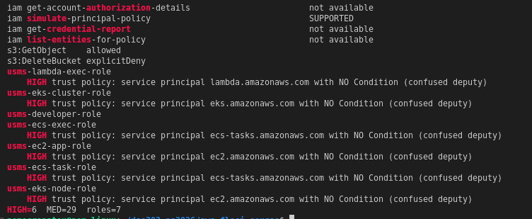

### Step 6: the transcripts policy

`USMSStudentDataReadWrite` grants GetObject, PutObject **and DeleteObject** to all three roles, which is wider than the lab's example. The bucket does not exist yet (404).

The enrolment API needs only GetObject and ListBucket. ListBucket makes a missing transcript return 404 instead of 403. The registry upload adds exactly one action: **s3:PutObject**.

### Step 7: the read-only split and the confused-deputy fix

([evidence](evidence/lab-09-step7.txt), [simulation](evidence/lab-09-step7-simulate.txt))

I created `USMSStudentDataReadOnly` and `usms-transcripts-reader-role`. I replaced `usms-ecs-task-role`'s trust after saving the undo: **SAME PRINCIPAL, NEW CONDITION.**

The simulator on one object:

| Role | GetObject | PutObject | DeleteObject |
|---|---|---|---|
| reader role | allowed | explicitDeny | explicitDeny |
| task role | allowed | allowed | allowed |

`usms-ec2-app-role` stays unconditioned, because EC2 sends no `aws:SourceArn` (accepted in Exercise 2).

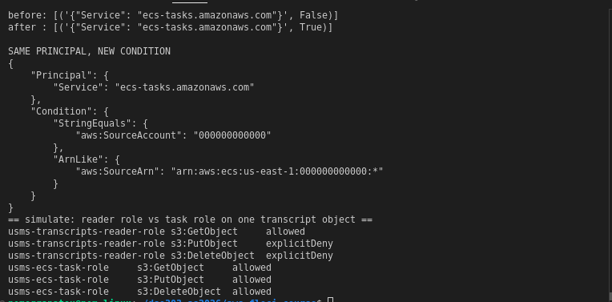

### Step 8: scoped PassRole, and a boundary that is enforced but not returned

([evidence](evidence/lab-09-step8.txt), [boundary](evidence/lab-09-step8-boundary.txt))

`USMSPermissionsBoundary` is attached to nothing (AttachmentCount 0). `USMSDeployBase` scopes PassRole to three named ARNs with `iam:PassedToService`. `usms-deploy-role` trusts `user/usms-admin-01`.

`get-role` shows `Boundary: null`; that's the known issue. Testing showed what's really happening:
- `create-role --permissions-boundary` is **dropped** on this build;
- `put-role-permissions-boundary` **stores** the boundary, and the simulator **enforces** it.

The deploy role gets `explicitDeny` for `iam:CreateUser`, `ec2:DeleteVpc` and `iam:AttachRolePolicy`, none of which `USMSDeployBase` mentions. The reader role, which has no boundary, gets `implicitDeny` for the same three.

PassRole, simulated with `iam:PassedToService`:

| Role passed | To service | Decision |
|---|---|---|
| task role | ECS | allowed |
| task role | EC2 | explicitDeny |
| `usms-ec2-app-role` | ECS | implicitDeny |

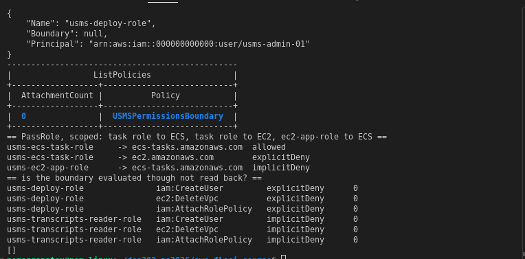

### Step 9: the session policy

([evidence](evidence/lab-09-step9.txt))

`assume-role --policy` returned credentials. Floci then let the scoped session list IAM users anyway: the session policy is ignored, and so is `--role-session-name`. The effective-permissions calculation showed the intersection. With `s3:PutObject` added to the session (deviation 4), the result for it was **"NOT in the identity policy → denied"**. Afterwards I unset the credentials, `whoami` returned root, and I deleted the session file.

### Step 10: the access-key rotation

([evidence](evidence/lab-09-step10.txt), IDs redacted)

1. **Create** a second key; its file is chmod 600 and git-ignored (`.gitignore:7:outputs/*`).
2. **Update** the `usms-dev` profile to use it. It still resolves to `user/usms-dev-01`.
3. **Deactivate** the old key.
4. **Delete** the old key, after you confirmed.

The result is exactly one Active key, created today. The checklist asks for the state *during* step 3 (two keys, one Inactive), and screenshot 4 shows it.

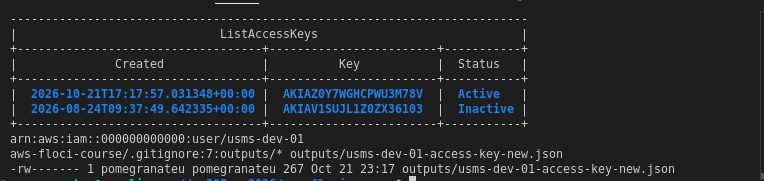

### Step 11: IMDSv2, not applied

([evidence](evidence/lab-09-step11.txt), [alternative](evidence/lab-09-step11-fallback.txt))

`modify-instance-metadata-options` returns **UnsupportedOperation**, so both instances stay at `HttpTokens: optional`. I recorded it as a Floci limitation and ran the Known Issues alternative (`student-fallback-demo.py security`: ALLOW/DENY/DENY, HTTP 401 without the token, 200 with it). It's a teaching model, not IMDSv2.

On real AWS:
- **`--http-tokens required`** stops SSRF credential theft;
- **hop limit 1** stops a container from reaching the host's credentials;
- **the rollout order:** watch `MetadataNoToken` until it's zero, then require tokens.

For `usms-db-01`, which has no instance profile, the right setting is `--http-endpoint disabled`. On `usms-web-01` that would cut off its own role credentials.

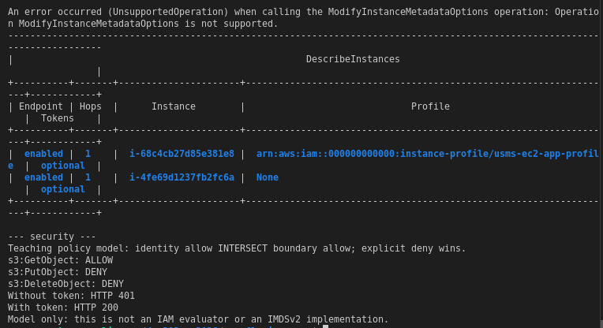

### Steps 12 to 16: the network half

([audit before](evidence/lab-09-sg-findings-before.txt), [Step 13](evidence/lab-09-step13.txt), [14–15](evidence/lab-09-step14-15.txt), [16](evidence/lab-09-step16.txt), [fix](evidence/lab-09-fix-empty-ids.txt), [audit after](evidence/lab-09-sg-findings-after.txt))

The SG audit before: **HIGH=4 MED=10 LOW=6 groups=8**. The changes (each time the replacement was authorised before the default was revoked):
- **Enrolment tasks:** tcp/443 to the S3 prefix list and to `0.0.0.0/0`.
- **Load balancer:** tcp/80 to `usms-enrolment-sg`.
- **Data tier:** tcp/443.
- **SSH:** the web tier now admits SSH from `usms-bastion-sg`, and the `10.0.0.0/16` rule is revoked.

The result in the group document: **zero allow-all egress on all three groups**, all ingress unchanged, and **0 CIDR sources on tcp/22**. The SG audit after: MED=7, then **MED=6** after Exercise 1.

Floci limitations met here:
- **Targets are lost.** Group and prefix-list targets are stored blank, even when the document carries the right ID.
- **Stale records.** `describe-security-group-rules` keeps records of revoked rules; `describe-security-groups` reflects the change. I took the group document as the state of record, as the lab's own checks do.
- **Revoking by rule ID** returns True and removes nothing.

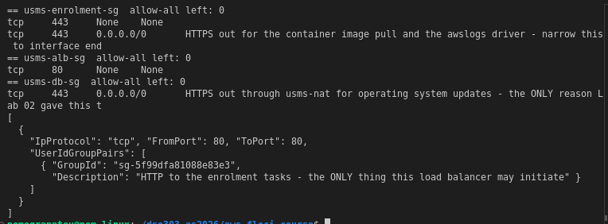

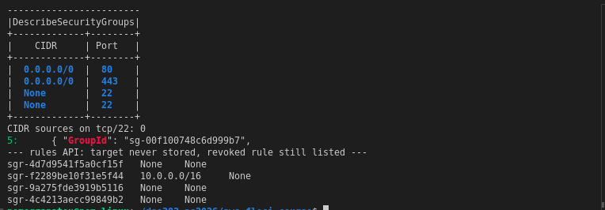

Screenshot 7 was retaken after the fix in deviation 6, so the document shows the real bastion group ID.

### Step 17: the reachability matrix and the negative proof

([matrix](evidence/lab-09-reachability.txt), [proof](evidence/lab-09-negative-proof.txt))

The matrix can't see group-referenced ingress, because the sources are blanked. So it doesn't flag `usms-db-sg` or `usms-enrolment-sg` as single points of control, though it does flag three others. That's the lab's "a tool that models one axis understates" point, in miniature.

The five controls for `usms-db-01`:

| # | Control | Readback |
|---|---|---|
| 2 | subnet doesn't auto-assign public addresses | False — holds |
| 3 | no internet-gateway route | `0.0.0.0/0 → nat-…`, no IGW — holds |
| 5 | custom NACL | `acl-2d156e19…`, IsDefault False — holds |
| 1 | no public address | reads `127.0.0.1`, a Floci artefact (loopback is not an internet address) |
| 4 | SG admits one group only | source unreadable (blanked) |

The claim rests on three independently provable controls. That's defence in depth working as intended.

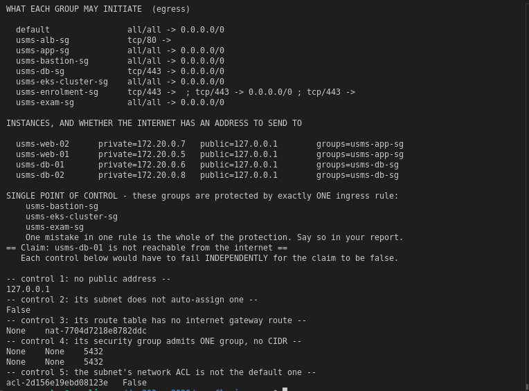

### Step 18: persistence and regression

([restart](evidence/lab-09-restart.txt), [before](evidence/lab-09-pre-restart.txt), [after](evidence/lab-09-post-restart.txt), [regression](evidence/lab-09-post-verify.txt))

After `floci-down`/`floci-up`, the nine facts were identical: **PERSISTENCE PROVEN**. Facts 2 (boundary) and 10 (IMDS) are identical because they read `None` and `optional` both times. The real evidence for the boundary is that the simulator still returned `explicitDeny` after the restart. The regression check passed too: **NOTHING BROKE** (the five earlier verifiers report exactly what they did in Step 2). I started the Lab 3 instances again.

The EKS rebuild after the restart got stuck in `CREATING`. The k3s log showed containerd failing with *"failed to create fsnotify watcher: too many open files"*: the host's `fs.inotify.max_user_instances=128` was used up while the dso202 kind cluster was running. I paused dso202, recreated the cluster, and applied `manifests/lab-07/` and then `manifests/lab-08/`. Afterwards `verify-lab-07` gave PASS=31 FAIL=0 and `verify-lab-08` PASS=34 FAIL=1 (its known gap). The new cluster came up on port 6502, so `configs/lab-07.env` was updated.

The host also rebooted twice during the lab, unplanned. Both times the nine facts and `verify-lab-09` were unchanged ([evidence](evidence/lab-09-reboot-check.txt)).

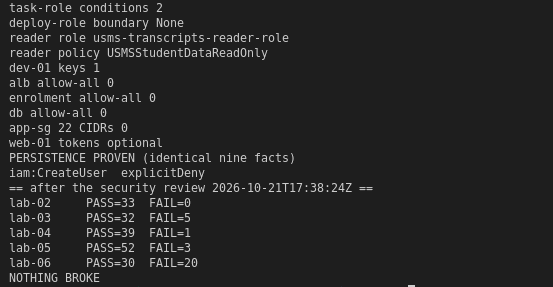

### Step 19: `configs/lab-09.env`

It has 16 exports (17 after Exercise 5), all populated and looked up live. It contains **no access key ID**, only the rotation date. `USMS_IMDS_TOKENS=optional` is recorded honestly, with the reason in the file's header. `USMS_EGRESS_ALLOW_ALL_REMAINING=0` was counted with the corrected query.

---

## 5. Floci limitations found

| # | Behaviour on Floci 1.5.34 | Real AWS |
|---|---|---|
| 1 | No policy is enforced on calls; any credentials are accepted | Every call is authorised |
| 2 | `create-role --permissions-boundary` is dropped; `put-role-permissions-boundary` stores and the simulator enforces, but `get-role` never returns it | Stored and returned |
| 3 | Session policies are ignored; `--role-session-name` is ignored | Enforced; the session name appears in the ARN and CloudTrail |
| 4 | Group and prefix-list targets in SG rules are stored blank; revoke by rule ID is a no-op; the rules API keeps stale records | Stored, revoked and listed accurately |
| 5 | `modify-instance-metadata-options` is unsupported | Enforced at the hypervisor |
| 6 | Every instance reports public `127.0.0.1` and a Docker address | Real VPC and public addresses |
| 7 | No ENIs for the ALB, NAT or Fargate tasks | Listed |
| 8 | AWS-managed `ReadOnlyAccess` is an `Allow "*"` stub | Read-only |
| 9 | No `list-entities-for-policy`, `get-account-authorization-details`, Access Analyzer or credential report | Available |
| 10 | `get-access-key-last-used` returns N/A | Last use, service and region |
| 11 | A restart stops EC2 instances; k3s can't start while dso202 holds the inotify limit | No equivalent |

What Floci does well here is the IAM simulator. It applies explicit Deny over Allow, the boundary as a ceiling, and `iam:PassedToService` conditions. That turned several path B "read it and trust it" checks into observed decisions.

**Observed vs reasoned** (Section 11): the simulator decisions, all readbacks, the key rotation and the persistence runs were *observed*. Anything about traffic, IMDS, the session policy's effect, the SG targets and CloudTrail/GuardDuty is *reasoned*.

---

## 6. Verification

`./scripts/utilities/verify-lab-09.sh` reports **PASS=43 FAIL=7** ([evidence](evidence/lab-09-verify.txt)). Every failure is labelled `[floci]` and is left failing on purpose:
- boundary readback;
- IMDSv2;
- the enrolment-sg source group;
- the db-sg source group;
- the alb-sg egress target group;
- the app-sg tcp/22 source group;
- db-01's `127.0.0.1`.

Run exactly as the lab gives it, the script reported **PASS=33 FAIL=17** ([evidence](evidence/lab-09-verify-asgiven.txt)). Ten of those failures were **bugs in the script**, which I fixed:
- **Policy holders:** counted role by role, because `list-entities-for-policy` is unsupported.
- **Missing `SecurityGroups[0].`** in five `length()` queries. Without it the query errors on any build, real AWS included.
- **The allow-all filter.** `` IpProtocol==`-1` `` is a JSON *number* and never matches the string `"-1"`. So "no allow-all egress" passed whatever the rules said; on `usms-app-sg`, which still had the default, the lab's query read 0 and the corrected one read 1.
- **The boundary AttachmentCount check** broke on its own quoting.
- **`${aws:username}`** in Lab 01's credentials policy is an IAM variable, not a leftover. The check now looks only for `${UPPER_CASE}`.
- **`outputs/.gitkeep`**, the same false positive as in Labs 2–8.

Negative tests: the narrowed variable check still catches a real `${USMS_ACCOUNT_ID}`, and the fixed allow-all count reads 1 on a group that has the default.

`scripts/cleanup/lab-09-cleanup.sh` passes `bash -n` and **has not been run**.

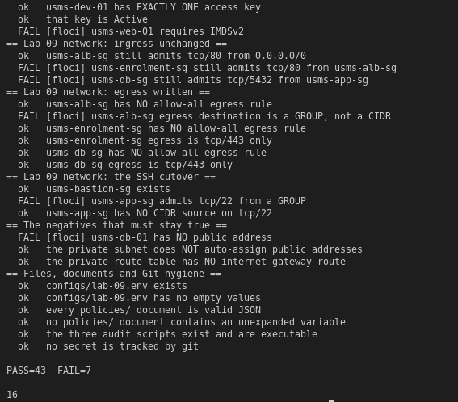

---

## 7. Independent exercises

Full write-ups in [`exercises.md`](exercises.md).

1. **Web-tier egress.** Six rules: S3, HTTPS, tcp/80 to **`usms-alb-sg`**, PostgreSQL to `usms-db-sg`, and DNS over UDP and TCP to `10.0.0.2`. The replacements were authorised before the default was revoked, and the audit no longer reports default egress on app-sg.
2. **Break glass.** `usms-breakglass-role` requires MFA **and** an external ID (one Condition block, so AND), lasts 3600 s (IAM refuses 3599), carries the boundary and allows exactly two scaling calls. I fixed two confused-deputy trusts and accepted three with reasons in `configs/usms-iam-accepted-findings.json`. The audit now reports HIGH=0 with 3 ACCEPTED, and still exits 1 with nothing accepted.
3. **Exposure report.** `usms-web-01` is **EXPOSED**, `usms-web-02` has **NO PUBLIC ADDRESS**, and the two DB instances are **ISOLATED**. The output is identical from any directory, and there's an `ADDRESSED, NO OPEN PORT` verdict for a public interface that admits nothing.
4. **Review for the security officer.** It covers the second front door, what egress control bought (with cited costs), a complete transcripts-access table and detection. It found a new issue: **the auditors group (including an intern) can read every transcript through `ReadOnlyAccess`**. The command sequence for moving the web tier behind the load balancer is written but not run.
5. **Bucket policy draft.** Five principals, each limited to what it has, plus a TLS Deny and a deny-everyone-else. It found the **third policy that names the bucket, `USMSLambdaBasic`**. The readiness file is written and the env file has 17 exports.

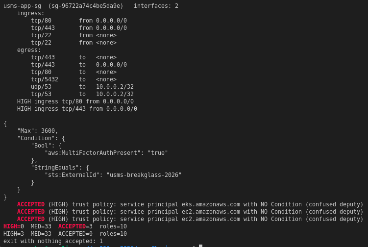

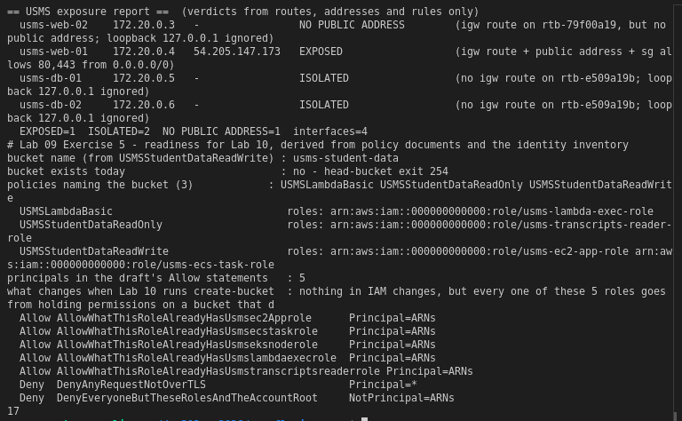

## 8. Review questions

Answered in prose in `notes/lab-09-notes.md`.

## 9. Reflection

Three things stood out.

First, the most useful check in this lab was the one I almost didn't run. The lab's allow-all query looked right, returned the expected 0 everywhere, and would have gone straight into the report. It could never have returned anything else. Only pointing it at a group that *should* fail showed that. A check that can't fail isn't evidence.

Second, my own subshell mistake was caught by a screenshot, not by a command. The commands all "succeeded". Reading the document I had written showed `"GroupId": ""`. Floci's silent acceptance of an empty ID is exactly why the lab keeps saying to judge controls by reading them.

Third, the simulator changed the character of the identity half. The boundary was invisible to `get-role`, but the simulator showed it was there, and showed which of two ways of setting it actually worked. The auditors finding came from simulating users, which no role-based inventory would ever have shown.

## 10. Screenshot checklist

All `.png`, in `labs/lab-09-security/img/`, all present. The lab asks for Checkpoints 4, 8 and 10; those are screenshots 03, 06 and 08.

| # | File | Shows |
|---|---|---|
| 01 | `lab09-01-probe-iam-audit` | support probe and IAM audit |
| 02 | `lab09-02-readonly-trust` | read-only split and scoped trust |
| 03 | `lab09-03-boundary-passrole` | boundary and PassRole (Checkpoint 4) |
| 04 | `lab09-04-key-rotation-during` | rotation, two keys, one Inactive |
| 05 | `lab09-05-imds` | IMDS not applied, and the alternative |
| 06 | `lab09-06-egress-written` | egress on three groups (Checkpoint 8) |
| 07 | `lab09-07-ssh-bastion` | SSH from the bastion group only |
| 08 | `lab09-08-matrix-negative-proof` | matrix and negative proof (Checkpoint 10) |
| 09 | `lab09-09-persistence` | persistence and regression |
| 10 | `lab09-10-verify` | verify-lab-09 |
| 11 | `lab09-11-ex1-ex2` | Exercises 1 and 2 |
| 12 | `lab09-12-ex3-ex5` | Exercises 3 and 5 |

## 11. Commits

The main lab (policies, scripts, env files, notes, evidence); the exercises; this report and its screenshots.
