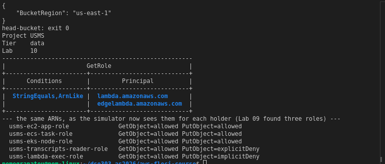
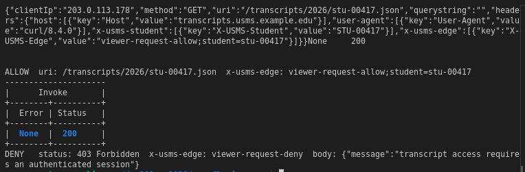
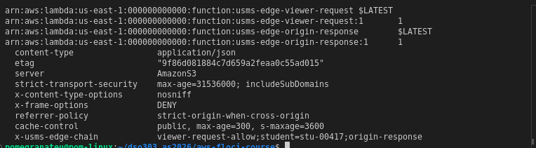
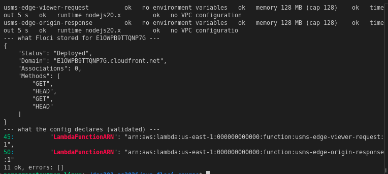
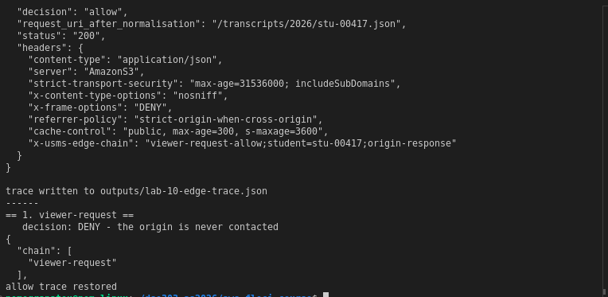
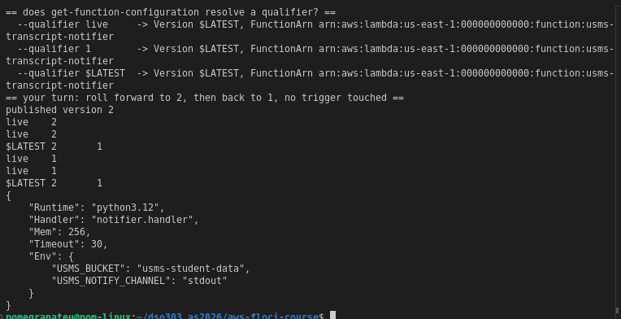
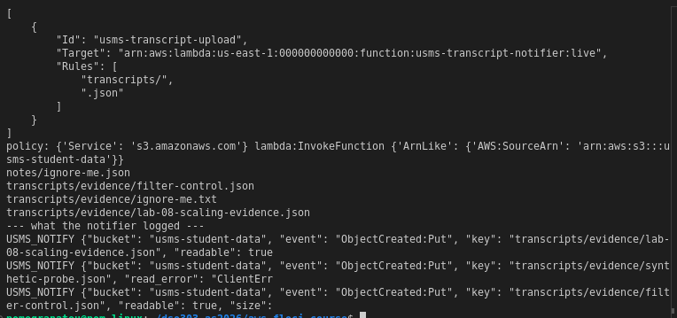
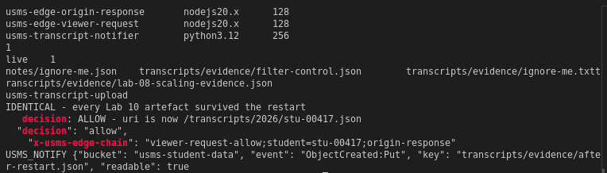
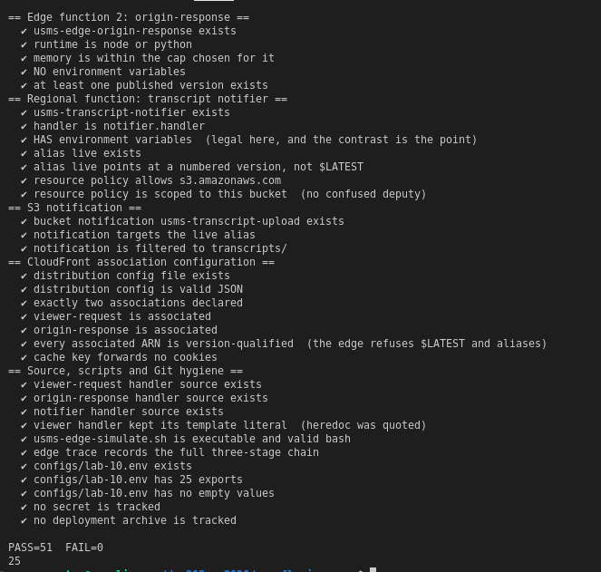
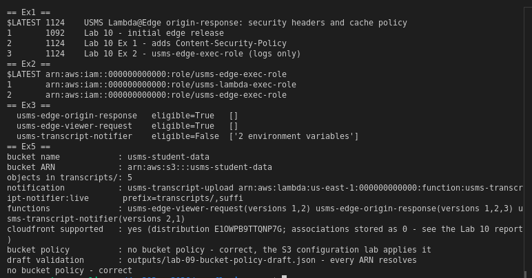

# DSO303 Lab 10: Edge Functions with AWS Lambda

**Student:** Pema Tshering Yangchen (ID 2230295)
**Module:** DSO303 Cloud Infrastructure, College of Science and Technology, Royal University of Bhutan
**Environment:** Floci v1.5.34, AWS CLI v2.31.35, Node.js v22 (local syntax checks), Docker, Pop!_OS (x86_64)
**Repository:** `~/dso303_as2026/aws-floci-course` (github.com/pomegranateis/dso303_as2026)

> Screenshots are in `img/` (listed at the end). Command output saved as text is linked from [`evidence/`](evidence/).

---

## 1. Objective

Create `usms-student-data`, the bucket Lab 1's `USMSStudentDataReadWrite` has named since the first day, as a CloudFront origin. Then build:
- two Lambda@Edge functions (viewer-request and origin-response): invoke them with real CloudFront events, publish versions, check them against the edge restrictions, and associate them with a CloudFront distribution;
- `usms-edge-simulate.sh`, to prove the two functions compose;
- a regional, S3-triggered notifier with an alias and a scoped resource policy, and proof that it ran.

Finally, prove persistence and record everything in `configs/lab-10.env`.

**What ran for real on Floci, and what didn't:**
- **For real:** Lambda runs real code in containers. S3 event delivery to Lambda works: an upload really invoked the notifier.
- **A record only:** CloudFront stores a distribution, without its function associations.
- **Not at all:** no emulator runs Lambda@Edge at an edge location; the simulator stands in for that. Floci evaluates no IAM or resource policies, and on this build it **runs `$LATEST` whatever version or alias is named**.

## 2. What was built

| Resource | Value | Notes |
|---|---|---|
| `usms-student-data` | created, tagged Project/Tier/Lab | 6 objects; no bucket policy (correct) |
| `usms-lambda-exec-role` trust | `lambda.amazonaws.com` (Lab 09 conditions kept) + `edgelambda.amazonaws.com` | two statements: deviation 2 |
| `usms-edge-viewer-request` | nodejs20.x, 128 MB, 5 s, no env vars | versions 1, 2 (v2 runs as `usms-edge-exec-role`) |
| `usms-edge-origin-response` | nodejs20.x, 128 MB, 5 s, no env vars | versions 1, 2 (adds CSP), 3 (`usms-edge-exec-role`) |
| `usms-transcript-notifier` | python3.12, 256 MB, 30 s, 2 env vars | versions 1, 2; alias `live → 1` |
| Resource policy on the notifier | `s3.amazonaws.com`, `lambda:InvokeFunction`, scoped to the bucket | Floci dropped the account condition |
| Bucket notification `usms-transcript-upload` | `ObjectCreated:*` → `…:live`, prefix `transcripts/`, suffix `.json` | delivery observed |
| `usms-transcript-cdn` | `E1OWPB9TTQNP7G`, Deployed | stored with **0** associations; config validated separately |
| Exercise 2: `usms-edge-exec-role` / `USMSEdgeBasic` | logs for `usms-edge-*` only | home region and edge replicas |

Files added:
- **Report:** `labs/lab-10-lambda-edge/` (this report, `exercises.md`, `evidence/`, `img/`, and the three handlers: `edge-viewer-request/index.mjs`, `edge-origin-response/index.mjs`, `transcript-notifier/notifier.py`).
- **Policies:** `policies/trust-lambda-edge.json`, `policies/usms-edge-basic-policy.json`.
- **Templates:** six `templates/lab-10-*.json`.
- **Config:** `configs/lab-10.env` (25 exports).
- **Scripts:** `scripts/utilities/usms-edge-simulate.sh`, `verify-lab-10.sh`, `usms-edge-report.sh` and `usms-s3-readiness.sh`; `scripts/cleanup/lab-10-cleanup.sh` (not run).
- **Notes:** `notes/lab-10-notes.md` and `notes/lab-10-edge-design.md`.

Changed: `configs/usms-iam-accepted-findings.json` gained two entries (the edge principal on both execution roles).

## 3. Deviations from the lab text

1. **`USMS_ROLE_LAMBDA` is an ARN** in our `configs/lab-01.env`, and `get-role` refuses an ARN, so every use strips it to the bare name.
2. **The trust policy keeps Lab 09's conditions.** The lab's Step 6 document would replace the whole trust policy, removing the `aws:SourceAccount`/`aws:SourceArn` conditions Lab 09 Exercise 2 added to `lambda.amazonaws.com`. I used two statements:
   - the conditioned Lambda principal;
   - an unconditioned `edgelambda.amazonaws.com`, recorded as an accepted finding.

   I haven't verified which source keys CloudFront's replication sends, and a condition on a key that's never sent would stop every edge function. The lab's `length(Statement[0]…)` check becomes `length(Statement[]…)` = 2.
3. **Tags `Lab=10`.** The lab's `Lab=06` on the bucket and the functions is a copy-paste slip.
4. **Step 15 ran both paths.** CloudFront answered, so I took Path A, but the stored distribution has no associations, so I also ran Path B's structural validation.
5. **`configs/lab-10.env`'s CloudFront values** come from the create response, not `list-distributions` (Floci limitation 6).
6. **My own subshell mistake, again.** The first support probe sourced `course.env` inside `{ …; } | tee` and reported everything UNSUPPORTED. I re-ran it correctly.
7. **I checked the checks.** The environment-variable check, the bucket-policy validator and the notification filter each got a negative or control test, in line with Lab 09's lesson that a check which can't fail is not evidence.
8. **`.gitignore` gained a Python rule.** The lab says `__pycache__` is already excluded, but our Lab 01 `.gitignore` had no such rule, so `py_compile`'s `notifier.cpython-310.pyc` showed up as untracked, inside a directory the commit names. I added `__pycache__/` and `*.pyc` and deleted the bytecode.
9. **The in-class practical (Section 13.1, Tasks A–D) was not done.** It's a timed, 75-minute assessment for you to sit, not part of the lab write-up.

---

## 4. Implementation

### Steps 1 to 4: environment and support

All nine env files were sourced and `whoami` returned 000000000000. The storage check is the course's earlier six-line version, all `[ok]`.

The probe ([evidence](evidence/lab-10-support-probe.txt)) found Lambda, layers, S3, Logs, CloudFront and IAM all answering. The runtime images were pulled on first use: `nodejs:20` in 17 s and `python:3.12` in about 3.5 minutes.

### Steps 5 and 6: the bucket, and the execution role

([evidence](evidence/lab-10-step5.txt), [trust](evidence/lab-10-step6.txt))

`head-bucket` exits 0 for the first time in the course. `USMSStudentDataReadWrite`'s ARNs match the bucket, and the simulator now gives real decisions on a real resource:

| Role | GetObject | PutObject |
|---|---|---|
| `usms-ec2-app-role`, `usms-ecs-task-role`, `usms-eks-node-role` | allowed | allowed |
| `usms-transcripts-reader-role` | allowed | **explicitDeny** |
| `usms-lambda-exec-role` | allowed | implicitDeny |

The trust policy now has two principals (deviation 2). The Lab 09 IAM audit stays at HIGH=0, with the edge principal reported as ACCEPTED.

### Steps 7 to 10: the viewer-request function

([evidence](evidence/lab-10-step7-8.txt), [invokes](evidence/lab-10-step9.txt))

The handler was written with a quoted heredoc, and `${studentId.toLowerCase()}` survived. The archive holds `index.mjs` at its root, and the function is Active at 128 MB and 5 s.

- **Allow:** the URI is lowercased and `x-usms-edge: viewer-request-allow;student=stu-00417` is stamped.
- **Deny:** Status 200, Error None. The function made a decision rather than failing, and returned a **response** object: 403, the deny header, a JSON body, and no `uri` anywhere.

**Floci limitation:** `--log-type Tail` returns **no `LogResult` key at all**. `--query LogResult --output text` prints the word `None`, which `openssl base64 -d` turns into garbage bytes. The log group and stream exist but are empty, so the returned payloads are the evidence.

### Steps 11 to 13: versions and the origin-response function

Both functions got version 1, and the qualified-ARN check accepts `:1` and rejects the unqualified ARN. On origin-response:
- the origin's `content-type`, `etag` and `server` survive;
- four security headers and `cache-control` are added;
- `x-usms-edge-chain` reads `viewer-request-allow;student=stu-00417;origin-response`, the first evidence of composition.

### Step 14: the edge restrictions

([evidence](evidence/lab-10-step14.txt))

Environment variables were set on the viewer function, which Lambda accepts, and removed again. Both functions are edge-eligible, with 0 NO lines. A negative test with one variable set made the check print `NO 1 environment variables set`.

### Step 15: CloudFront, Path A and only half real

([evidence](evidence/lab-10-step15.txt))

`create-distribution` returned `E1OWPB9TTQNP7G` (Deployed), but the stored cache behaviour is wrong in three ways:
- **`LambdaFunctionAssociations` has Quantity 0;**
- **ForwardedValues and the TTLs are missing;**
- **`AllowedMethods` has `CachedMethods` merged into it** (GET, HEAD, GET, HEAD).

So the record proves nothing about the associations. The Path B structural validation of `templates/lab-10-distribution-config.json` gave **11 ok, no errors** ([evidence](evidence/lab-10-distribution-validation.json)), and that file is what the verifier reads.

### Step 16: the edge chain, end to end

([evidence](evidence/lab-10-step16.txt))

- **Allow:** three stages, status 200, five headers added, and the composed chain marker.
- **Deny:** a chain of one, 403, origin never contacted.

The script also runs from `~`.

### Steps 17 to 19: the notifier, its alias and its permission

([evidence](evidence/lab-10-step17-18.txt), [your turn](evidence/lab-10-step18-yourturn.txt), [policy](evidence/lab-10-step19.txt))

The notifier is Python 3.12 with environment variables. Version 1 was published with `live → 1`, then rolled forward to 2 and back to 1, with every version kept throughout.

**Floci limitations:**
- **`get-function-configuration` ignores `--qualifier`.** This also invalidated one Step 14 claim, which the notes correct.
- **`add-permission` dropped the `--source-account` condition** and stored the statement on the unqualified function. The lab's assertion only checks the bucket name, so it still printed "scoped to one bucket in one account".

### Steps 20 and 21: the notification, and proof the notifier ran

([evidence](evidence/lab-10-step20.txt), [logs](evidence/lab-10-step21.txt), [filter test](evidence/lab-10-step21-yourturn.txt))

**Event delivery works on this build.** Uploading `lab-08-scaling-evidence.json` launched the notifier immediately. `filter-log-events` found `USMS_NOTIFY {… "key": "transcripts/evidence/lab-08-scaling-evidence.json", "readable": true, "size": 3128}`, and `readable: true` means the container reached Floci's S3. The synthetic fallback also returned `processed: 1` (with `read_error: ClientError`, as the lab predicts).

**Floci limitation:** `invoke --qualifier live` reports `ExecutedVersion: $LATEST`.

The filter test: `notes/ignore-me.json` and `transcripts/evidence/ignore-me.txt` caused **no invocation at all**. The container log shows exactly three runs and no "skipping" line, so S3's filter excluded them before any invocation. A matching control upload fired immediately.

### Step 22: persistence

([evidence](evidence/lab-10-restart.txt))

The inventory before and after `floci-down`/`floci-up` was **IDENTICAL**. The stronger checks passed too: the edge chain still composes, and a new upload still fired the notifier. The Lab 3 instances were started again.

### Step 23: `configs/lab-10.env`

It has **25 exports**, all populated, and it sources cleanly. `list-distributions` returns an XML root of `<ListDistributionsResult>` instead of `<DistributionList>`, so the AWS CLI parses it to nothing and the CloudFront values came out `not-created`. I replaced them with the create-response ID and domain, confirmed with `get-distribution`, and recorded the reason in the file. After the exercises it names viewer `:2`, origin `:3` and `usms-edge-exec-role`.

---

## 5. Floci limitations found

| # | Behaviour on Floci 1.5.34 | Real AWS |
|---|---|---|
| 1 | `invoke --qualifier` runs `$LATEST`; `get-function` / `get-function-configuration` ignore `--qualifier`; one code snapshot per function | Each version is frozen code and configuration, run when named |
| 2 | `--log-type Tail` returns no `LogResult`; `/aws/lambda/<fn>` streams stay empty for the Node functions | Always returned; START/END/REPORT always logged |
| 3 | The notifier's stdout does reach CloudWatch Logs (`filter-log-events` works) | Same |
| 4 | `create-distribution` stores 0 Lambda associations, drops ForwardedValues and TTLs, merges `CachedMethods` into `AllowedMethods` | The full config, validated at association time |
| 5 | Association rules (version-qualified ARN, no env vars, caps) are never validated | `InvalidLambdaFunctionAssociation` |
| 6 | `list-distributions` returns the wrong XML root; the CLI parses it to nothing | A `DistributionList` |
| 7 | `add-permission` drops `--source-account` and ignores `--qualifier` | Both stored and checked on every invocation |
| 8 | No IAM, trust or resource policy is evaluated | Every call is authorised |
| 9 | No edge execution, replication, cache or edge logs | Replicated to every point of presence; logs nearest the viewer |
| 10 | Restart leaves EC2 instances stopped | No equivalent |

**What Floci does well here:** real Lambda execution with both runtimes; the CloudFront event contract; versions and aliases as *records* (per-version Role is kept correctly); S3 event delivery with prefix/suffix filtering; boto3 reaching S3 from inside a function; and persistence across a restart.

**Observed / recorded / not available** (Section 11):
- **Observed:** functions created and invoked, requests modified and refused, responses modified, the two functions composing, the alias repointed, the notification delivered and filtered, persistence.
- **Recorded, not enforced:** the two-principal trust rule, the distribution configuration and its association rules, the qualified-ARN and no-environment-variable rules, the caps, the resource policy, and version immutability.
- **Not available, and not claimed:** latency, caching, edge replication and cost.

---

## 6. Verification

`./scripts/utilities/verify-lab-10.sh` reports **PASS=51 FAIL=0** ([evidence](evidence/lab-10-verify.txt)), the lab's target.

As given it reported PASS=46 FAIL=5 ([evidence](evidence/lab-10-verify-asgiven.txt)). Four role checks failed because `USMS_ROLE_LAMBDA` is an ARN in our env file, and one was the `outputs/.gitkeep` false positive (the same as Labs 2–9). Those two script fixes are the only changes.

A caveat worth stating: the "resource policy is scoped to this bucket" check passes although Floci dropped the account condition, because it greps for the bucket name only. A stricter check would require `SourceAccount` too, and would fail on this build.

`scripts/cleanup/lab-10-cleanup.sh` passes `bash -n` and **has not been run**.

---

## 7. Independent exercises

Full write-ups in [`exercises.md`](exercises.md).

1. **CSP header.** One line added to `SECURITY_HEADERS`, published as version 2, and the distribution config moved to `:2`. On Floci, `--qualifier 1` returns 5 headers, not 4, because Floci runs `$LATEST` and keeps a single code snapshot. Only the recorded CodeSize (1092 vs 1124 bytes) shows that version 1 was different.
2. **Dedicated edge role.** `usms-edge-exec-role` with `USMSEdgeBasic`: logs for `usms-edge-*` in the home region and as edge replicas in any region, and no S3. Version 1 of each function still names the old role, so **rolling back restores the old role too**. The distribution config now names viewer `:2` and origin `:3`.
3. **Edge-readiness report.** JSON on stdout, diagnostics on stderr, the same output from any directory, and each `false` explained. Under the exercise's rule the notifier fails for *one* reason, not the two the lab expects.
4. **Transcript delivery design** ([notes/lab-10-edge-design.md](../../notes/lab-10-edge-design.md)). A URI-only cache key is safe only because authorisation runs before the cache. Long s-maxage plus invalidation on correction. The refusal report comes from centralised CloudFront logs. Origin group plus `stale-if-error`.
5. **The S3 hand-off.** The Lab 09 draft validated (every ARN resolves; a negative test caught 3 planted mismatches) and was not applied (NoSuchBucketPolicy). The trace was uploaded and seen by the notifier, and the readiness file is generated by a re-runnable script.

## 8. Review questions

Answered in prose in `notes/lab-10-notes.md`.

## 9. Reflection

Three things stood out.

First, this lab had more commands that "succeeded" without doing what they claimed than any before it:
- `create-distribution` stored no associations;
- `add-permission` stored no account condition;
- `publish-version` froze no code;
- `--qualifier` was accepted everywhere and ignored everywhere.

Each was found by reading back what was stored, not by the exit code. Step 14's point, that the call that accepts a setting is not the call that judges it, turned out to describe the emulator as much as Lambda@Edge.

Second, the version finding changed what I think the lab can prove. Immutable versions are the reason the edge insists on `:1` and refuses an alias, and here a version is just a label on one shared copy of the code. The rule is right and worth checking statically, as the verifier does, but on this build I can describe it, not demonstrate it.

Third, a security fix from Lab 09 nearly got undone by a later lab's well-meaning instruction, because `update-assume-role-policy` replaces the whole document. Replace-only APIs are a category, as Section 16 says, and the habit that protected the fix was reading the current document before replacing it.

