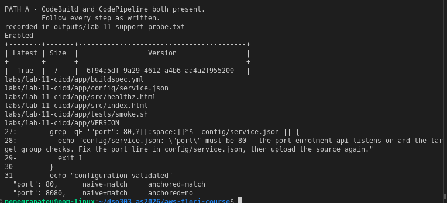
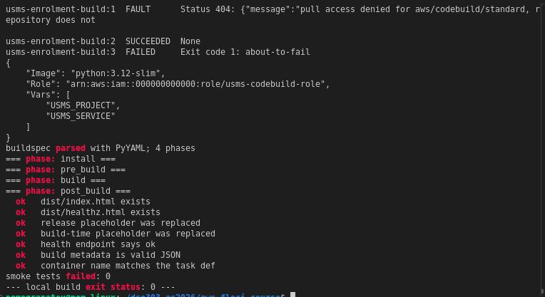
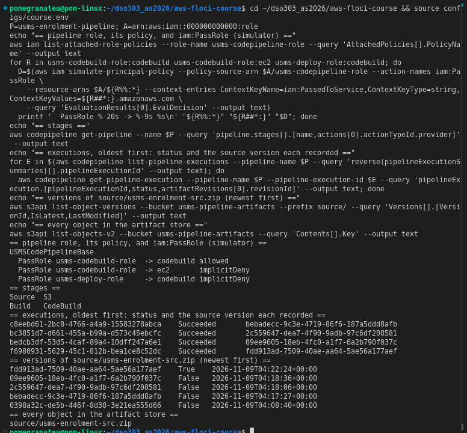
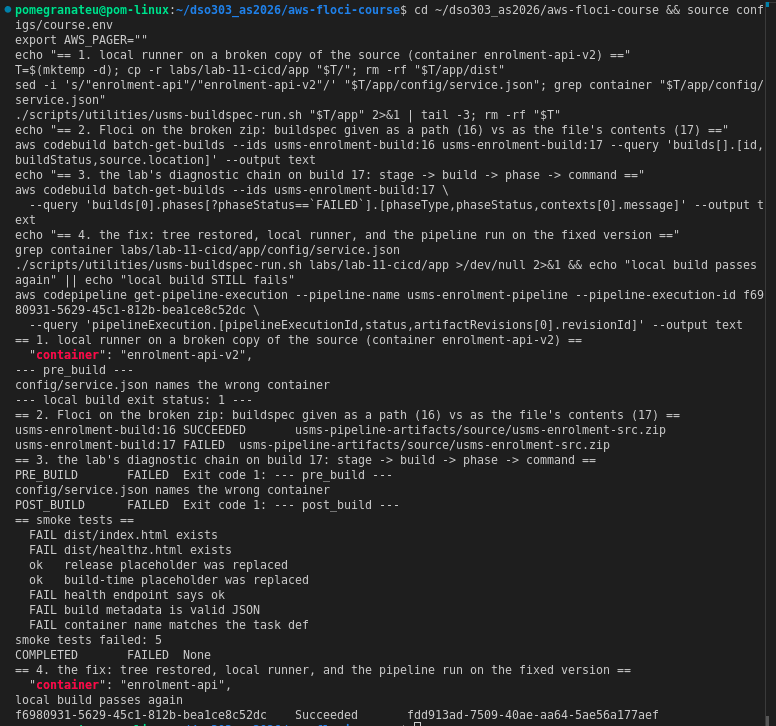
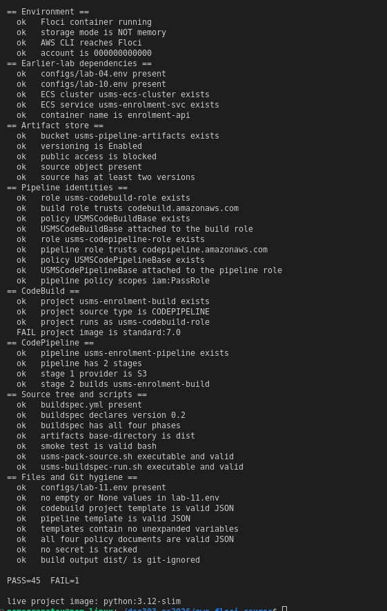
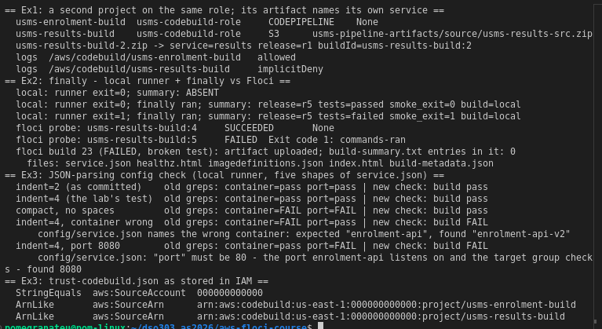
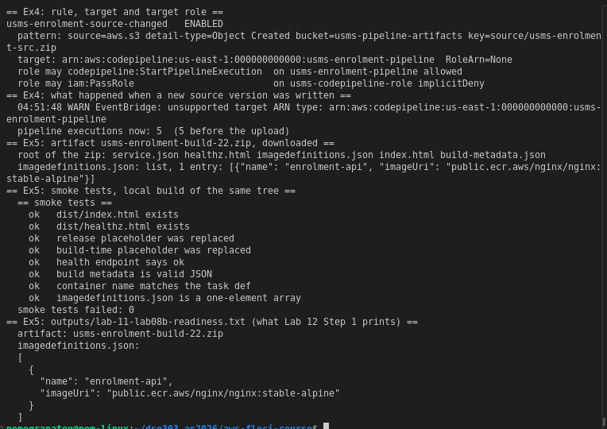

# DSO303 Lab 11: CI/CD with CodeBuild and CodePipeline

**Student:** Pema Tshering Yangchen (ID 2230295)
**Module:** DSO303 Cloud Infrastructure, College of Science and Technology, Royal University of Bhutan
**Environment:** Floci v1.5.34, AWS CLI v2.31.35, Python 3.10.12 with PyYAML 5.4.1 (local buildspec runner), Docker, Pop!_OS (x86_64)
**Repository:** `~/dso303_as2026/aws-floci-course` (github.com/pomegranateis/dso303_as2026)

> Screenshots are in `img/` and appear where they belong. Command output saved as text is linked from [`evidence/`](evidence/).

---

## 1. Objective

Build the first half of a delivery pipeline for the USMS enrolment service:
- a versioned artifact store;
- a source tree with a `buildspec.yml`, smoke tests, a packer and a local runner;
- a CodeBuild project with its own least-privilege role;
- a two-stage CodePipeline (S3 source → CodeBuild) with its own role, allowed to pass exactly one role to exactly one service.

Then prove the create → perturb → read back chain: an execution tied to the source version just uploaded. Break the build on purpose, diagnose it down to a phase and a command, fix it, and record what Lab 12 needs in `configs/lab-11.env`.

**What ran for real on Floci, and what didn't** (Path A: every API answers):
- **For real:** CodeBuild starts real containers (`python:3.12-slim`), unpacks the source into `/codebuild/output/src/src`, runs buildspec phases, fails in the right phase, and uploads standalone artifacts. CodePipeline executions record the exact S3 versionId they took.
- **Only partly:** Floci reads a project's `buildspec` field as YAML text, never as a file in the source, so **a build pointed at `buildspec.yml` runs nothing and "succeeds"**. Every pipeline-run build in this lab ran no commands. The buildspec itself was proven by passing it inline and by the local runner.
- **Not at all:** no SourceOutput/BuildOutput artifacts, no S3-triggered executions, no `finally` blocks, no IAM or trust evaluation.

## 2. What was built

| Resource | Value | Notes |
|---|---|---|
| `usms-pipeline-artifacts` | versioning Enabled, all four public-access blocks, tags Project/Tier=pipeline/Lab=11 | 7 versions of `source/usms-enrolment-src.zip` by the end |
| `labs/lab-11-cicd/app/` | `VERSION` r5, `src/`, `config/service.json`, `tests/smoke.sh`, `buildspec.yml` | buildspec extended by Exercises 2, 3 and 5 |
| `usms-codebuild-role` / `USMSCodeBuildBase` v1 | logs for its own group, the artifact bucket, **explicit Deny** on `usms-student-data` | trust: `codebuild.amazonaws.com` + SourceAccount + SourceArn (Ex 3) |
| `usms-enrolment-build` | source and artifacts CODEPIPELINE, `python:3.12-slim`, small, 15 min, 2 env vars | image per Known Issues (deviation 1) |
| `usms-codepipeline-role` / `USMSCodePipelineBase` v1 | artifact store, StartBuild on one project, PassRole on one role to `codebuild` only | |
| `usms-enrolment-pipeline` | Source (S3, `PollForSourceChanges` false) → Build (CodeBuild) | 5 executions, each tied to its source version |
| Exercise 1: `usms-results-build` | second project, same role | artifact `usms-results-build-2.zip` |
| Exercise 4: rule `usms-enrolment-source-changed`, `usms-events-pipeline-role` / `USMSEventsStartPipeline` | S3 Object Created on one key → the pipeline | the target hop fails on Floci |

Files added:
- **Report:** `labs/lab-11-cicd/` (this report, `exercises.md`, `evidence/`, `img/`), plus the source trees `app/` and `app-results/`.
- **Policies:**
  - `trust-codebuild.json`, `usms-codebuild-policy.json`;
  - `trust-codepipeline.json`, `usms-codepipeline-policy.json`;
  - `trust-events-pipeline.json`, `usms-events-pipeline-policy.json` (Exercise 4).
- **Templates:**
  - `lab-11-codebuild-project.json`, `lab-11-pipeline.json`;
  - `lab-11-results-build-project.json` (Exercise 1);
  - `lab-11-source-trigger-rule.json`, `lab-11-source-trigger-rule-cloudtrail.json`, `lab-11-source-trigger-targets.json` (Exercise 4).
- **Config:** `configs/lab-11.env` (26 exports).
- **Scripts:**
  - `scripts/utilities/cicd-support-probe.sh`, `usms-pack-source.sh`, `usms-buildspec-run.sh`, `verify-lab-11.sh`;
  - `scripts/cleanup/lab-11-cleanup.sh` (not run).
- **Notes:** `notes/lab-11-notes.md` (support path on line 1, step notes, the PassRole and SourceArn answers, review questions).

Changed: `.gitignore` gained `labs/lab-11-cicd/app/dist/` and `labs/lab-11-cicd/app-results/dist/`.

## 3. Deviations from the lab text

1. **Build image `python:3.12-slim`, not `aws/codebuild/standard:7.0`.** Build 1 faulted with "pull access denied for aws/codebuild/standard", the documented Known Issue for Lab 11, so I used its alternative.
   - `update-project --environment` replaces the whole struct. The first shorthand call silently dropped both environment variables, so I re-applied it as JSON with them.
   - As Known Issues says, `configs/lab-11.env` still records the managed image. The verify check `project image is standard:7.0` is the one stale failure (Section 6).
2. **The project's buildspec field was left as written,** although on Floci it means nothing runs (Section 5, limitation 1). Changing it to inline YAML would have made the pipeline "work" here and be wrong on real AWS. Wherever a step needed the buildspec to actually run, I passed it with `--buildspec-override` on a temporary S3-source switch of the project, and switched back to CODEPIPELINE each time.
3. **`verify-lab-11.sh`: one line changed,** the `outputs/.gitkeep` false positive in "no secret is tracked", the same as Labs 2–10. The fix was tested against a tracked `.gitkeep`, a tracked real output and nothing tracked. Nothing else in the script was changed.
4. **Two stale claims in my own Step 13 notes were corrected later:**
   - "standalone artifacts are never uploaded" (they are, when the buildspec runs);
   - "the buildspec is executed" (only inline).
   Both are explained in Section 4, Step 20.
5. **`configs/lab-11.env` was regenerated after the exercises** with the same Step 21 heredoc. Only `USMS_SOURCE_VERSION_ID` changed.
6. **VERSION stays `r5` after the exercises.** Lab 12 Step 8 sets `r6` itself.
7. **Screenshot 1's versions table shows one row,** because I cut it with `tail`. The probe versions were already deleted by then. Versioning is shown live in screenshot 3 (five versions at the source key).

---

## 4. Implementation

### Steps 1 to 6: environment, support probe, artifact store

([support probe](evidence/lab-11-step3.txt), [bucket](evidence/lab-11-step5-6.txt))

All earlier env files sourced. Lab 12's deploy targets are present: `usms-ecs-cluster`, `usms-enrolment-svc`, container `enrolment-api`, the target group and the exec role.
- **The probe:** **PATH A**. CodeBuild and CodePipeline answer, and so do ECR and CodeDeploy.
- **The bucket:** created with versioning Enabled, tagged, with all four public-access blocks True.
- **Versioning proved:** two writes to one key gave two versions, and the older one (`first`) was still readable by its ID. Both were then deleted by version ID; 0 probe versions are left.

### Steps 7 and 8: the source tree and the buildspec

([your turn](evidence/lab-11-step8-yourturn.txt))

- **The buildspec heredoc:** written with a quoted `<< 'BUILDSPEC'`, so `$USMS_RELEASE`, `$(date …)` and `${CODEBUILD_BUILD_ID:-local}` reached the file unexpanded. The `<< META` nested inside it is unquoted, because it must expand at build time.
- **The port check (your turn):** the obvious `grep -q '"port": 80'` also matches `"port": 8080`, so I used an anchored pattern instead. With 8080 the local build stops in pre_build with a message naming the fix (exit 1).

### Steps 9 to 11: the build role, the project, the source zip

([role](evidence/lab-11-step9.txt), [project](evidence/lab-11-step10.txt), [zip](evidence/lab-11-step11.txt))

The simulator, which works on this build, gives the role's boundary:

| Action | Resource | Decision |
|---|---|---|
| `s3:PutObject` | `usms-pipeline-artifacts/build/x.zip` | allowed |
| `logs:PutLogEvents` | `/aws/codebuild/usms-enrolment-build` | allowed |
| `logs:PutLogEvents` | `/aws/lambda/usms-transcript-notifier` | implicitDeny |
| `s3:GetObject` | `usms-student-data/transcripts/x.json` | **explicitDeny** |

- **Why the explicit Deny:** the build role runs whatever the source zip tells it to, and a deny beats every allow. No future grant can hand build code the student records.
- **The project:** created from a template with 0 unexpanded `$`.
- **The source zip:** `buildspec.yml` sits at its root, 9 entries, 0 under `app/`. Version r3 is `0398a32c…`.

### Steps 12 to 14: running builds, and the local runner

([fault](evidence/lab-11-step12-fault.txt), [retry](evidence/lab-11-step12-retry.txt), [diagnostic](evidence/lab-11-step12-diagnostic.txt), [phases](evidence/lab-11-step13.txt), [local](evidence/lab-11-step14.txt))

- **Build 1:** FAULT, pull access denied (deviation 1).
- **Build 2:** SUCCEEDED on `python:3.12-slim`.
- **Build 3:** an inline buildspec that can only fail FAILED in BUILD with `Exit code 1: about-to-fail`, so builds aren't rubber-stamped.
- **Step 13's eleven phase rows:** all SUCCEEDED in **0 seconds**, the log stream is empty, and nothing is under `build/`.
- **Local runner:** 4 phases, 7/7 smoke tests, and `build-metadata.json` with `"buildId": "local"`; `dist/` is git-ignored.

### Steps 15 to 18: the pipeline role, the pipeline, the hand-off

([role](evidence/lab-11-step15.txt), [pipeline](evidence/lab-11-step16-17.txt), [hand-off](evidence/lab-11-step18.txt))

`iam:PassRole` with `iam:PassedToService`, simulated:
- `usms-codebuild-role` → codebuild: **allowed**;
- `usms-codebuild-role` → ec2: implicitDeny;
- `usms-deploy-role` → codebuild: implicitDeny.

The pipeline was created from a template with 0 `$`: two stages, S3 then CodeBuild.

**Floci limitations:**
- `create-pipeline` started no execution, and `get-pipeline-state` reports `None` for every stage for the whole lab.
- After the hand-off to CODEPIPELINE, a direct `start-build` should fail with InvalidInputException. On Floci it was accepted, and build 4 SUCCEEDED with no source.
- `--source-type-override` and `--source-location-override` were ignored.

### Step 19: the release proof

([r4](evidence/lab-11-step19.txt), [r5](evidence/lab-11-step19-yourturn.txt), [read back](evidence/lab-11-step19-readback.txt))

- **r4:** uploaded as `bebadecc…`. Execution `c8eebd61` Succeeded, and its `artifactRevisions` holds exactly that versionId and the object's ETag.
- **r5 (your turn):** uploaded as `2c559647…`. Execution `bc3851d7` recorded it.
- **The your-turn counts:**
  - **3** source versions;
  - **0** objects under `usms-enrolment-pipeline/BuildOutput/`;
  - 2 executions.
  The notes explain why the two numbers are not tied: versions count uploads, outputs count build runs.
- **Floci limitation:** no SourceOutput or BuildOutput object is ever written, so the execution → source-version half of the proof is real and the artifact half is not.

### Step 20: the deliberate failure, and what it uncovered

([execution](evidence/lab-11-step20.txt), [controls](evidence/lab-11-step20-controls.txt), [container](evidence/lab-11-step20-what-the-container-sees.txt), [phase matrix](evidence/lab-11-phase-matrix.txt), [root cause](evidence/lab-11-buildspec-path-test.txt), [fail and fix](evidence/lab-11-step20-fail-fix.txt))

- **The break:** container set to `enrolment-api-v2` and uploaded. The execution **Succeeded**, where real AWS fails at Build / PRE_BUILD.
- **Narrowing it down:**
  1. The local runner on the same tree stopped in pre_build: `config/service.json names the wrong container`, exit 1. The check works.
  2. A standalone S3-source build of the same zip also SUCCEEDED, so the pipeline wasn't the cause.
  3. Build 10 listed the container's working directory. The source *was* there: `VERSION buildspec.yml config src tests` in `/codebuild/output/src/src`.
  4. A phase matrix (builds 11–15) failed in exactly the phase holding `exit 1`, including a `- |` block. Phases do run.
  5. **Root cause:** with `--buildspec-override buildspec.yml`, build 16 SUCCEEDED. With `--buildspec-override "$(cat buildspec.yml)"` on the same broken zip, build 17 FAILED in PRE_BUILD with the container message. **Floci parses the buildspec field as YAML text.** The string `buildspec.yml` is a scalar with no phases, so nothing runs.
- **The lab's diagnostic chain** (stage → build → phase → command) works on build 17. It shows PRE_BUILD with the failing command's message, plus POST_BUILD (Floci ran post_build after the pre_build failure) and COMPLETED; the lab expects one row.
- **The fix:** container restored with the lab's `json.dump`, the local build passes, uploaded as `fdd913ad…`, and execution `f6980931` Succeeded.

### Step 21: `configs/lab-11.env`

([evidence](evidence/lab-11-step21.txt))

- **Contents:** 26 exports, all populated. `versioning=Enabled stages=2 release=r5 path=A`, and the file contains no command substitutions.
- **Stale values:** it records `aws/codebuild/standard:7.0` and a BuildOutput prefix that Floci never writes. Both are stale per Known Issues, and judged instead by live readback.
- **Regenerated after the exercises** (deviation 5).
- **Git hygiene:** `git status` showed nothing from `outputs/` before staging.

---

## 5. Floci limitations found

| # | Behaviour on Floci 1.5.34 | Real AWS |
|---|---|---|
| 1 | **Project `buildspec` field read as inline YAML.** A path (`buildspec.yml`) parses to a scalar with no phases: the build runs nothing and SUCCEEDS | Runs the file at that path in the source |
| 2 | Inline buildspecs run correctly and fail in the right phase; after a PRE_BUILD failure, POST_BUILD still runs | One failed phase, per the phase-transition rules |
| 3 | Every phase reports 0 seconds; log streams are created and stay empty; a FAILED phase's context holds the **tail of its output**, the only way to read container output | Real timings; full logs in CloudWatch |
| 4 | Standalone artifacts go to `<bucket>/<project>-<build#>.zip`, ignoring `path` and `name`; uploaded even after a POST_BUILD failure | `build/<name>`; UPLOAD_ARTIFACTS always attempted |
| 5 | `CODEBUILD_RESOLVED_SOURCE_VERSION` unset (`sourceVersion: local`); `resolvedSourceVersion` null | The S3 object version |
| 6 | `start-build` on a CODEPIPELINE project accepted; source overrides ignored | InvalidInputException; overrides honoured |
| 7 | `create-pipeline` starts no execution; stage states stay `None`; executions "Succeed" instantly | The first execution starts at creation; real stage states |
| 8 | Executions record the right `artifactRevisions`, but write no SourceOutput/BuildOutput | Both written, per execution |
| 9 | `finally` blocks are not executed | Run after `commands`, even after a failure |
| 10 | EventBridge has no CodePipeline target; target `RoleArn` not stored; bucket EventBridge setting reads back empty | Starts the pipeline as the target role |
| 11 | No IAM, trust or PassRole evaluation on calls (the simulator works and was used) | Every call authorised |

**What Floci does well here:**
- real build containers with the source unpacked where CodeBuild puts it;
- correct phase-level failure reporting for inline buildspecs;
- S3 versioning, and executions pinned to a versionId;
- the IAM policy simulator, including `iam:PassedToService` context;
- EventBridge pattern matching, and S3 → EventBridge delivery.

**Observed / recorded / not available** (Section 11):
- **Observed:** the source zip layout, the four phases, smoke tests passing and failing, a pre_build failure (build 17 and locally), artifacts naming their release and service (Exercises 1 and 5), and several versions at one key.
- **Recorded, not enforced:** the build role's scoping, the explicit Deny, the scoped PassRole, the single project ARN, and both trust conditions.
- **Not available, and not claimed:** a pipeline whose builds run commands, BuildOutput artifacts, S3-triggered executions, `finally`, approvals, build reports, and KMS-encrypted artifacts.

---

## 6. Verification

`./scripts/utilities/verify-lab-11.sh` reports **PASS=45 FAIL=1** ([evidence](evidence/lab-11-verify.txt)). The same result came after the exercises ([evidence](evidence/lab-11-verify-after-exercises.txt)).

- **As given: PASS=44 FAIL=2** ([evidence](evidence/lab-11-verify-asgiven.txt)). The second failure was the `outputs/.gitkeep` false positive (deviation 3).
- **The remaining failure, `project image is standard:7.0`,** is the stale check Known Issues describes after the image switch: "judge the workaround by live get-project readback". The readback is `python:3.12-slim`, and it's on the last line of the screenshot. I didn't edit the check to hide it.
- **Two caveats about checks that pass:**
  - "project source type is CODEPIPELINE" and "pipeline has 2 stages" read stored configuration, which Floci keeps correctly. Nothing in the verifier checks that a pipeline-run build executes commands, and on this build none does (limitation 1).
- **IAM audit:** the Lab 09 audit, run on a refreshed inventory, sees all 14 roles at **HIGH=0** ([evidence](evidence/lab-11-iam-audit.txt)). Each Lab 11 role has only the usual MED (no permissions boundary).
- **Cleanup:** `scripts/cleanup/lab-11-cleanup.sh` passes `bash -n` and **has not been run**. It doesn't cover the exercise resources: `usms-results-build`, the EventBridge rule and target, `usms-events-pipeline-role` with `USMSEventsStartPipeline`, and the bucket's EventBridge setting. They would need removing by hand at the end of the course.

---

## 7. Independent exercises

Full write-ups in [`exercises.md`](exercises.md).

1. **Second project, same role.** `usms-results-build` from a five-line diff of the Step 10 template.
   - The policy already permits it: S3 covers the whole bucket, and the template keeps the enrolment log group. A log group of its own would be implicitDeny.
   - I didn't add a policy version for that, because Lab 12 owns v2.
   - Its artifact `usms-results-build-2.zip` says `"service": "results"`, `"buildId": "usms-results-build:2"`.
2. **`finally` and a build summary.** The logic writes `tests=failed smoke_exit=1` after a broken test (tested by emulation). But neither the lab's runner nor Floci executes `finally`: Floci's failed build 23 uploaded an artifact without the summary.
3. **JSON-parsing check.** It names expected and found values. The lab's four-space test doesn't break the old grep; compact JSON does, and the new check passes it.
   - The trust policy has two conditions, listing both projects because they share the role.
4. **EventBridge trigger.** The rule matches one key. S3 → EventBridge → rule worked on Floci; the CodePipeline target failed with `unsupported target ARN type`.
   - The CloudTrail route, and its data-event dependency, are written up.
   - The target role can start one pipeline and do nothing else.
5. **`imagedefinitions.json` for Lab 12.** Written from `config/service.json`, as an array, with an `IMAGE_URI` default. An eighth smoke assertion is placed where Lab 12 recognises it.
   - A downloaded Floci artifact has the file at its root.
   - `outputs/lab-11-lab08b-readiness.txt` is generated from live state, in the shape Lab 12 Step 1 prints.

## 8. Review questions

Answered in prose in [`notes/lab-11-notes.md`](../../notes/lab-11-notes.md), with the Step 15 PassRole question, the Step 19 counts and the Exercise 3 SourceArn answer.

## 9. Reflection

Three things stood out.

First, the most important finding of the lab came from a build that passed when it shouldn't have.
- **The finding:** the broken container name "Succeeded" all the way through the pipeline.
- **How I found it:** testing one hypothesis at a time, each against a known positive.
  - The local runner proved the check itself worked.
  - A standalone build ruled out the pipeline.
  - Listing the container's directory proved the source arrived.
  - The phase matrix proved phases run.
  - Then two builds that differed only in how the buildspec was given isolated the cause.
- **What it changed:** without it I would have reported a working pipeline. With it, every "SUCCEEDED" in Steps 12–19 has a precise meaning: the build ran *no commands*.

Second, I had to correct myself twice.
- I wrote down in Step 13 that standalone artifacts are never uploaded. That was a reasonable reading of an empty `build/` prefix, and wrong: the build hadn't run, and when one did, Floci put the artifact at the bucket root.
- I also nearly missed it, because Exercise 1 listed only `build/`. The same lesson as Lab 10 applies, in a new place: read back the whole state, not just where you expect the answer to be.

Third, the exercises kept running into later labs.
- Adding a policy version for Exercise 1 would have broken Lab 12's verify.
- Bumping VERSION would have collided with Lab 12's image tags.
- The smoke-test label had to stay exactly as it was for Lab 12's script to find it.
- Exercise 3's SourceArn had to name a project created in Exercise 1.

Reading the next lab before changing shared things cost one page fetch and avoided three silent breakages.
